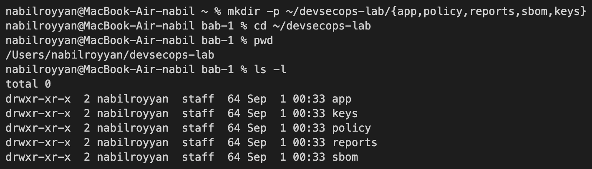
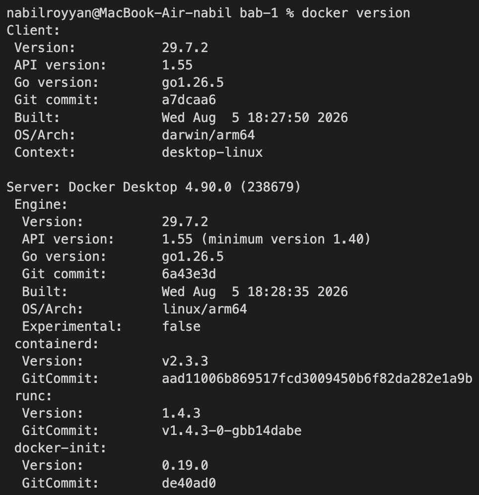
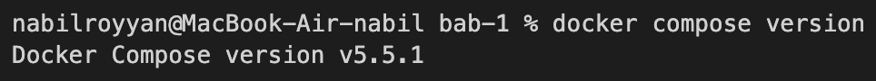
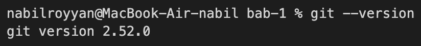
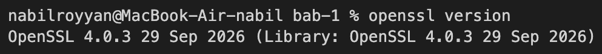
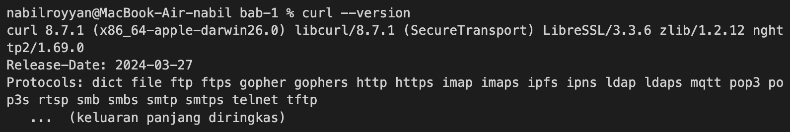
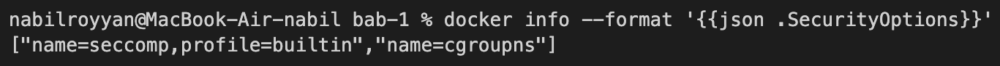

# LAPORAN BAB 1

## Fondasi Teoretis dan Kerangka Kerja DevSecOps — Praktikum Baseline Laboratorium

**Mata Kuliah:** DevOps  
**Nama:** MUHAMMAD NABIL ROYYAN
**NRP:** 3126640032 

## Pendahuluan

Praktikum Bab 1 menetapkan **baseline laboratorium** sebelum eksperimen keamanan dijalankan. Tujuannya membuat satu direktori kerja tunggal dan merekam versi komponen (Docker, Docker Compose, Git, OpenSSL, curl) serta opsi keamanan daemon. Rekaman ini penting karena hasil pemindaian dan perilaku tool dapat berubah mengikuti versi engine, basis data kerentanan, dan rule set. Laporan ini mengikuti langkah "Praktikum 1 — Menetapkan Baseline Laboratorium" pada `bab-01.md` dan dijalankan pada Terminal macOS (Docker Desktop).

## Laporan Praktikum

### 1. Membuat Direktori Baseline Laboratorium

```bash
mkdir -p ~/devsecops-lab/{app,policy,reports,sbom,keys}
cd ~/devsecops-lab
pwd
ls -l
```



**Keterangan.** Dibuat satu direktori kerja `~/devsecops-lab` beserta subfolder `app`, `policy`, `reports`, `sbom`, dan `keys`. Struktur ini memisahkan kode aplikasi, kebijakan, bukti/evidence, SBOM, dan kunci sehingga artefak sensitif tidak tercampur.

### 2. Versi Docker

```bash
docker version
```



**Keterangan.** Menampilkan versi Docker Client dan Engine (Server). Baris ini menjadi acuan reproduksibilitas: perintah pemindaian hanya dapat direproduksi bila versi engine, basis data kerentanan, rule set, dan target diketahui.

### 3. Versi Docker Compose

```bash
docker compose version
```



**Keterangan.** Memastikan Compose v2 (plugin) tersedia, bukan binary `docker-compose` lama. Compose v2 menjadi prasyarat untuk bab-bab berikutnya.

### 4. Versi Git

```bash
git --version
```



**Keterangan.** Git digunakan untuk version control; versinya dicatat sebagai bagian baseline.

### 5. Versi OpenSSL

```bash
openssl version
```



**Keterangan.** OpenSSL dipakai pada bab-bab berikutnya (sertifikat TLS, secret acak). Versinya dicatat agar perilaku pembuatan kunci/sertifikat dapat direproduksi.

### 6. Versi curl

```bash
curl --version
```



**Keterangan.** curl digunakan untuk pengujian endpoint; versi dan dukungan protokolnya dicatat.

### 7. Opsi Keamanan Daemon

```bash
docker info --format '{{json .SecurityOptions}}'
```



**Keterangan.** Daemon melaporkan `["name=seccomp,profile=builtin","name=cgroupns"]`. Ini menunjukkan seccomp dengan profil bawaan dan cgroup namespace tersedia. Hasil berbeda antardistribusi (mis. Linux native menampilkan AppArmor/SELinux) dan harus dicatat sebagai bagian baseline.

## Verifikasi dan Skenario Pengujian

- [x] Docker daemon dapat diakses akun praktikum; `docker version` menampilkan Client **dan** Server.
- [x] `docker compose` menggunakan plugin v2.
- [x] Direktori `reports`, `sbom`, dan `keys` berada di dalam direktori kerja lab (bukan web root) sehingga tidak dipublikasikan.
- [x] `SecurityOptions` berhasil dibaca dan dicatat.
- [x] Threat statement ditulis (lihat bagian berikut).

## Threat Statement (Laboratorium)

Aset utama laboratorium adalah **host pengguna** yang menjalankan Docker Engine beserta image, volume, dan kredensial laboratorium. Aktor ancaman mencakup image/dependency yang tidak terpercaya dan pihak yang memperoleh akses ke Docker socket. Jalur serangan yang paling relevan pada bab ini adalah: (1) menjalankan image berbahaya yang memanfaatkan kernel bersama atau volume host, dan (2) akses ke Docker daemon (setara root secara praktis) melalui socket/group. Dampaknya meliputi kompromi host, kebocoran kredensial lab, serta integritas hasil praktikum yang tidak dapat dipercaya. Karena itu baseline versi dan opsi keamanan dicatat, dan keanggotaan grup `docker` diperlakukan sebagai keputusan keamanan, bukan sekadar kemudahan.

## Analisis Hasil

Versi tool bukan informasi administratif semata. Sebuah temuan pemindai hanya bermakna bila dikaitkan dengan versi engine, basis data kerentanan, dan rule set yang dipakai; tanpa itu, hasil sulit direproduksi dan dibandingkan. Selain itu, keluaran `SecurityOptions` **tidak** membuktikan bahwa semua container telah diperkeras: nilai tersebut hanya menunjukkan mekanisme yang **tersedia** pada daemon/host (di macOS Docker Desktop: seccomp bawaan dan cgroupns). Pada lingkungan Linux native umumnya akan tampak AppArmor atau SELinux. Perbedaan ini dicatat sebagai karakteristik platform, bukan dinilai sebagai benar/salah.

## Rangkuman

Praktikum 1 menghasilkan baseline laboratorium: satu direktori kerja `~/devsecops-lab` dengan subfolder terpisah, serta rekaman versi Docker, Compose, Git, OpenSSL, curl, dan opsi keamanan daemon. Baseline ini menjadi acuan reproduksibilitas untuk seluruh eksperimen pada bab-bab berikutnya, sekaligus menegaskan bahwa keamanan container bergantung pada mekanisme host yang tersedia dan konfigurasi runtime, bukan pada tool semata.
