# LAPORAN BAB 2

## Konsep Container dan Instalasi Docker

**Mata Kuliah:** DevOps  
**Nama:** MUHAMMAD NABIL ROYYAN
**NRP:** 3126640032 

## Pendahuluan

Bab ini membahas containerization, arsitektur Docker, image/layer, jaringan, storage, dan model keamanan container, lalu menjalankan container pertama serta membangun image custom sederhana. Laporan mengikuti langkah "Langkah Praktikum Eksploratif" pada `bab-02.md`. Praktikum dijalankan pada Terminal macOS dengan Docker Desktop.

> **Catatan platform.** Langkah **Instalasi Docker Engine Ubuntu** (`apt`/`systemctl`) tidak dapat dijalankan di macOS sehingga ditandai **dilewati**; sebagai gantinya diverifikasi bahwa Docker Engine (via Docker Desktop) sudah tersedia dan dapat diakses. Seluruh langkah container, Dockerfile, build, dan pengujian lainnya dijalankan penuh.

## Laporan Praktikum

### 1. Membuat Direktori Kerja Bab 2

```bash
mkdir -p ~/docker-lab/bab-2
cd ~/docker-lab/bab-2
pwd
```

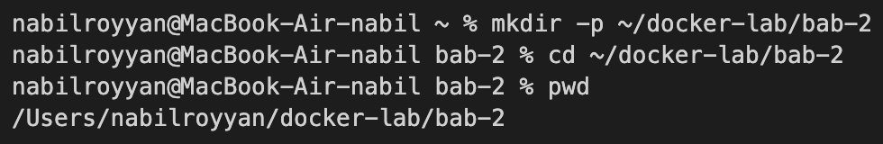

**Keterangan.** Satu direktori kerja per bab agar file konfigurasi, volume bind mount, dan laporan mudah dipisahkan.

### 2. Docker Engine Tersedia (Pengganti Instalasi Ubuntu)

```bash
sw_vers
docker version --format '{{.Server.Version}}'
```

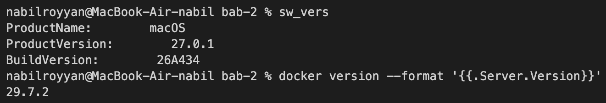

**Keterangan.** **Langkah instalasi Ubuntu dilewati** karena host adalah macOS. Langkah `sudo apt update`, `apt install docker-ce ...`, `usermod -aG docker`, dan `newgrp docker` pada teori khusus Linux. Di macOS, Docker Engine disediakan Docker Desktop; perintah di atas membuktikan Client dapat menjangkau Server (Engine) sehingga daemon dapat diakses akun praktikum tanpa `sudo`.

### 3. Menarik Image Nginx

```bash
docker pull nginx:1.26
```

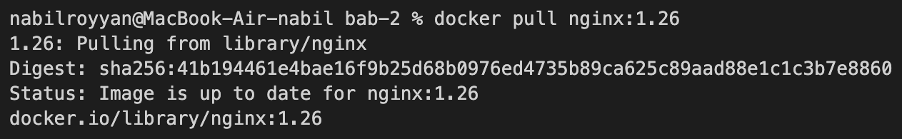

**Keterangan.** Image ditarik dengan **tag spesifik** `1.26` (bukan `latest`) agar deployment dapat direproduksi. (Progres unduhan diringkas.)

### 4. Menjalankan Container Nginx

```bash
docker run -d --name web-public -p 8080:80 nginx:1.26
```

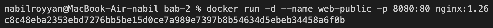

**Keterangan.** Container dijalankan detached (`-d`) dengan pemetaan host `8080` ke port container `80` (`-p 8080:80`).

### 5. Status Container

```bash
docker ps
```

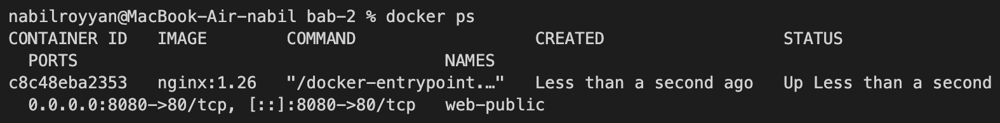

**Keterangan.** `web-public` berstatus `Up` dengan pemetaan `0.0.0.0:8080->80/tcp`. Perhatikan bahwa tanpa alamat bind, port terekspos pada **seluruh interface host** — bukan hanya loopback.

### 6. Log Container

```bash
docker logs --tail 20 web-public
```

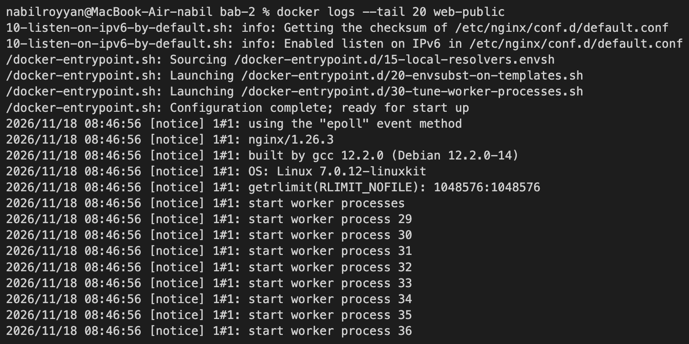

**Keterangan.** Log startup Nginx dari stdout/stderr container.

### 7. Mengakses Nginx dari Host

```bash
curl http://localhost:8080
```

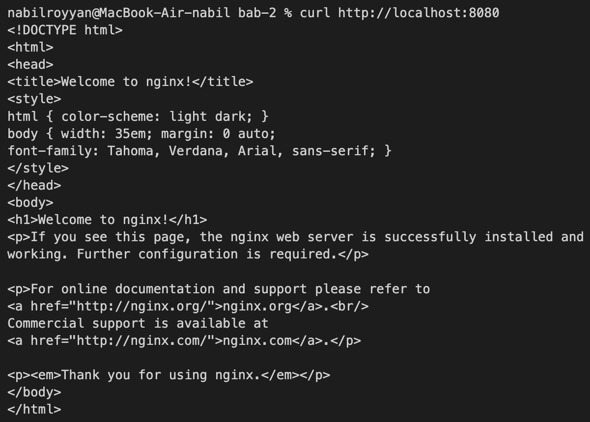

**Keterangan.** Halaman default Nginx tersaji, membuktikan pemetaan port bekerja.

### 8. Container Ubuntu Interaktif

```bash
docker run -it --name ubuntu-test ubuntu:22.04 /bin/bash
cat /etc/os-release
exit
```

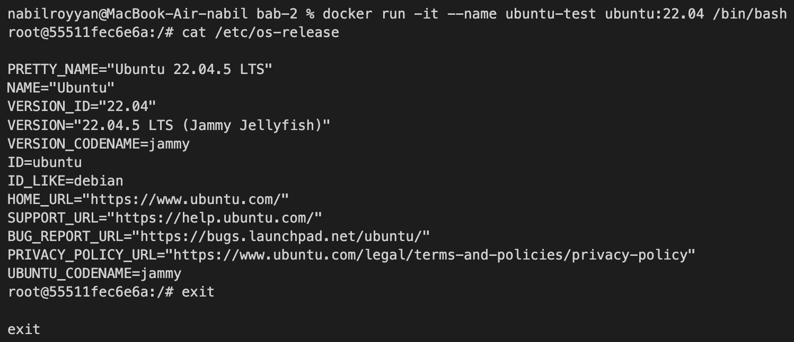

**Keterangan.** Masuk ke shell container Ubuntu 22.04 (`-it`) dan menjalankan `cat /etc/os-release`. Terlihat `PRETTY_NAME="Ubuntu 22.04.5 LTS"` dan hostname container (`root@…`) — memperlihatkan UTS namespace memisahkan hostname serta container berbagi kernel host. Sesudah `exit`, container berhenti.

### 9. Menghapus Container Uji

```bash
docker rm -f web-public ubuntu-test
```

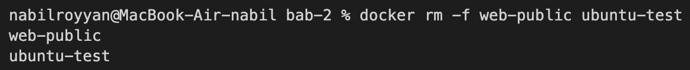

**Keterangan.** Container uji dihapus agar tidak menumpuk dan membebaskan port 8080.

### 10. Membuat Custom Web (index.html dan Dockerfile)

```bash
mkdir -p ~/docker-lab/custom-web && cd ~/docker-lab/custom-web
cat > index.html << 'EOF'
<h1>Docker Lab PENS</h1>
<p>Container berhasil berjalan.</p>
EOF
cat > Dockerfile << 'EOF'
FROM nginx:1.26-alpine
LABEL maintainer="admin@pens.ac.id"
COPY index.html /usr/share/nginx/html/index.html
EXPOSE 80
CMD ["nginx", "-g", "daemon off;"]
EOF
ls -l
```

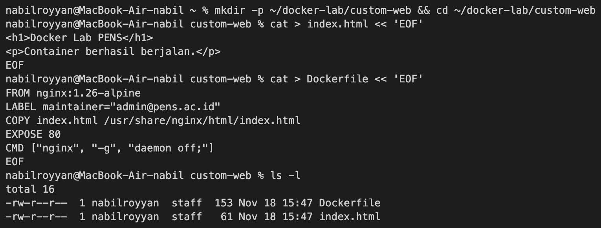

**Keterangan.** Dibuat `index.html` dan `Dockerfile`. Base image `nginx:1.26-alpine` dipilih (varian kecil berbasis Alpine) dan tag spesifik. `COPY` menimpa halaman default, `EXPOSE 80` hanya mendokumentasikan port, dan `CMD` menjalankan Nginx di foreground.

### 11. Build Image Custom

```bash
docker build -t pens-web:1.0 .
```

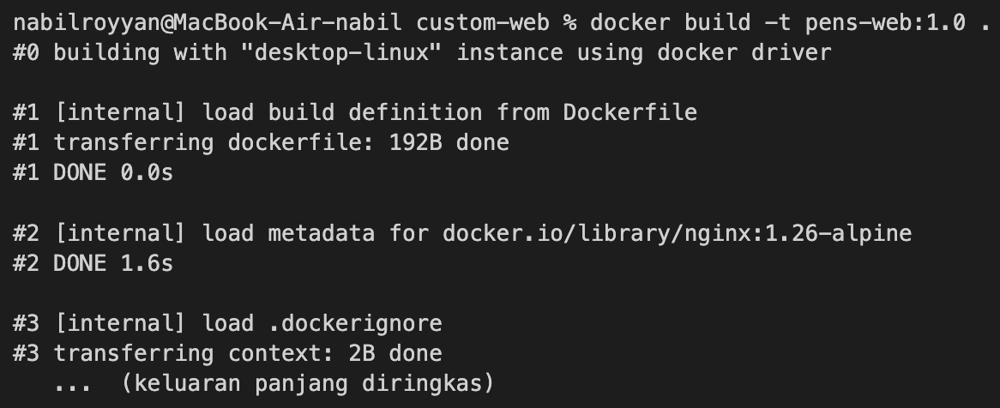

**Keterangan.** Image `pens-web:1.0` dibangun dari konteks `.`. (Progres build diringkas.)

### 12. Menjalankan Image Custom

```bash
docker run -d --name pens-app -p 9090:80 pens-web:1.0
```

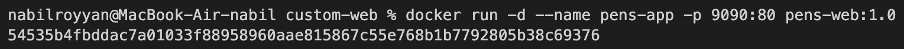

**Keterangan.** Container `pens-app` dijalankan dengan pemetaan host `9090` ke port container `80`.

### 13. Mengakses Image Custom

```bash
curl http://localhost:9090
```

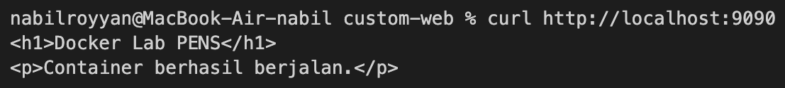

**Keterangan.** Halaman menampilkan `<h1>Docker Lab PENS</h1>` dan `<p>Container berhasil berjalan.</p>` — image custom dibangun dan dijalankan dengan benar.

### 14. Verifikasi Lingkungan

```bash
docker network ls
docker volume ls
docker inspect pens-app
```

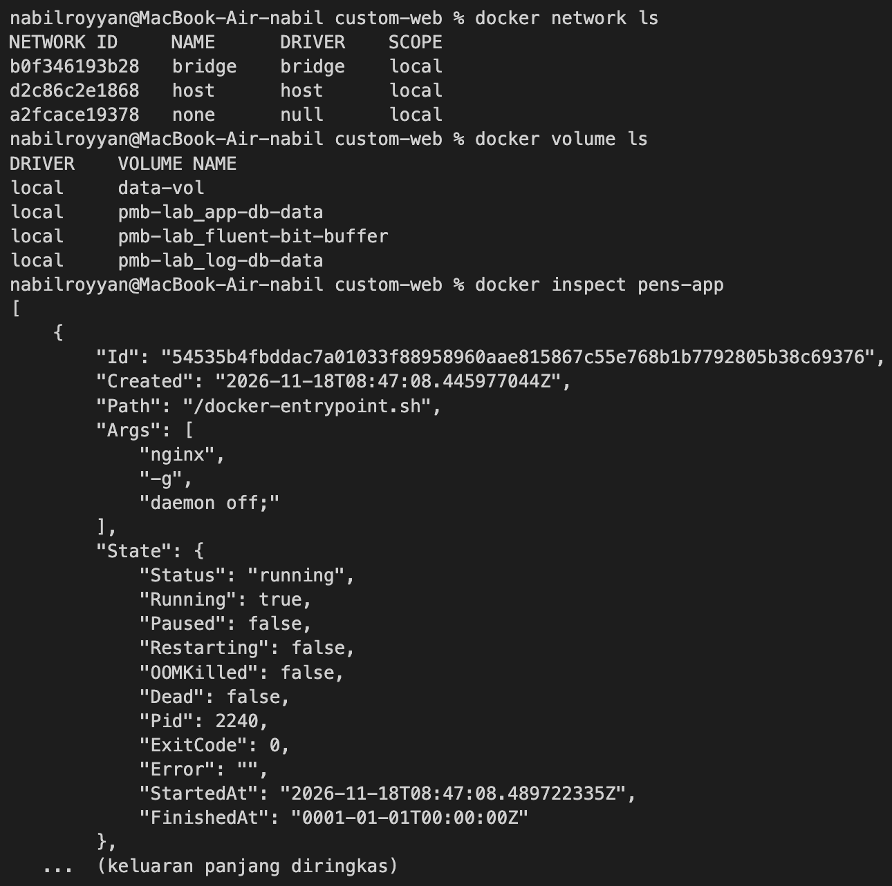

**Keterangan.** `docker network ls` menampilkan network bawaan Docker; `docker volume ls` menampilkan volume; `docker inspect pens-app` memperlihatkan detail runtime (termasuk pemetaan port, image, dan state). Ini mengikuti prinsip troubleshooting: mulai dari status container, log, network, volume, lalu konfigurasi.

### 15. Cleanup

```bash
docker rm -f pens-app
docker rmi pens-web:1.0
```

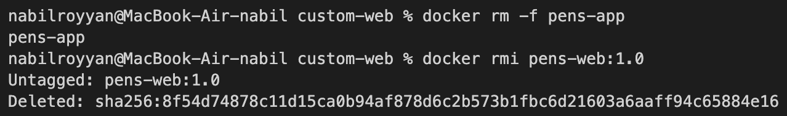

**Keterangan.** Container `pens-app` dan image `pens-web:1.0` dihapus agar lingkungan laboratorium bersih sebelum bab berikutnya (menghindari konflik port dan penumpukan image).

## Verifikasi dan Skenario Pengujian

- [x] Docker Engine aktif; `docker version` menampilkan Client dan Server.
- [x] Akun non-root dapat menjalankan `docker ps` tanpa `sudo` (Docker Desktop macOS).
- [x] Container Nginx (dan image custom) dapat diakses dari browser/curl via port host.
- [x] Image `pens-web:1.0` berhasil dibangun dan dijalankan.
- [x] Perbedaan `EXPOSE` dan `-p` dapat dijelaskan (lihat analisis).
- [ ] Instalasi Docker Engine Ubuntu — **dilewati** (host macOS), digantikan verifikasi Docker Desktop.

## Analisis dan Evaluasi

**Perbedaan `EXPOSE` dan `-p`.** `EXPOSE 80` pada Dockerfile hanyalah **metadata** yang mendokumentasikan port aplikasi; instruksi itu tidak membuka akses ke luar host. Akses dibuat oleh opsi `-p` (atau `ports` pada Compose) yang memetakan port host ke port container. Karena itu, `EXPOSE` saja tidak membuat layanan dapat dijangkau.

**Masalah dan diagnosis yang muncul.** Pada run pertama, `docker run -it ubuntu:22.04` memerlukan unduhan image sehingga langkah verifikasi awal membingungkan; gejala itu bukan bug, melainkan image belum tersedia lokal (Docker hanya menarik image saat belum ada). Diagnosis dilakukan dengan memastikan image tersedia lebih dulu, lalu menjalankan kembali. Prinsip troubleshooting mulai dari status container, log, network, dan volume terbukti efektif.

**Perbandingan layer image.** `nginx:1.26-alpine` memuat sistem dasar Alpine yang minimal, sehingga menghasilkan image lebih kecil dan permukaan serangan (jumlah paket/CVE) lebih sempit. Image custom `pens-web:1.0` menambahkan **satu layer** kecil berisi `index.html` (dan metadata) di atas base image — membuktikan konsep layer: perubahan ditambahkan sebagai layer baru, bukan salinan penuh filesystem.

**Risiko keamanan/operasional.** (1) `-p 8080:80` tanpa alamat bind mengekspos layanan pada seluruh interface host; sebaiknya gunakan `-p 127.0.0.1:8080:80` (least exposure). (2) Keanggotaan grup `docker` setara akses root secara praktis; harus diperlakukan sebagai keputusan keamanan. (3) Base image besar membawa paket/CVE tak terpakai; pilih image minimal dan non-root. (4) Container berbagi kernel host; isolasi tidak setara VM, sehingga perlu hardening runtime (capability, seccomp, read-only, limit resource).

**Rekomendasi untuk lingkungan mirip produksi.** Pin image dengan tag spesifik (atau digest), bind published port ke loopback/reverse proxy, jalankan proses sebagai non-root, gunakan `.dockerignore` untuk mencegah secret/bahan tak perlu masuk build context, buat multi-stage build agar image runtime minimal, serta tambahkan pemindaian image dan penandaan digest sebagai bagian pipeline.

## Rangkuman

Praktikum Bab 2 berhasil menjalankan container pertama (`web-public` dari `nginx:1.26`), melakukan sesi interaktif di container Ubuntu, serta membangun dan menjalankan image custom `pens-web:1.0`. Praktikum menegaskan perbedaan `EXPOSE` (metadata) dan `-p` (pemetaan nyata), konsep image/layer, dan pentingnya prinsip least exposure serta hardening runtime. Langkah instalasi khusus Ubuntu ditandai dilewati karena host macOS, dengan verifikasi bahwa Docker Engine (Docker Desktop) tetap dapat diakses akun non-root.
