# LAPORAN BAB 3

## Docker Compose: Nginx, Flask, dan PostgreSQL

**Mata Kuliah:** DevOps  
**Nama:** MUHAMMAD NABIL ROYYAN
**NRP:** 3126640032 

## Pendahuluan

Bab ini menggabungkan tiga layanan dalam satu berkas `compose.yaml`: Nginx sebagai pintu masuk, aplikasi Flask yang mengakses database, dan PostgreSQL sebagai penyimpan data. Laporan ini mengikuti `cheatsheets/bab-03-cs.md` dan menjalankan setiap perintah pada Terminal macOS di `~/docker-lab/bab-3`. Setiap subbab memuat satu perintah, tangkapan layar keluaran aslinya, dan keterangannya.

## Laporan Praktikum

### 1. Menyiapkan Direktori Praktikum

```bash
mkdir -p ~/docker-lab/bab-3/app
mkdir -p ~/docker-lab/bab-3/html
cd ~/docker-lab/bab-3
ls
```

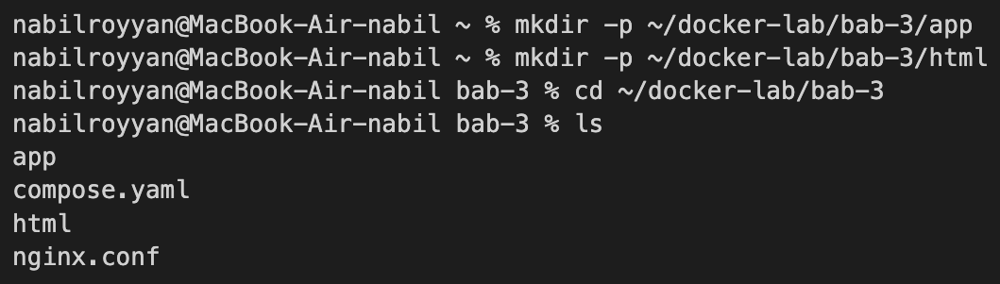

**Keterangan.** `mkdir -p` membuat folder `app` (untuk aplikasi Flask) dan `html` (untuk halaman statis) tanpa error bila sudah ada. Setelah `cd`, `ls` menampilkan isi direktori kerja: `app`, `compose.yaml`, `html`, dan `nginx.conf`.

### 2. Berkas `compose.yaml`

```bash
nano compose.yaml
```

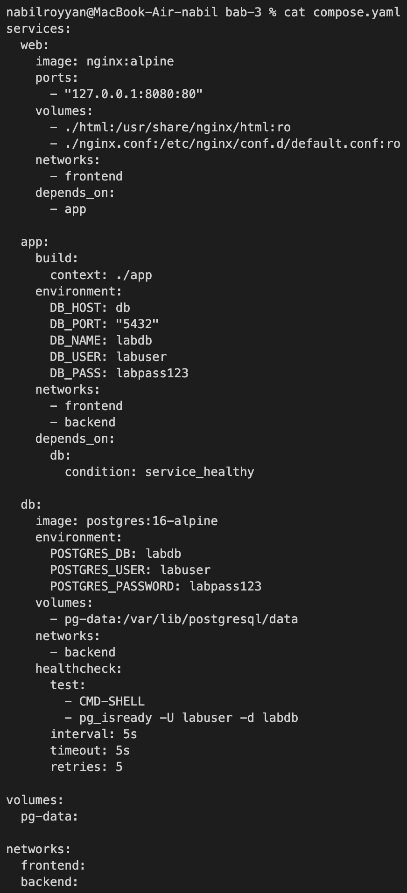

**Keterangan.** Tiga service didefinisikan. `web` (Nginx) memetakan `127.0.0.1:8080:80` sehingga hanya bisa diakses dari laptop lokal, serta me-mount `./html` dan `./nginx.conf` read-only. `app` dibangun dari `./app` dan menerima konfigurasi koneksi database lewat environment (`DB_HOST=db`, `DB_PORT=5432`). `db` (PostgreSQL) menyimpan data pada named volume `pg-data` dan memiliki healthcheck `pg_isready`. `app` menunggu `db` berstatus sehat, dan `web` bergantung pada `app`. Jaringan dipisah menjadi `frontend` dan `backend`.

### 3. Berkas `app/requirements.txt`

```bash
nano app/requirements.txt
```

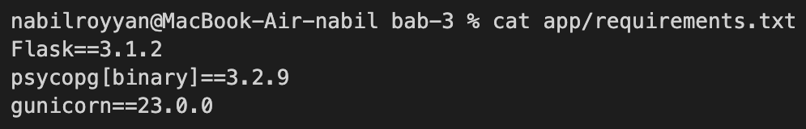

**Keterangan.** Dependency Python yang dipin: `Flask==3.1.2` (framework), `psycopg[binary]==3.2.9` (driver PostgreSQL), dan `gunicorn==23.0.0` (WSGI server produksi).

### 4. Berkas `app/app.py`

```bash
nano app/app.py
```

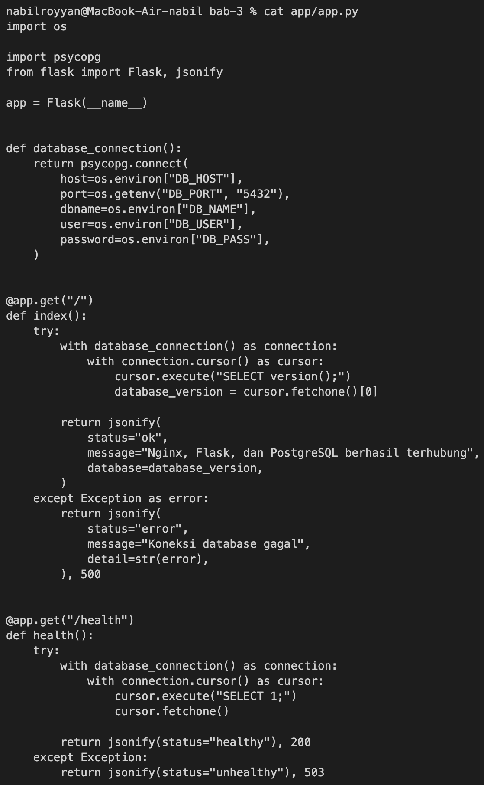

**Keterangan.** Aplikasi Flask dengan dua endpoint. `/` membuka koneksi ke PostgreSQL, menjalankan `SELECT version();`, lalu mengembalikan JSON berisi versi database. `/health` menjalankan `SELECT 1;` dan mengembalikan `healthy` (200) atau `unhealthy` (503). Kredensial database dibaca dari environment, bukan ditulis di kode.

### 5. Berkas `app/Dockerfile`

```bash
nano app/Dockerfile
```

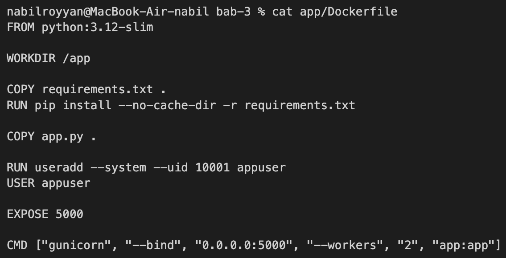

**Keterangan.** Image dibangun dari `python:3.12-slim`. `requirements.txt` disalin lalu diinstal lebih dulu agar build cache maksimal, baru kode aplikasi disalin. Praktik keamanan `USER appuser` (UID 10001) diterapkan agar proses tidak berjalan sebagai root. Aplikasi diekspos pada port 5000 dan dijalankan dengan gunicorn dua worker.

### 6. Berkas `nginx.conf`

```bash
nano nginx.conf
```

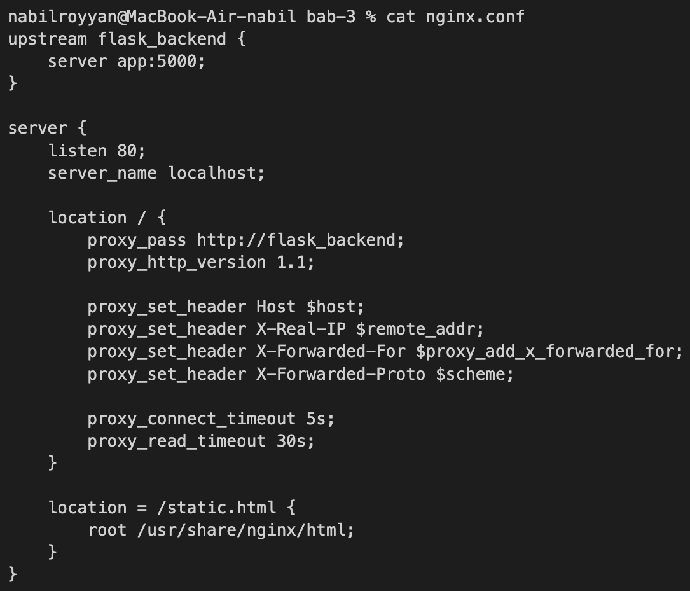

**Keterangan.** Nginx meneruskan `/` ke upstream `app:5000` (nama service Compose yang diresolusi lewat DNS internal Docker) sambil meneruskan header `Host`, `X-Real-IP`, `X-Forwarded-For`, dan `X-Forwarded-Proto`, serta menetapkan timeout koneksi/baca. Location `= /static.html` menyajikan berkas statis dari `/usr/share/nginx/html`.

### 7. Berkas `html/index.html`

```bash
nano html/index.html
```

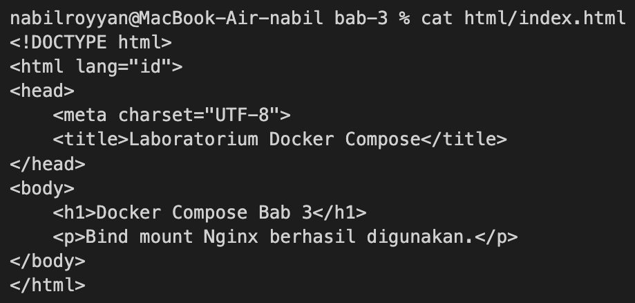

**Keterangan.** Halaman HTML statis sederhana yang disediakan untuk diuji lewat bind mount.

### 8. Memvalidasi Berkas Compose

```bash
docker compose config
```

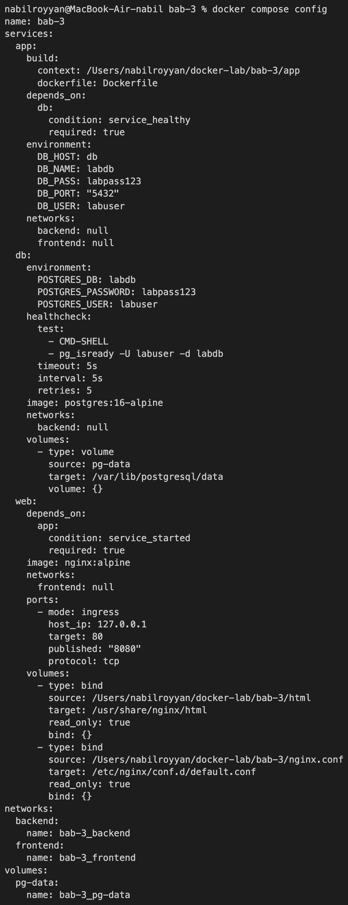

**Keterangan.** Menampilkan konfigurasi akhir setelah resolusi; tidak ada galat berarti YAML dan interpolasi valid. Terlihat port, volume, environment, dan healthcheck hasil resolusi.

### 9. Menampilkan Daftar Service

```bash
docker compose config --services
```

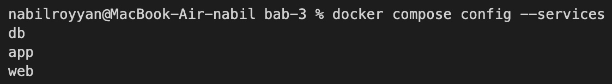

**Keterangan.** Menampilkan hanya nama service: `app`, `db`, dan `web`.

### 10. Build dan Menjalankan Stack

```bash
docker compose up -d --build
```

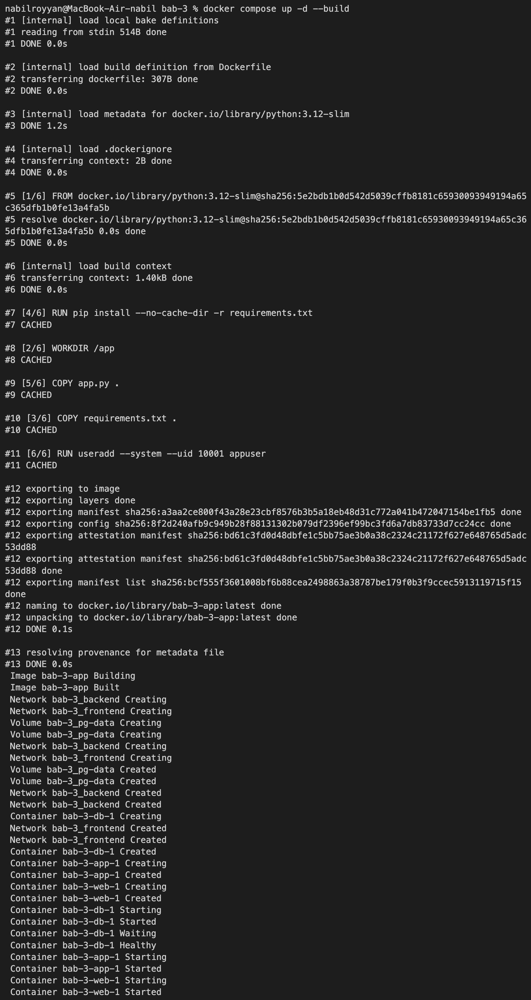

**Keterangan.** `--build` membangun image Flask lalu `-d` menjalankan container di latar belakang. Terlihat tahapan build (`FROM`, `COPY`, `pip install`, `USER appuser`), pembuatan `pg-data`, dan urutan start: `db` → `Healthy` → `app` → `web`.

### 11. Memeriksa Status Container

```bash
docker compose ps
```

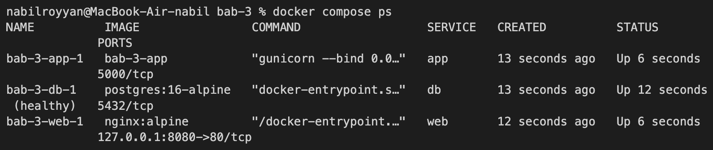

**Keterangan.** `bab-3-db-1` berstatus `Up (healthy)`. Hanya `bab-3-web-1` yang memiliki pemetaan port (`127.0.0.1:8080->80/tcp`); `app` dan `db` hanya terekspos di jaringan internal.

### 12. Menguji Endpoint Utama

```bash
curl http://localhost:8080/
```

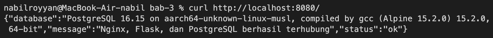

**Keterangan.** Balasan JSON `{"status":"ok", ...}` beserta versi PostgreSQL membuktikan rantai Nginx → Flask → PostgreSQL tersambung.

### 13. Menguji Endpoint Health

```bash
curl -i http://localhost:8080/health
```

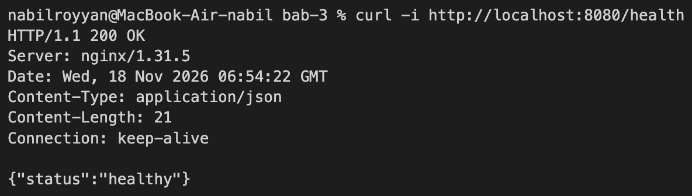

**Keterangan.** Respons `HTTP/1.1 200 OK` dengan `{"status":"healthy"}`, membuktikan koneksi database sehat dari sudut pandang aplikasi.

### 14. Menguji Halaman Statis

```bash
curl -i http://localhost:8080/static.html
```

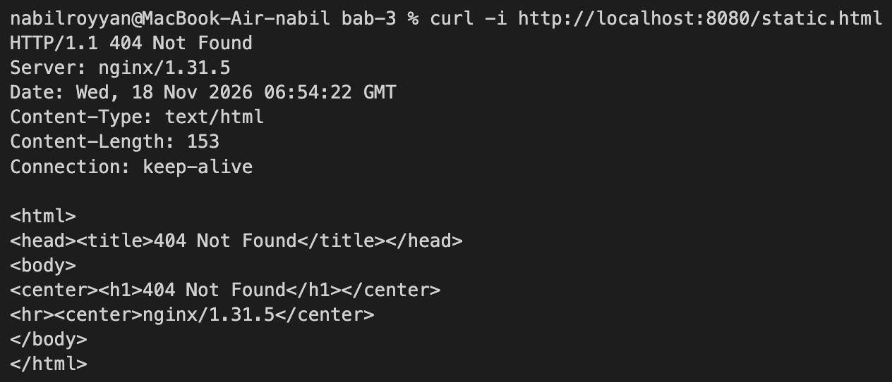

**Keterangan.** Hasilnya `404 Not Found`. Ini adalah temuan nyata: cheatsheet membuat berkas bernama `index.html`, tetapi location Nginx menunjuk ke `/static.html`, sehingga berkas tidak ditemukan (location `= /static.html` mencari berkas `static.html`). Selain itu `location /` meneruskan ke Flask, bukan ke folder statis. Ini contoh bahwa konfigurasi harus diuji, bukan diasumsikan benar.

### 15. Perbaikan Halaman Statis

```bash
cp html/index.html html/static.html
curl -i http://localhost:8080/static.html
```

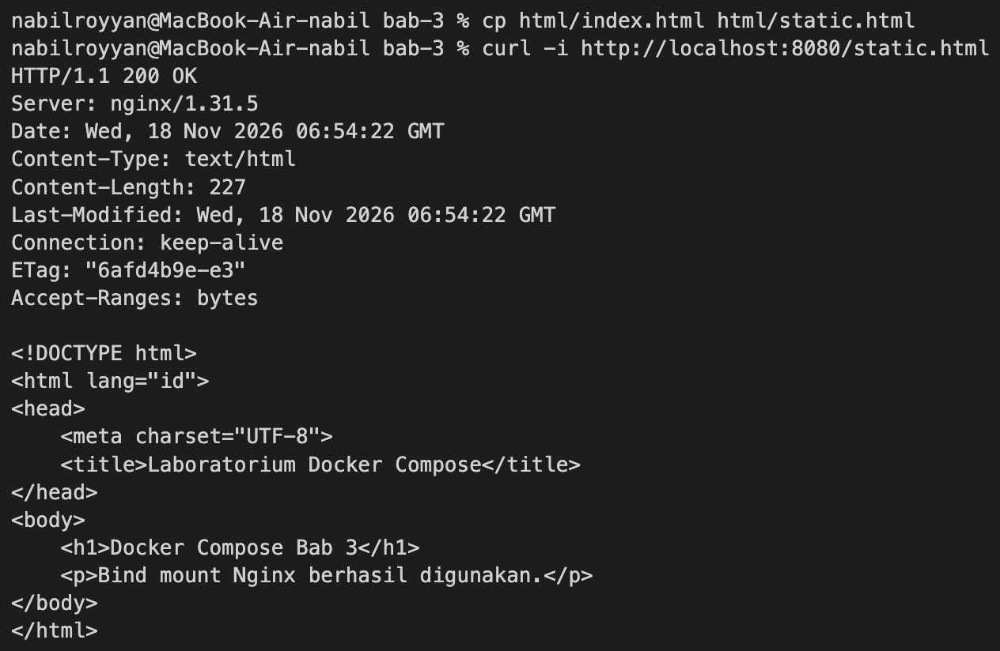

**Keterangan.** Setelah menyalin berkas menjadi `static.html` (mengikuti nama pada location), permintaan mengembalikan `200 OK` beserta isi halaman. Karena `./html` di-mount sebagai volume, penambahan berkas langsung terbaca tanpa rebuild. Perbaikan alternatif adalah mengubah location menjadi `= /index.html` atau mengarahkan `location /static/` ke folder tersebut.

### 16. Melihat Log Seluruh Service

```bash
docker compose logs --tail 100
```

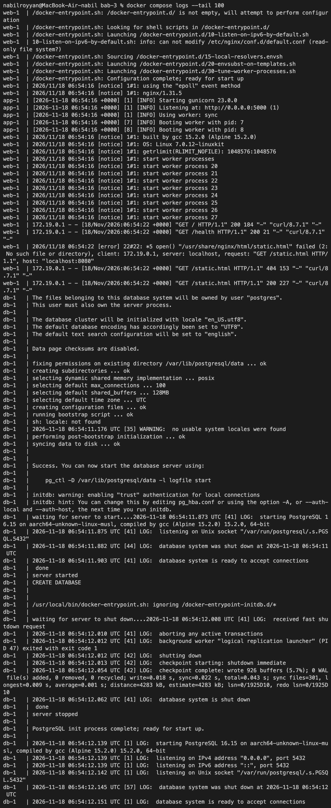

**Keterangan.** Menampilkan 100 baris terakhir dari ketiga service. Terlihat Nginx selesai konfigurasi, gunicorn Flask mendengarkan pada port 5000, dan access log Nginx mencatat `GET /` serta `GET /health` dengan status 200.

### 17. Log Service `app`

```bash
docker compose logs app
```

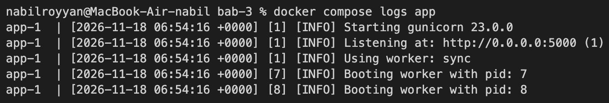

**Keterangan.** Gunicorn versi 23.0.0 berjalan dengan dua worker (`pid 7` dan `pid 8`) dan mendengarkan pada `0.0.0.0:5000`.

### 18. Log Service `db`

```bash
docker compose logs db
```

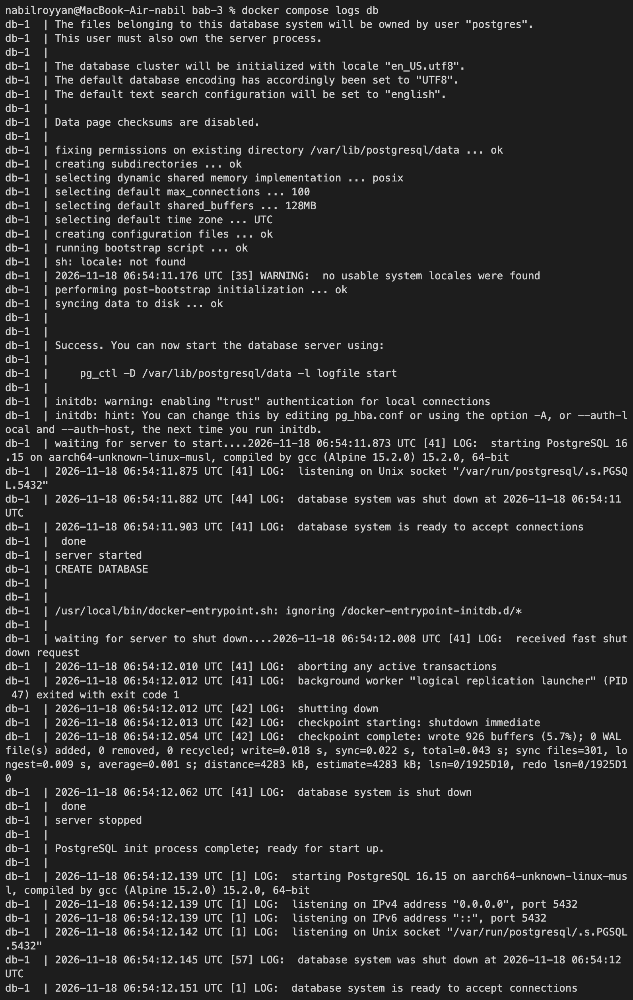

**Keterangan.** Log inisialisasi PostgreSQL: pembuatan cluster data, konfigurasi, dan bootstrap berhasil. Terlihat peringatan `no usable system locales were found` yang tidak mengganggu fungsi.

### 19. Log Service `web`

```bash
docker compose logs web
```

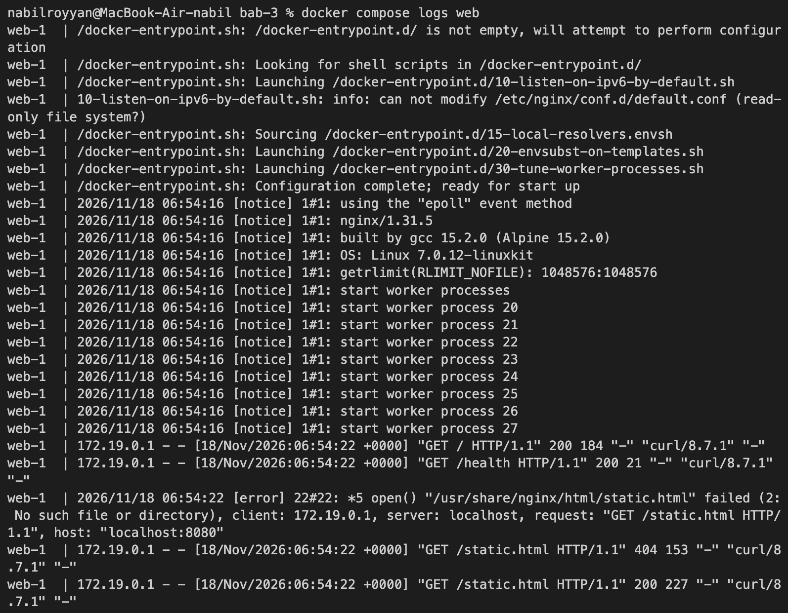

**Keterangan.** Log Nginx: skrip entrypoint selesai ("ready for start up"), worker dimulai, dan setiap request tercatat pada access log — bukti observabilitas.

### 20. Menghentikan Stack

```bash
docker compose down
```

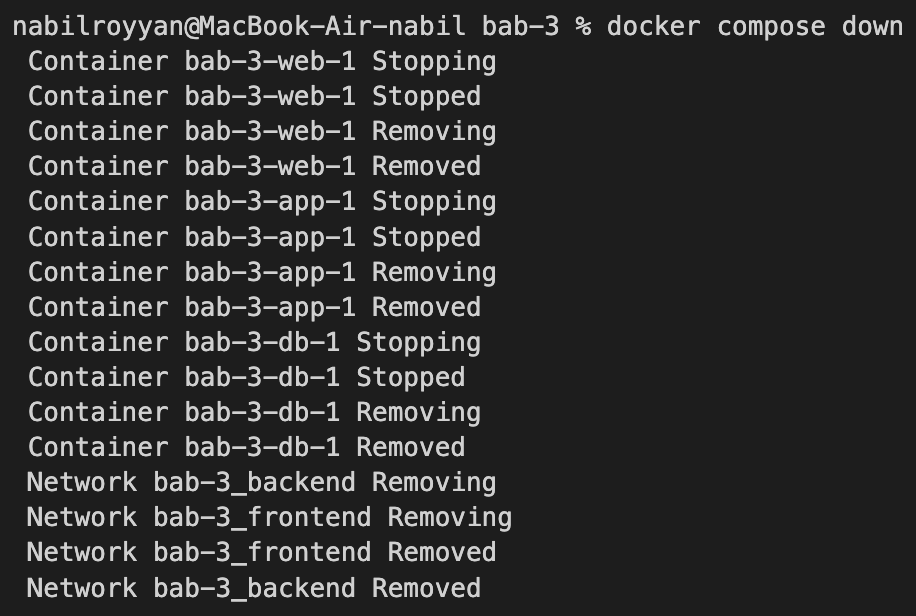

**Keterangan.** Menghentikan dan menghapus container serta network, tetapi **mempertahankan** named volume `pg-data` sehingga data PostgreSQL tetap ada.

### 21. Menghentikan Stack dan Menghapus Volume

```bash
docker compose down -v
```

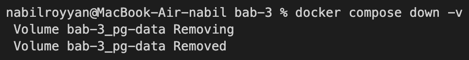

**Keterangan.** Menghapus juga volume `pg-data`. Perintah ini destruktif terhadap data database dan hanya dijalankan karena data laboratorium tidak lagi diperlukan.

## Hasil Uji Penerimaan

| Pemeriksaan | Hasil pada laporan |
| --- | --- |
| `docker compose config` valid | Lulus |
| Ketiga service berjalan | Lulus (`web`, `app`, `db`) |
| PostgreSQL berstatus healthy | Lulus |
| `/` menampilkan JSON koneksi database | Lulus |
| `/health` mengembalikan 200 `healthy` | Lulus |
| Halaman statis `/static.html` | 404 pada konfigurasi cheatsheet, 200 setelah perbaikan nama berkas |
| Hanya Nginx punya published port | Lulus |
| Data bertahan pada `down` (tanpa `-v`) | Lulus |

## Analisis dan Evaluasi

**Mengapa backend tidak dipublikasikan ke host?** Service `app` dan `db` tidak mendeklarasikan `ports`, sehingga hanya dapat dijangkau lewat jaringan internal Compose. Ini menerapkan prinsip least exposure: permukaan serangan di host minimal dan komunikasi antar-service tidak melewati host.

**Peran healthcheck dan urutan start.** `depends_on` dengan `condition: service_healthy` membuat `app` baru dijalankan setelah PostgreSQL benar-benar siap menerima koneksi, mengurangi kegagalan koneksi saat startup. Namun healthcheck hanya membuktikan kesiapan saat itu, bukan jaminan ketersediaan permanen.

**Pelajaran dari halaman statis 404.** Nama berkas dan nama location harus konsisten. Konfigurasi proxy dan penyajian statis harus diuji dengan request nyata; asumsi "seharusnya jalan" dapat menyembunyikan kesalahan penamaan path.

**Risiko keamanan.** Kredensial database masih ditulis pada `compose.yaml` dan environment untuk keperluan lab. Untuk lingkungan mirip produksi, gunakan secret manager, batasi akses jaringan database, jangan pakai password contoh, dan jalankan container dengan user non-root (sudah dilakukan pada aplikasi).

## Rangkuman

Docker Compose memungkinkan tiga layanan (Nginx, Flask, PostgreSQL) dijalankan dan dihubungkan dengan deklarasi tunggal. Pemisahan jaringan, ketiadaan published port pada backend, dan healthcheck menghasilkan arsitektur yang lebih aman dan andal. Pengujian nyata (bukan asumsi) mengungkap ketidaksesuaian path halaman statis, yang diperbaiki dengan menyesuaikan nama berkas terhadap konfigurasi.
