# LAPORAN BAB 4

## Web Service Container: Apache, Nginx, Reverse Proxy, dan TLS

**Mata Kuliah:** DevOps  
**Nama:** MUHAMMAD NABIL ROYYAN
**NRP:** 3126640032 

## Pendahuluan

Web server merupakan pintu masuk layanan web yang menerima request HTTP, memilih respons atau backend tujuan, dan mencatat aktivitas layanan. Di lingkungan container, Apache HTTP Server dan Nginx dapat dijalankan sebagai layanan terpisah dan dihubungkan melalui jaringan internal. Nginx atau Apache juga dapat berperan sebagai reverse proxy untuk menerapkan routing, meneruskan header, dan menangani koneksi TLS.

Laporan ini membahas tujuh konsep yang saling berkaitan: model event-driven, perbedaan arsitektur Apache dan Nginx, HTTP routing dan trusted header, dua pola TLS, pengelolaan private key, liveness dan readiness, serta governance konfigurasi sebagai kode. Tujuan utamanya adalah memahami alur request sekaligus batas keamanan dan operasionalnya.

## Pembahasan

### 1. Konsep Event-Driven

Pada model event-driven, sejumlah worker memantau banyak koneksi menggunakan event loop. Worker memproses koneksi yang siap dibaca atau ditulis, alih-alih menahan satu thread untuk menunggu setiap koneksi menyelesaikan seluruh proses I/O. Pendekatan ini efisien untuk banyak koneksi yang sebagian waktunya menunggu jaringan atau disk.

Nginx menggunakan arsitektur master-worker dengan pemrosesan koneksi berbasis event pada worker. Ini bukan berarti pekerjaan aplikasi yang intensif CPU menjadi tanpa biaya: beban CPU, konfigurasi, batas file descriptor, dan kapasitas upstream tetap perlu dikelola.


**Gambar 1.** Alur event-driven pada worker web server.

### 2. Arsitektur Apache vs Nginx

Apache HTTP Server menggunakan Multi-Processing Module (MPM), misalnya `prefork`, `worker`, atau `event`, untuk menentukan bagaimana proses dan thread menangani koneksi. Karena itu, karakteristik Apache tidak tepat diringkas sebagai selalu satu proses per request. Nginx menggunakan proses master dan worker; worker memanfaatkan event loop untuk menangani banyak koneksi secara asynchronous.

Keduanya mampu menyajikan konten statis dan menjadi reverse proxy. Pilihan ditentukan oleh kebutuhan aplikasi, modul, konfigurasi, kompatibilitas, dan hasil pengujian beban. Contoh laboratorium yang berguna adalah menempatkan Nginx pada lapisan depan untuk routing, lalu meneruskan request ke Apache atau aplikasi di jaringan internal.


**Gambar 2.** Perbandingan model pemrosesan; implementasi Apache bergantung pada MPM yang dipilih.

### 3. HTTP Routing dan Trusted Header

Reverse proxy dapat memilih upstream berdasarkan hostname dan path. Sebagai contoh, `/` dapat diarahkan ke web Apache, sedangkan `/api/` diarahkan ke layanan API. Proxy meneruskan informasi yang diperlukan backend, seperti host asli dan skema koneksi. Header umum meliputi `Host`, `X-Forwarded-For`, dan `X-Forwarded-Proto`.

Header tersebut bukan bukti identitas yang berdiri sendiri. Proxy tepercaya harus menghapus atau menimpa nilai kiriman client sebelum meneruskan request. Backend hanya boleh mempercayai forwarded header dari proxy yang dikenal, dan sebaiknya tidak dapat diakses langsung dari jaringan publik. Tanpa pembatasan itu, client dapat memalsukan alamat asal atau skema request, yang berisiko mengacaukan log, redirect, dan keputusan keamanan.


**Gambar 3.** Routing request dan batas kepercayaan header antara client, proxy, dan backend.

### 4. Dua Opsi TLS

TLS melindungi kerahasiaan dan integritas data selama transit serta memungkinkan client memeriksa identitas server. **Terminasi TLS di reverse proxy** berarti koneksi client ke proxy dienkripsi, lalu proxy meneruskan HTTP ke backend. Pola ini menyederhanakan pengelolaan sertifikat, tetapi segmen proxy-ke-backend tidak terenkripsi dan harus dibatasi pada jaringan yang sesuai.

**TLS passthrough** meneruskan koneksi TLS tanpa membuka isinya di proxy; handshake TLS berakhir di backend. Backend mengelola sertifikat dan routing pada lapisan TLS lebih terbatas. Pilihan lain yang umum adalah TLS re-encryption: proxy melakukan terminasi TLS lalu membuat koneksi TLS baru ke backend. Apa pun polanya, sertifikat harus sesuai hostname, private key dilindungi, dan masa berlaku dipantau. Sertifikat self-signed hanya sesuai untuk latihan, bukan layanan publik.


**Gambar 4.** Perbandingan lokasi terminasi handshake TLS.

### 5. Penyimpanan Private Key

Private key harus diperlakukan sebagai secret: jangan dimasukkan ke image container, repository kode, log, atau artefak build yang dapat diunduh. Pada deployment, key dapat diberikan melalui secret manager atau secret runtime platform. Untuk laboratorium, bind mount read-only dapat digunakan dengan permission file dan akses host yang dibatasi.

Hak baca diberikan hanya kepada proses yang memerlukan key. Rotasi harus mencakup penggantian material, reload layanan, pemeriksaan sertifikat baru, dan prosedur pemulihan. Mount read-only membantu mencegah perubahan dari container, tetapi tidak dengan sendirinya melindungi key dari pengguna host yang memiliki hak akses.


**Gambar 5.** Alur pemberian dan perlindungan private key saat runtime.

### 6. Liveness vs Readiness

Liveness menjawab apakah proses masih berjalan dengan benar. Jika pemeriksaan liveness gagal berulang kali, platform dapat memulai ulang container. Readiness menjawab apakah layanan siap menerima trafik. Jika readiness gagal, endpoint dikeluarkan sementara dari routing tanpa harus memulai ulang proses.

Keduanya tidak boleh disamakan dengan status container `running`. Pemeriksaan sebaiknya mewakili kondisi layanan yang relevan dan memiliki timeout serta ambang kegagalan yang masuk akal. Readiness dapat memeriksa dependency yang benar-benar dibutuhkan untuk melayani request; hindari menjadikan setiap gangguan dependency sementara sebagai alasan restart berulang.


**Gambar 6.** Dampak kegagalan liveness dan readiness yang berbeda.

### 7. Governance dan Config as Code

Konfigurasi web server merupakan bagian dari sistem yang harus ditinjau dan diuji. Simpan konfigurasi di version control, lakukan review perubahan, validasi sintaks dengan tool server yang sesuai, dan uji routing serta perilaku gagal sebelum deployment. Perubahan yang sudah dirilis perlu dapat ditelusuri ke commit, pemilik, lingkungan, dan hasil pemeriksaannya.

Gunakan konfigurasi terkontrol untuk membatasi port yang dipublikasikan, menetapkan upstream dan timeout, mengatur header, serta menunjuk lokasi sertifikat atau secret tanpa menyimpan private key di repository. Setelah deployment, pantau status, log, dan metrik. Siapkan rollback ke versi konfigurasi yang diketahui baik, lalu catat hasil dan pengecualian kebijakan.


**Gambar 7.** Siklus config as code untuk perubahan web service yang dapat ditelusuri.


## Laporan Praktikum

Bagian ini mengikuti langkah-langkah pada `cheatsheets/bab-04-cs.md`. Seluruh perintah dijalankan pada Terminal macOS di dalam direktori `~/docker-lab/bab-4`. Setiap subbab memuat satu perintah beserta tangkapan layar keluaran aslinya dan keterangannya. Khusus langkah penyuntingan berkas dengan `nano`, isi berkas hasil penyuntingan ditampilkan sebagai bukti.

### 1. Menyiapkan Direktori Kerja

#### 1.1 Membuat struktur direktori proyek

```bash
mkdir -p ~/docker-lab/bab-4/{apache/sites,nginx/conf,certs,logs/nginx,app}
cd ~/docker-lab/bab-4
ls
```

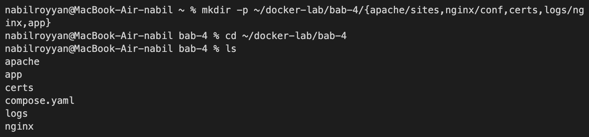

**Keterangan.** Opsi `-p` pada `mkdir` membuat folder induk (`bab-4`) sekaligus seluruh subfolder (`apache/sites`, `nginx/conf`, `certs`, `logs/nginx`, `app`) dalam satu langkah, dan tidak menghasilkan galat bila folder sudah ada. Setelah itu `cd` masuk ke folder kerja dan `ls` menampilkan isi direktori. Hasilnya memperlihatkan direktori `apache`, `app`, `certs`, `logs`, `nginx`, serta berkas `compose.yaml`.

### 2. Membuat Sertifikat TLS Laboratorium

#### 2.1 Membuat sertifikat self-signed

```bash
openssl req -x509 -nodes -days 365 -newkey rsa:2048 \
  -keyout certs/lab.key \
  -out certs/lab.crt \
  -subj "/CN=localhost/O=DevSecOps Docker Lab" \
  -addext "subjectAltName=DNS:localhost,IP:127.0.0.1"
```

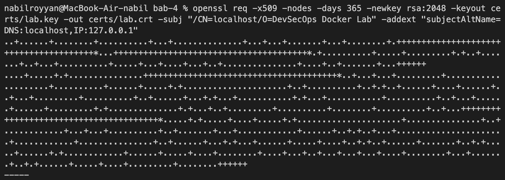

**Keterangan.** `openssl req` membuat sertifikat SSL/TLS self-signed untuk enkripsi HTTPS lokal: `-x509` menghasilkan sertifikat yang ditandatangani sendiri (bukan CSR ke CA resmi), `-nodes` membuat private key tanpa passphrase agar Nginx dapat membacanya otomatis saat start, `-days 365` menetapkan masa berlaku satu tahun, `-newkey rsa:2048` membuat private key RSA 2048-bit baru, `-keyout`/`-out` menuliskan file private key dan sertifikat, `-subj` menetapkan identitas (`CN=localhost`), dan `-addext "subjectAltName=..."` menambahkan DNS/IP alternatif agar klien tidak menolak sertifikat karena nama. Keluarannya adalah baris progres pembuatan kunci, dan dua berkas terbentuk: `certs/lab.key` dan `certs/lab.crt`.

#### 2.2 Mengatur permission berkas sertifikat

```bash
chmod 600 certs/lab.key
chmod 644 certs/lab.crt
ls -l certs
```

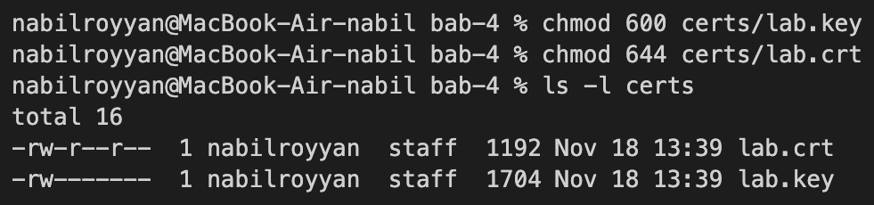

**Keterangan.** `chmod 600` membatasi `lab.key` hanya dapat dibaca dan ditulis oleh pemilik (mencegah kebocoran private key), sedangkan `chmod 644` membuat `lab.crt` dapat dibaca proses lain di container. `ls -l certs` memverifikasi hasilnya: `lab.key` berpermission `-rw-------` dan `lab.crt` berpermission `-rw-r--r--`.

### 3. Berkas `compose.yaml`

#### 3.1 Menulis definisi layanan dan jaringan

```bash
nano compose.yaml
```

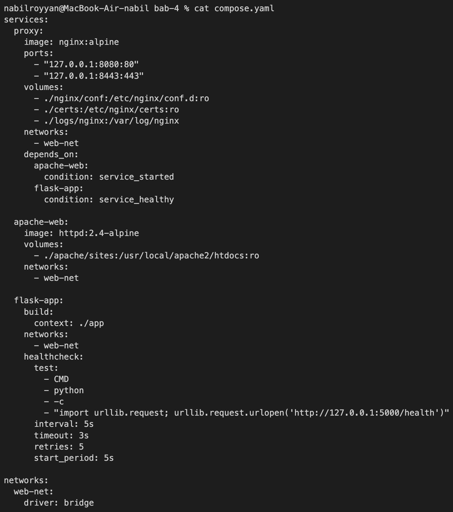

**Keterangan.** `compose.yaml` mendefinisikan tiga layanan (`proxy`, `apache-web`, `flask-app`) pada satu jaringan bridge `web-net`. Service `proxy` (Nginx) mempublikasikan `127.0.0.1:8080` (HTTP) dan `127.0.0.1:8443` (HTTPS) ke host, serta me-mount konfigurasi, sertifikat, dan direktori log secara read-only (kecuali log). `apache-web` dan `flask-app` tidak membuka port ke host sehingga hanya dapat dijangkau lewat jaringan internal. `depends_on` mengatur urutan start, dan `healthcheck` pada `flask-app` memastikan endpoint `/health` benar-benar siap sebelum Nginx dianggap siap melayani.

### 4. Berkas Konfigurasi Nginx

#### 4.1 Menulis konfigurasi reverse proxy Nginx

```bash
nano nginx/conf/default.conf
```

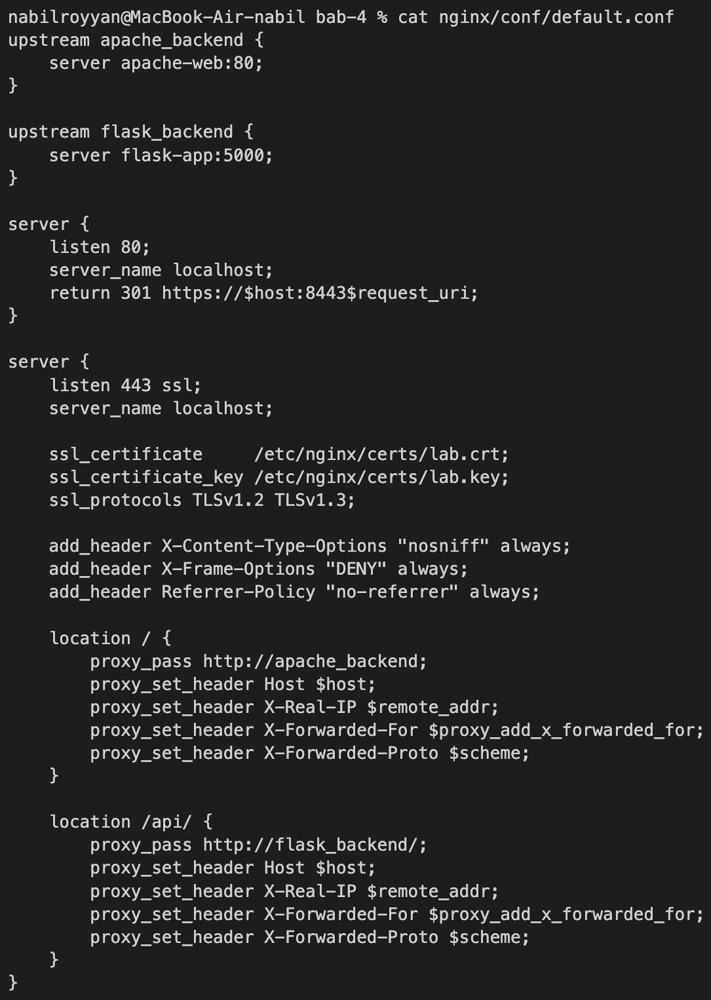

**Keterangan.** Berkas ini mendefinisikan dua upstream (`apache_backend` → `apache-web:80`, `flask_backend` → `flask-app:5000`). Server pada port 80 melakukan redirect 301 ke HTTPS, sedangkan server pada port `443 ssl` menangani terminasi TLS dengan `ssl_certificate`/`ssl_certificate_key` dan membatasi protokol ke TLSv1.2/TLSv1.3. Ditambahkan pula header keamanan (`X-Content-Type-Options`, `X-Frame-Options`, `Referrer-Policy`). Rute `location /` diarahkan ke Apache, dan `location /api/` diarahkan ke Flask, masing-masing dengan penerusan header `Host`, `X-Real-IP`, `X-Forwarded-For`, dan `X-Forwarded-Proto`.

### 5. Berkas Halaman Apache

#### 5.1 Menulis halaman HTML statis

```bash
nano apache/sites/index.html
```

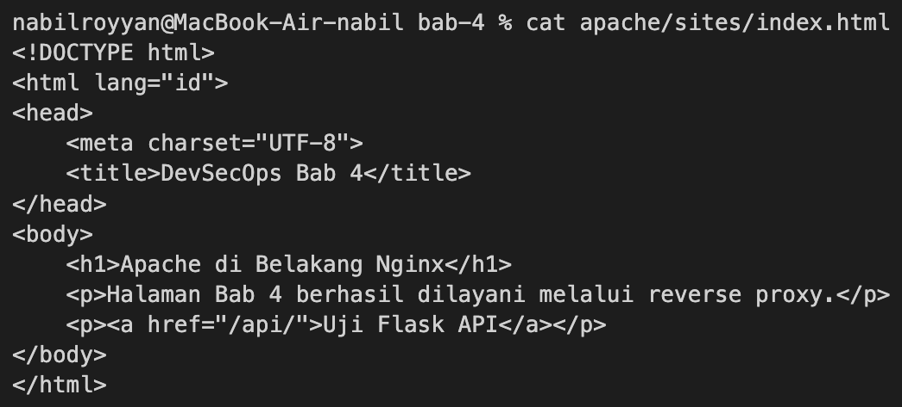

**Keterangan.** Halaman HTML statis sederhana yang dilayani Apache sebagai backend untuk rute `/`. Halaman menampilkan judul "Apache di Belakang Nginx", penjelasan singkat, dan tautan uji ke `/api/`.

### 6. Berkas Dependensi Python

#### 6.1 Menulis `requirements.txt`

```bash
nano app/requirements.txt
```

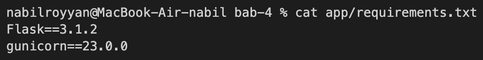

**Keterangan.** Menetapkan pustaka Python yang dibutuhkan aplikasi API beserta versinya secara terkunci: `Flask==3.1.2` (framework web) dan `gunicorn==23.0.0` (WSGI server produksi). Versi dipin agar build dapat direproduksi.

### 7. Berkas Aplikasi Flask

#### 7.1 Menulis `app.py`

```bash
nano app/app.py
```

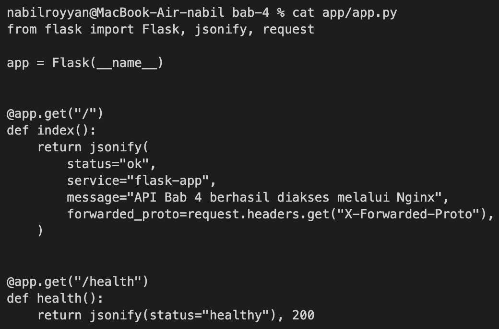

**Keterangan.** Aplikasi REST API berbasis Flask dengan dua endpoint: `/` mengembalikan JSON berisi status, nama service, pesan, dan nilai header `X-Forwarded-Proto` (untuk membuktikan request datang lewat proxy HTTPS), sedangkan `/health` mengembalikan `{"status": "healthy"}` dengan status 200 sebagai endpoint pemeriksaan kesehatan.

### 8. Berkas Dockerfile

#### 8.1 Menulis `Dockerfile` aplikasi

```bash
nano app/Dockerfile
```

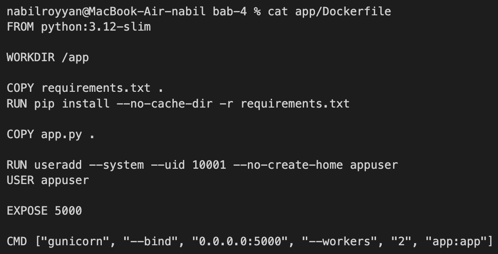

**Keterangan.** Resep build image Flask menggunakan base `python:3.12-slim`. Untuk memaksimalkan build cache, `requirements.txt` disalin dan diinstal terlebih dahulu, baru kode aplikasi. Praktik keamanan non-root diterapkan dengan membuat user `appuser` (UID 10001) dan `USER appuser` sebelum menjalankan aplikasi. Aplikasi diekspos pada port 5000 dan dijalankan dengan gunicorn (`--bind 0.0.0.0:5000 --workers 2`).

### 9. Validasi Konfigurasi

#### 9.1 Memeriksa daftar berkas proyek

```bash
find . -maxdepth 3 -type f | sort
```

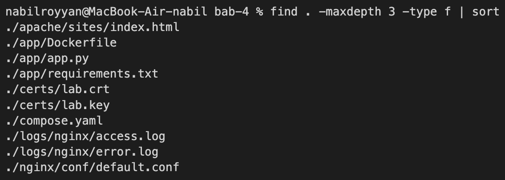

**Keterangan.** Menampilkan seluruh berkas hingga kedalaman tiga subfolder secara terurut untuk memastikan tidak ada berkas yang kelewatan atau salah posisi. Terlihat `compose.yaml`, konfigurasi Nginx, halaman Apache, berkas aplikasi (`Dockerfile`, `app.py`, `requirements.txt`), sertifikat, serta berkas log.

#### 9.2 Memvalidasi berkas Compose

```bash
docker compose config
```

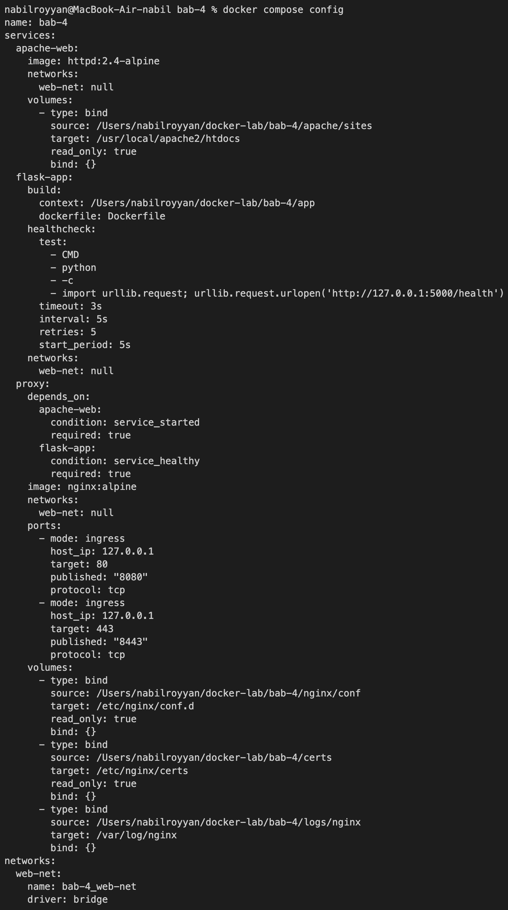

**Keterangan.** Memeriksa sintaks dan validitas `compose.yaml`. Bila tidak ada galat, Compose menampilkan konfigurasi akhir hasil resolusi (misalnya interpolasi variabel dan nilai default), yang di sini memperlihatkan tiga service, jaringan `web-net`, volume bind mount, dan healthcheck.

#### 9.3 Menampilkan daftar service

```bash
docker compose config --services
```

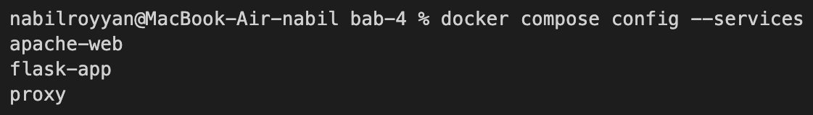

**Keterangan.** Menampilkan hanya nama service yang terdefinisi: `apache-web`, `flask-app`, dan `proxy`. Ini memastikan ketiga layanan terdeteksi oleh Compose.

### 10. Membangun dan Menjalankan Stack

#### 10.1 Build dan menjalankan container

```bash
docker compose up -d --build
```

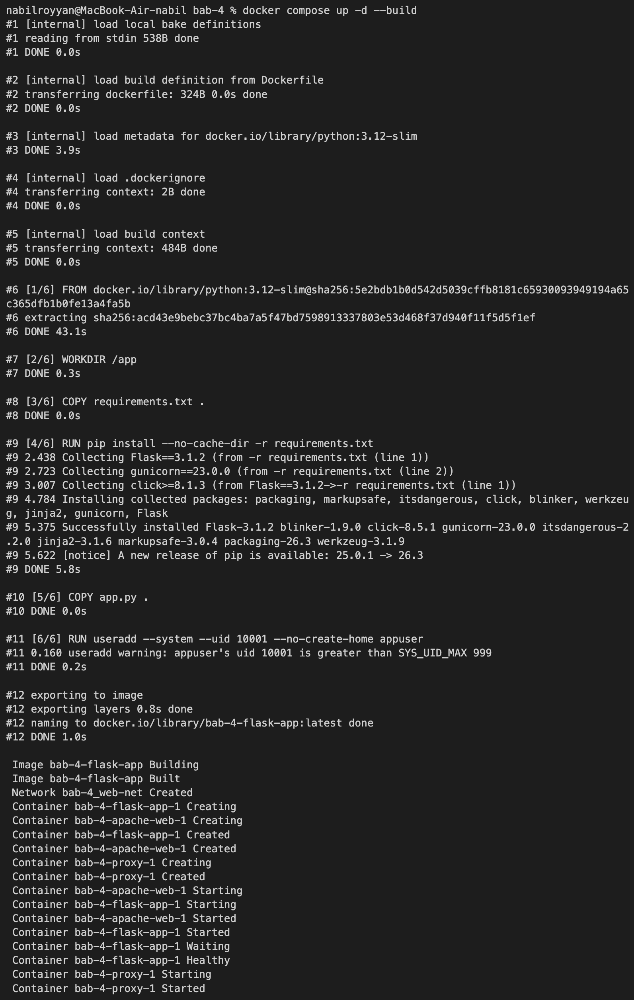

**Keterangan.** `--build` membangun ulang image (terutama `flask-app` yang memiliki Dockerfile) dan `-d` menjalankan seluruh container di background. Keluaran memperlihatkan tahapan build image Flask (instalasi dependency, penerapan user non-root, ekspor image) lalu pembuatan jaringan `bab-4_web-net` dan container. Indikator terpenting: `Image bab-4-flask-app Built` dan `Container bab-4-flask-app-1 Healthy`, artinya healthcheck Flask lulus sebelum proxy dijalankan. (Keluaran panjang dipersingkat pada bagian unduhan layer.)

#### 10.2 Memeriksa status container

```bash
docker compose ps
```

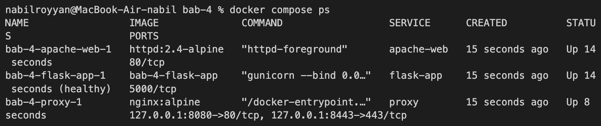

**Keterangan.** Menampilkan status tiap container. `bab-4-flask-app-1` berstatus `Up (healthy)`, dan hanya `bab-4-proxy-1` yang memiliki ikatan port host (`127.0.0.1:8080->80/tcp`, `127.0.0.1:8443->443/tcp`). `apache-web` dan `flask-app` hanya menampilkan port internal (`80/tcp`, `5000/tcp`) tanpa publikasi ke host.

#### 10.3 Melihat log startup

```bash
docker compose logs --tail 100
```

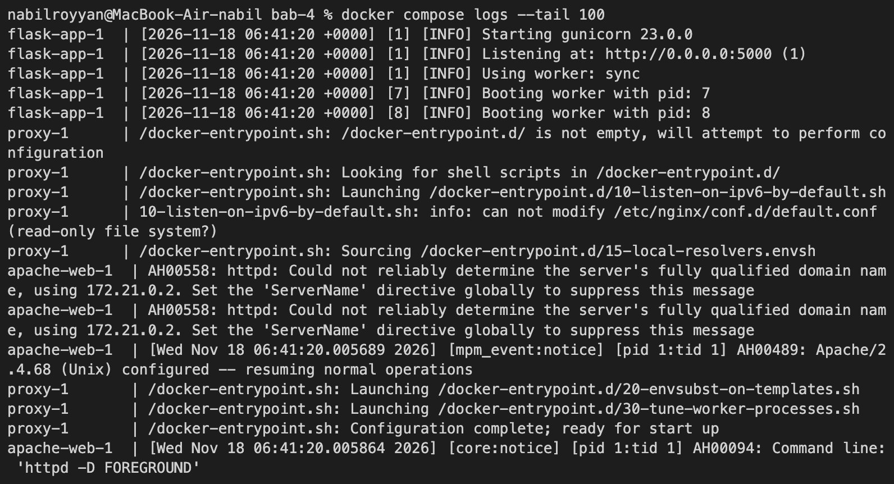

**Keterangan.** Menampilkan 100 baris log terakhir seluruh container untuk memeriksa proses startup. Terlihat gunicorn Flask mulai dan mendengarkan pada port 5000, Nginx menyelesaikan konfigurasi, serta Apache berjalan normal. Muncul pula peringatan `AH00558` Apache tentang ServerName yang tidak diset; ini hanya catatan, bukan kegagalan.

### 11. Pengujian Cepat

#### 11.1 HTTP harus redirect ke HTTPS

```bash
curl -I http://localhost:8080/
```

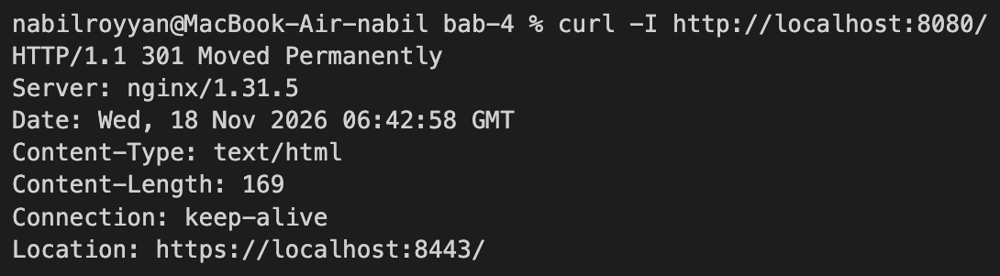

**Keterangan.** Menguji header respons pada port 8080. Hasilnya `HTTP/1.1 301 Moved Permanently` dengan `Location: https://localhost:8443/`, membuktikan Nginx mengalihkan seluruh trafik HTTP ke HTTPS.

#### 11.2 Mengakses halaman Apache melalui HTTPS

```bash
curl -k -i https://localhost:8443/
```

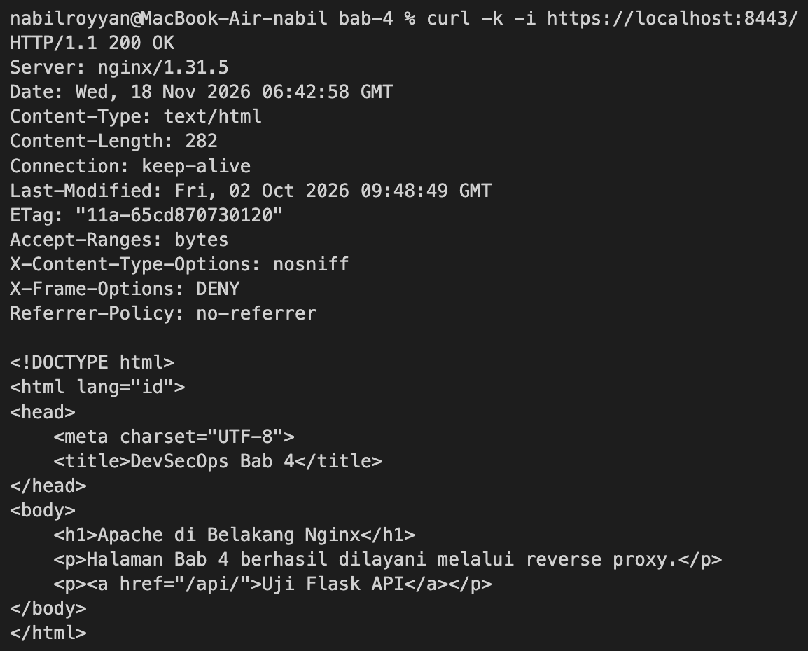

**Keterangan.** Mengakses halaman utama melalui HTTPS. Opsi `-k` mengabaikan peringatan sertifikat self-signed dan `-i` menampilkan header. Respons `200 OK` dan body menampilkan halaman HTML dari Apache, serta terlihat header keamanan (`X-Frame-Options`, `X-Content-Type-Options`, `Referrer-Policy`) yang ditambahkan Nginx.

#### 11.3 Menguji endpoint API Flask

```bash
curl -k https://localhost:8443/api/
```

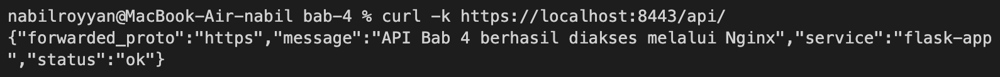

**Keterangan.** Menguji rute `/api/` yang diteruskan ke `flask-app`. Respons berupa JSON dengan `"status":"ok"` dan `"forwarded_proto":"https"`, membuktikan routing ke Flask berhasil dan header `X-Forwarded-Proto` diteruskan dengan benar.

#### 11.4 Menguji endpoint kesehatan Flask

```bash
curl -k -i https://localhost:8443/api/health
```

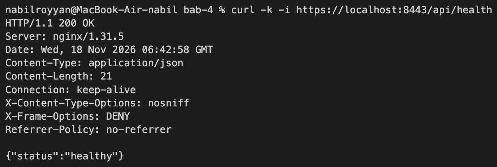

**Keterangan.** Menguji endpoint `/api/health`. Respons `200 OK` dengan JSON `{"status":"healthy"}`, konsisten dengan healthcheck yang digunakan Compose.

#### 11.5 Memeriksa negosiasi TLS

```bash
openssl s_client -connect localhost:8443 -servername localhost -brief </dev/null
```

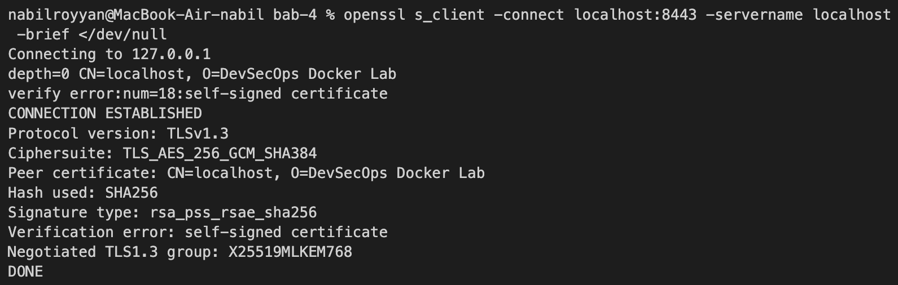

**Keterangan.** Menampilkan detail negosiasi TLS pada port 8443. Terlihat `Protocol version: TLSv1.3`, cipher `TLS_AES_256_GCM_SHA384`, dan identitas `CN=localhost, O=DevSecOps Docker Lab`. Muncul peringatan `self-signed certificate` yang wajar untuk sertifikat laboratorium.

### 12. Pemeriksaan Isolasi Jaringan

#### 12.1 Memastikan hanya proxy yang punya port host

```bash
docker compose ps
```


**Keterangan.** Mengulang `docker compose ps` untuk menegaskan bahwa hanya service `proxy` yang memetakan port ke host. `apache-web` dan `flask-app` tidak memiliki published port.

#### 12.2 Memeriksa jaringan internal

```bash
docker network inspect bab-4_web-net
```

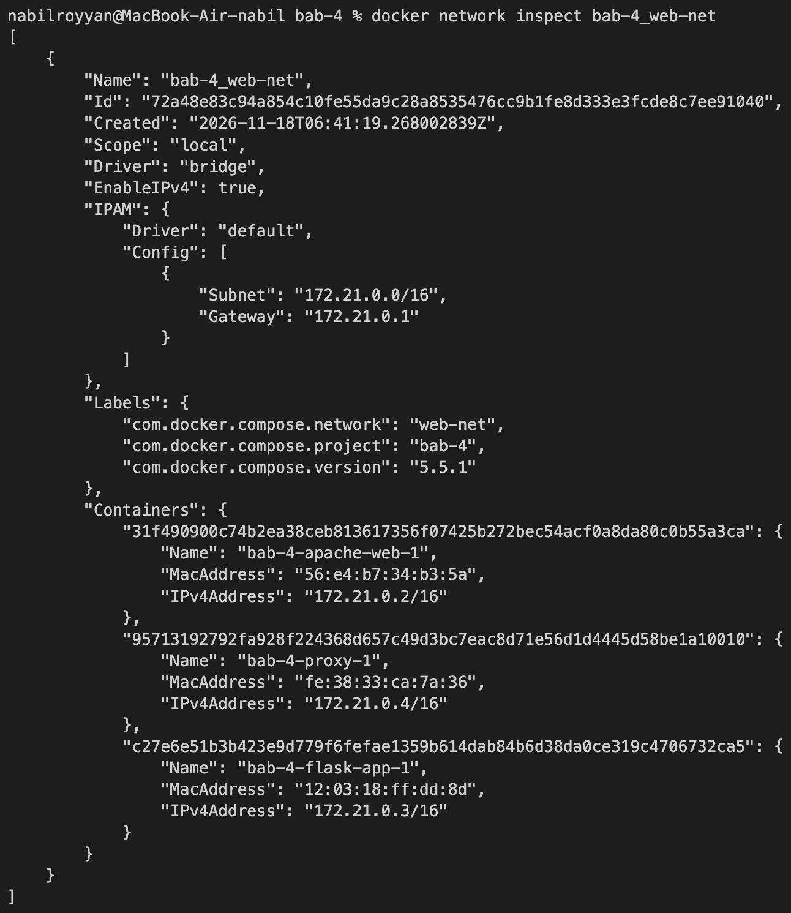

**Keterangan.** Menampilkan konfigurasi jaringan `bab-4_web-net` dengan driver `bridge` dan subnet `172.21.0.0/16`. Bagian `Containers` menunjukkan IP internal tiap container (Apache `172.21.0.2`, Flask `172.21.0.3`, proxy `172.21.0.4`), membuktikan ketiganya berada di jaringan yang sama. (Keluaran panjang dipersingkat pada bagian yang tidak relevan.)

#### 12.3 Uji komunikasi proxy ke Apache

```bash
docker compose exec proxy wget -qO- http://apache-web/
```

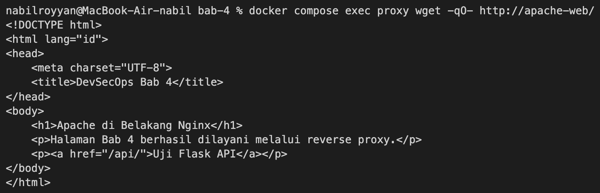

**Keterangan.** Menjalankan `wget` dari dalam container `proxy` menuju `apache-web` memakai nama service. Balasan berupa HTML halaman Apache, membuktikan komunikasi antar-container di jaringan `web-net` dan DNS internal Docker bekerja.

#### 12.4 Uji komunikasi proxy ke Flask

```bash
docker compose exec proxy wget -qO- http://flask-app:5000/health
```

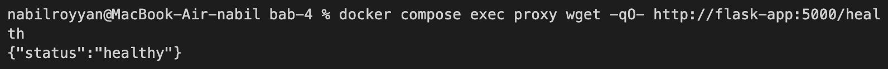

**Keterangan.** Membuktikan container Nginx dapat mengakses endpoint healthcheck `flask-app` pada port internal 5000, dengan balasan `{"status":"healthy"}`.

### 13. Pemeriksaan Log

#### 13.1 Log service proxy

```bash
docker compose logs proxy
```

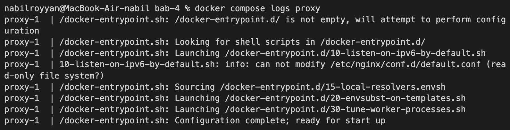

**Keterangan.** Menampilkan log container Nginx. Terlihat skrip entrypoint membaca direktori konfigurasi dan berakhir dengan `Configuration complete; ready for start up`. Muncul catatan bahwa skrip tidak dapat memodifikasi `default.conf` karena mount read-only; ini sesuai desain karena konfigurasi kita sendiri yang dipakai.

#### 13.2 Log service apache-web

```bash
docker compose logs apache-web
```

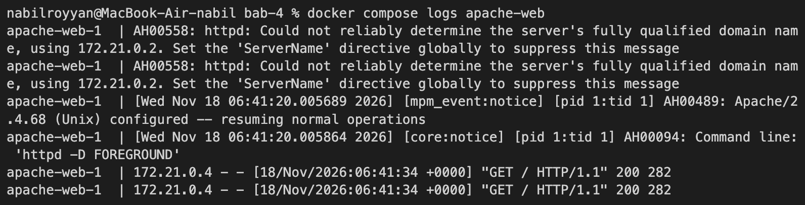

**Keterangan.** Menampilkan log Apache. Terlihat Apache mulai berjalan dan mencatat request `GET / HTTP/1.1" 200`, konsisten dengan pengujian sebelumnya.

#### 13.3 Log service flask-app

```bash
docker compose logs flask-app
```

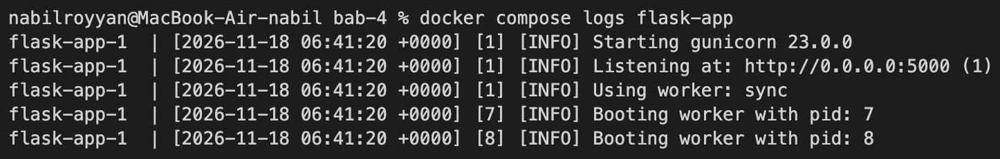

**Keterangan.** Menampilkan log gunicorn Flask: versi, alamat bind `http://0.0.0.0:5000`, dan dua worker yang dijalankan.

#### 13.4 Log akses Nginx

```bash
tail -n 20 logs/nginx/access.log
```

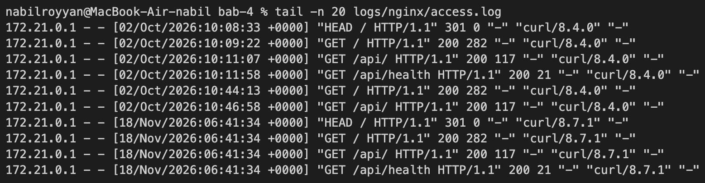

**Keterangan.** Menampilkan 20 baris terakhir access log Nginx yang di-mount ke host. Terlihat setiap request tercatat lengkap dengan alamat, waktu, metode/path, status, dan user-agent `curl` — bukti bahwa observabilitas berjalan.

#### 13.5 Log galat Nginx

```bash
tail -n 20 logs/nginx/error.log
```

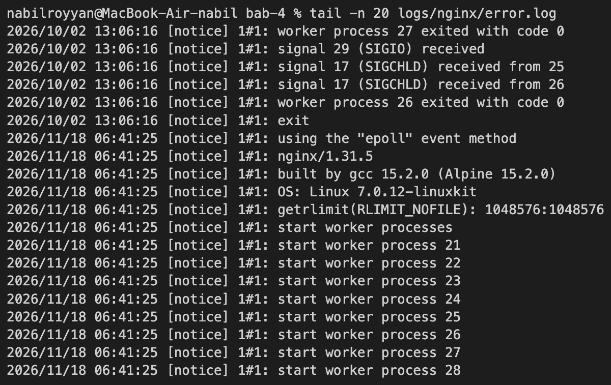

**Keterangan.** Menampilkan 20 baris terakhir error log. Isinya didominasi pesan `[notice]` tentang start/stop worker, bukan galat fatal, sehingga konfigurasi Nginx berjalan tanpa masalah.

### 14. Troubleshooting Cepat

Cheatsheet menyediakan tabel gejala–pemeriksaan–perbaikan (misalnya `502 Bad Gateway` diperiksa lewat `docker compose logs flask-app apache-web`). Pada praktikum ini tidak muncul galat tersebut, sehingga tabel hanya menjadi rujukan dan tidak dijalankan.

### 15. Cleanup

#### 15.1 Menghentikan dan menghapus stack

```bash
docker compose down
```

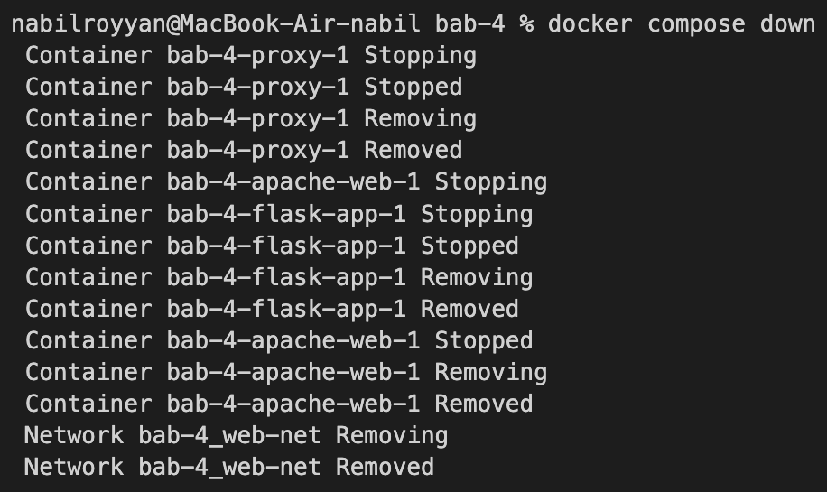

**Keterangan.** Menghentikan dan menghapus seluruh container serta network milik project ini tanpa menghapus named volume. Terlihat setiap container `Stopped`/`Removed` dan `Network bab-4_web-net Removed`.

#### 15.2 Menghapus image lokal hasil build

```bash
docker compose down --rmi local
```

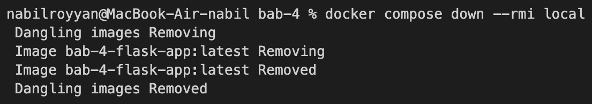

**Keterangan.** Menghapus image lokal yang dibangun dari Dockerfile (image `bab-4-flask-app:latest`) beserta dangling image. Image dasar publik seperti `nginx:alpine` dan `httpd:2.4-alpine` tidak dihapus.


## Hasil Uji Penerimaan

| Pemeriksaan | Hasil pada laporan |
| --- | --- |
| `docker compose config` valid | Lulus |
| Flask berstatus healthy | Lulus |
| HTTP port 8080 redirect ke HTTPS | Lulus, status 301 |
| HTTPS port 8443 menyajikan halaman Apache | Lulus, status 200 |
| `/api/` diarahkan ke Flask dan menghasilkan JSON | Lulus |
| Negosiasi TLS 1.2 atau 1.3 | Lulus, TLS 1.3 tercatat |
| Backend tidak memiliki published port | Lulus |
| Request tercatat di access log Nginx | Lulus |

## Analisis dan Evaluasi

**Mengapa reverse proxy tidak menjalankan seluruh logika aplikasi?** Proxy dan aplikasi memiliki tanggung jawab serta kebutuhan resource berbeda. Pemisahan memungkinkan routing, TLS, logging, dan kebijakan koneksi dikelola di proxy, sementara logika bisnis serta validasi tetap di aplikasi. Keduanya juga dapat diperbarui dan diskalakan secara terpisah.

**Apa perbedaan TLS termination dan end-to-end TLS?** Pada konfigurasi praktikum, TLS berakhir di Nginx lalu koneksi Nginx-ke-backend menggunakan HTTP pada network Compose. Pada end-to-end TLS, koneksi dari proxy ke backend juga dilindungi TLS (TLS re-encryption), atau TLS diteruskan tanpa terminasi di proxy (passthrough). Pilihan bergantung pada threat model dan kebutuhan inspeksi/routing.

**Bagaimana backend diisolasi dari akses host langsung?** Jangan deklarasikan `ports` pada service backend, tempatkan service pada network Compose yang sama, dan publikasikan hanya port proxy. Bind port proxy ke `127.0.0.1` untuk akses lokal. Untuk pembatasan yang lebih kuat, evaluasi opsi network internal dan aturan egress sesuai kebutuhan.

**Apa risiko private key pada bind mount?** Permission host yang longgar atau host yang terkompromi dapat membocorkan key. Kompromi container proxy juga memberi penyerang kesempatan membaca key yang dipakai proses. UID/GID yang tidak sesuai dapat membuat service gagal membaca file. Mitigasi lab: permission `600`, mount read-only, dan akses host terbatas; untuk produksi gunakan secret manager atau mekanisme secret runtime yang terkontrol.

| Aspek | Log Nginx (proxy) | Log Apache (backend) |
| --- | --- | --- |
| Perspektif | Request dari client dan keputusan proxy | Request yang diteruskan ke origin |
| Informasi client | Dapat melihat peer client; forwarded chain perlu trust yang benar | Umumnya melihat IP proxy sebagai peer kecuali dikonfigurasi untuk memproses header tepercaya |
| Fokus troubleshooting | TLS, redirect, routing, timeout, dan `502 Bad Gateway` | Status aplikasi/konten seperti `404` atau `500` |

## Rangkuman

Apache dan Nginx menawarkan model pemrosesan dan pilihan konfigurasi yang berbeda, tetapi keduanya dapat digunakan untuk menyajikan konten maupun sebagai proxy. Desain yang baik menempatkan routing dan trust boundary secara eksplisit, memilih pola TLS sesuai kebutuhan perlindungan antarsegmen, serta menjaga private key sebagai secret runtime. Health check harus membedakan proses hidup dari kesiapan menerima trafik. Seluruh konfigurasi perlu dikelola melalui version control, review, pengujian, observasi, dan rollback.
