# LAPORAN BAB 5

## PostgreSQL, pgAdmin, Volume, Backup, dan Restore

**Mata Kuliah:** DevOps  
**Nama:** MUHAMMAD NABIL ROYYAN
**NRP:** 3126640032 

## Pendahuluan

Bab ini membahas pengelolaan PostgreSQL di lingkungan container: volume untuk persistensi, skrip inisialisasi schema, pgAdmin sebagai klien database, serta alur backup dan restore yang diuji. Laporan mengikuti `cheatsheets/bab-05-cs.md` dan dijalankan pada Terminal macOS di `~/docker-lab/bab-5`. Setiap subbab memuat satu perintah, tangkapan layar keluaran aslinya, dan keterangannya.

## Laporan Praktikum

### 1. Menyiapkan Direktori Bab 5

```bash
mkdir -p ~/docker-lab/bab-5/{init,backup,pgadmin,scripts}
cd ~/docker-lab/bab-5
ls
```

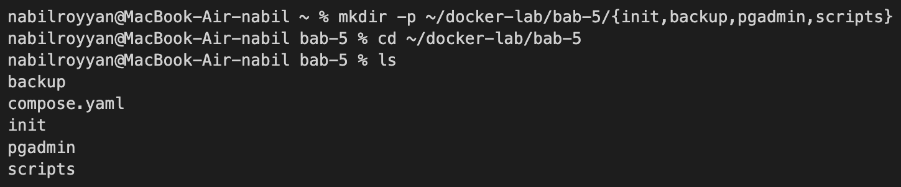

**Keterangan.** `mkdir -p` membuat folder `init`, `backup`, `pgadmin`, dan `scripts`. `ls` menampilkan isinya.

### 2. Berkas `.env.example`

```bash
nano .env.example
```

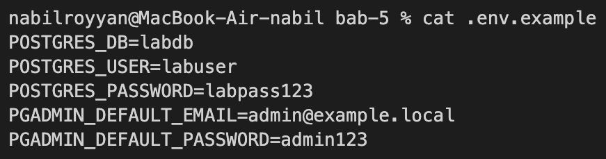

**Keterangan.** Template variabel: database, user, password PostgreSQL, serta email dan password default pgAdmin. Nilai ini sintetis untuk lab dan bukan secret manager.

### 3. Mengaktifkan `.env`

```bash
cp .env.example .env
chmod 600 .env
ls -l .env
```

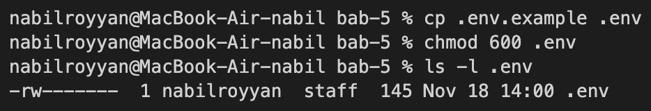

**Keterangan.** `.env` dibuat dari template dan permission-nya dibatasi ke `600` (`-rw-------`) agar credential tidak mudah dibaca pengguna lain.

### 4. Berkas `.gitignore`

```bash
nano .gitignore
```

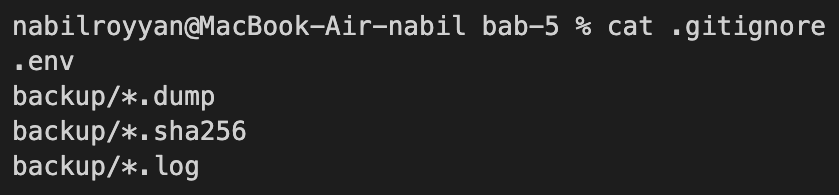

**Keterangan.** Mencegah `.env` serta berkas dump/checksum/log backup masuk ke repository Git.

### 5. Berkas `compose.yaml`

```bash
nano compose.yaml
```

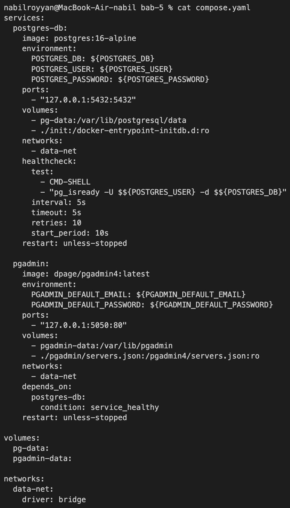

**Keterangan.** Service `postgres-db` (PostgreSQL 16) memakai named volume `pg-data`, memuat script dari `./init` read-only, mempublikasikan `127.0.0.1:5432`, dan memiliki healthcheck `pg_isready`. Service `pgadmin` memakai volume `pgadmin-data`, mempublikasikan `127.0.0.1:5050`, dan me-mount `servers.json`. Keduanya berada di jaringan `data-net`; `pgadmin` menunggu `postgres-db` sehat.

### 6. Berkas `init/01-schema.sql`

```bash
nano init/01-schema.sql
```

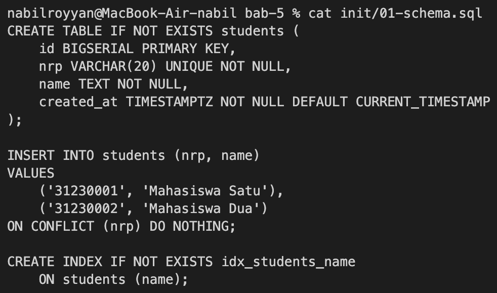

**Keterangan.** Membuat tabel `students` (`nrp` UNIQUE NOT NULL), menyisipkan dua baris data awal dengan `ON CONFLICT DO NOTHING`, dan membuat indeks pada kolom `name`. Script init hanya dijalankan PostgreSQL saat direktori data masih kosong (volume baru).

### 7. Berkas `pgadmin/servers.json`

```bash
nano pgadmin/servers.json
```

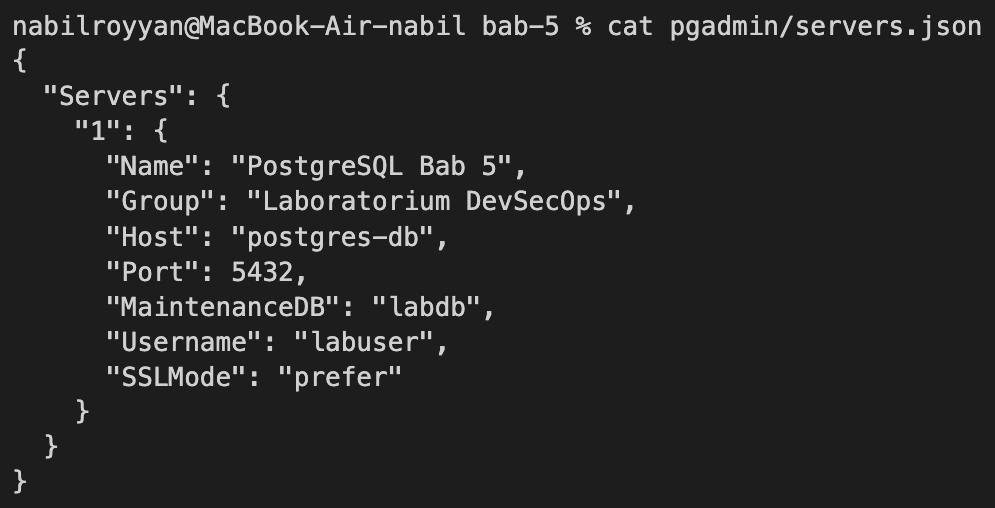

**Keterangan.** Mendaftarkan server PostgreSQL pada pgAdmin dengan `Host: postgres-db` (nama service Compose, bukan `localhost`) karena pgAdmin berjalan di container berbeda. Password tidak ditulis di file ini.

### 8. Berkas `scripts/backup.sh`

```bash
nano scripts/backup.sh
```

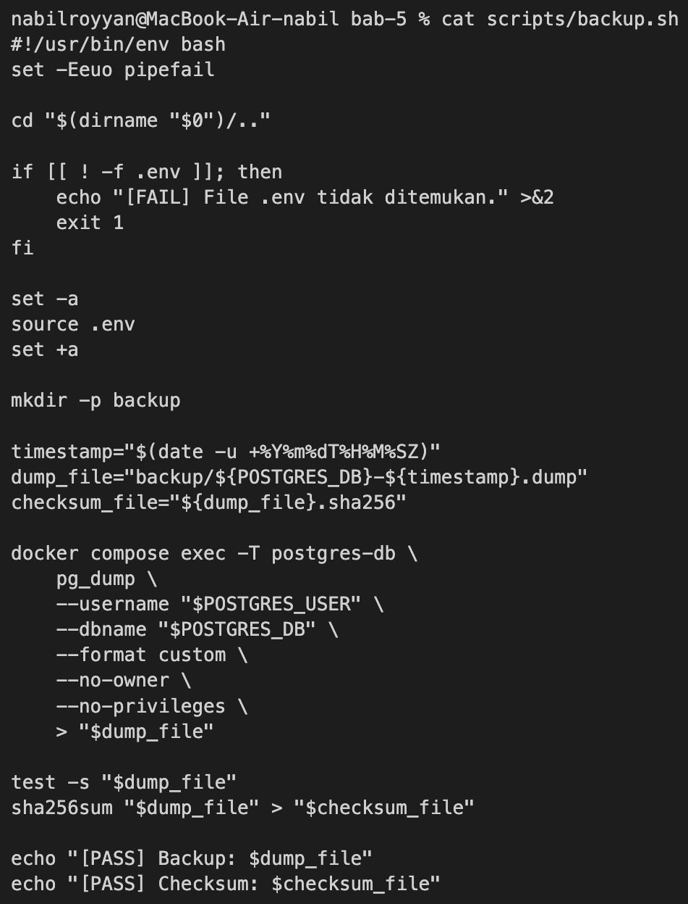

**Keterangan.** Script membuat logical backup dengan `pg_dump --format custom`, memastikan dump tidak kosong (`test -s`), lalu menulis checksum `sha256sum`. Menggunakan `docker compose exec` sehingga tidak bergantung nama container dinamis.

### 9. Berkas `scripts/restore-test.sh`

```bash
nano scripts/restore-test.sh
```

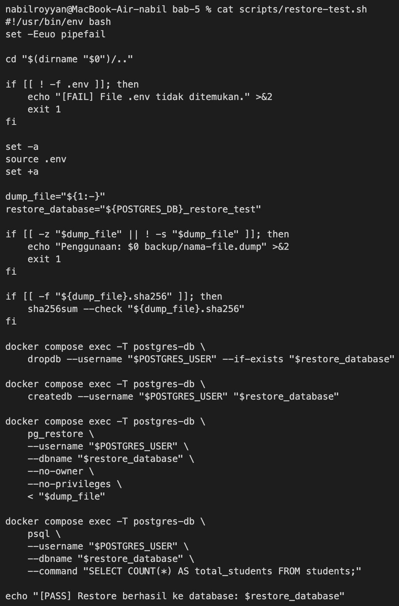

**Keterangan.** Script memverifikasi checksum, membuat database terpisah `labdb_restore_test`, menjalankan `pg_restore`, lalu menghitung jumlah baris. Restore **tidak** ditimpakan ke `labdb` agar data aktif aman.

### 10. Memberi Izin Eksekusi

```bash
chmod +x scripts/backup.sh scripts/restore-test.sh
ls -l scripts
```

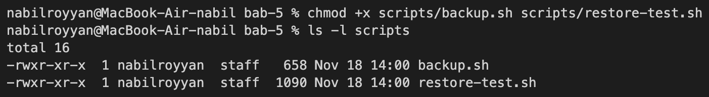

**Keterangan.** Menjadikan kedua script executable (`-rwxr-xr-x`).

### 11. Memeriksa Daftar Berkas

```bash
find . -maxdepth 3 -type f | sort
```

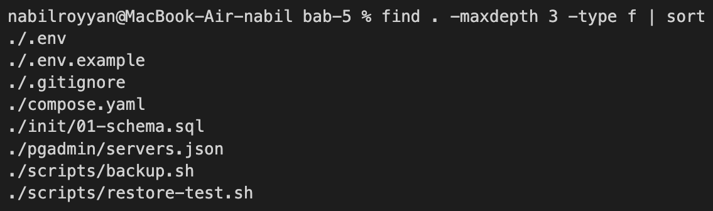

**Keterangan.** Menampilkan seluruh berkas hingga kedalaman tiga folder untuk memastikan struktur lengkap.

### 12. Memvalidasi Compose

```bash
docker compose config
```

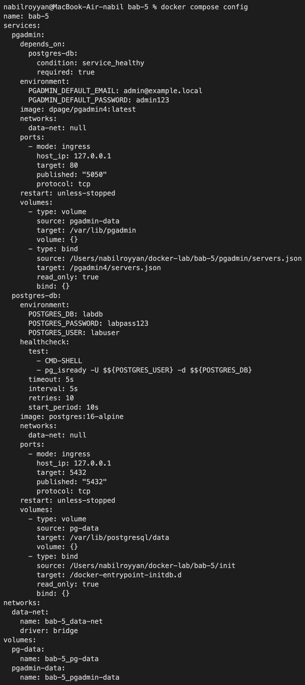

**Keterangan.** Menampilkan konfigurasi akhir hasil interpolasi `.env` tanpa galat.

### 13. Menampilkan Daftar Service

```bash
docker compose config --services
```

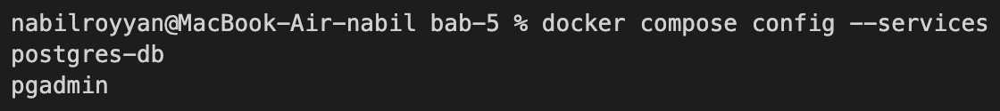

**Keterangan.** Menampilkan service `pgadmin` dan `postgres-db`.

### 14. Menjalankan Stack

```bash
docker compose up -d
```

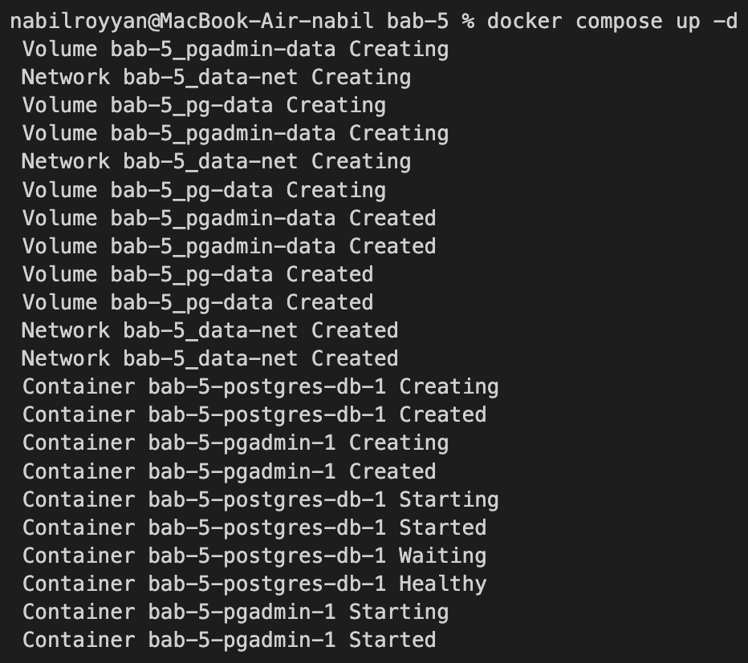

**Keterangan.** Membuat volume `pg-data` dan `pgadmin-data`, jaringan `data-net`, lalu menjalankan container. PostgreSQL mencapai `Healthy` sebelum pgAdmin dijalankan.

### 15. Status Container

```bash
docker compose ps
```


**Keterangan.** `postgres-db` berstatus `Up (healthy)` dengan port `127.0.0.1:5432`. Namun `pgadmin` berstatus **`Restarting (1)`** — kegagalan yang didiagnosis pada subbab 27.

### 16. Melihat Log

```bash
docker compose logs --tail 100
```

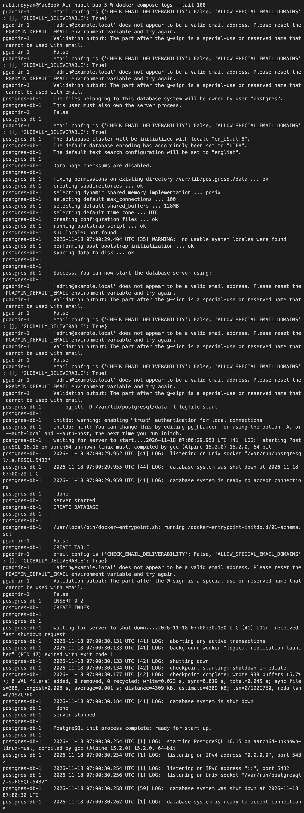

**Keterangan.** Menampilkan log kedua service. Log PostgreSQL memperlihatkan inisialisasi dan pembuatan tabel; log pgAdmin memperlihatkan pesan kegagalan validasi email yang diulang.

### 17. Memeriksa Tabel

```bash
docker compose exec -T postgres-db psql -U labuser -d labdb -c "\dt"
```

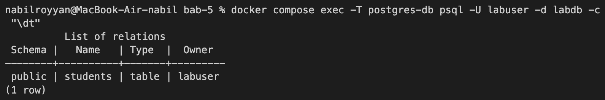

**Keterangan.** Script init berhasil; tabel `students` ada pada schema `public`.

### 18. Melihat Data Awal

```bash
docker compose exec -T postgres-db psql -U labuser -d labdb -c "SELECT id, nrp, name, created_at FROM students ORDER BY id;"
```

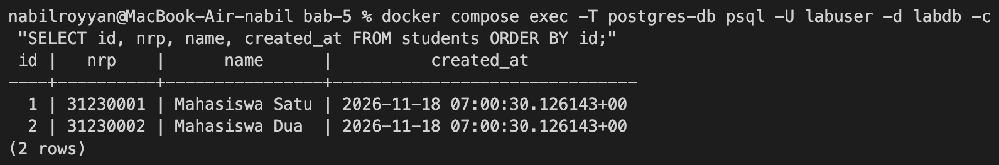

**Keterangan.** Dua baris data awal (`31230001`, `31230002`) tersedia sesuai script init.

### 19. Menambah Data

```bash
docker compose exec -T postgres-db psql -U labuser -d labdb -c "INSERT INTO students(nrp, name) VALUES ('31230003', 'Mahasiswa Tiga') ON CONFLICT DO NOTHING;"
```

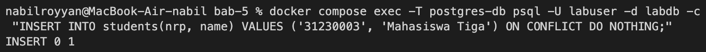

**Keterangan.** Menyisipkan satu record baru untuk menguji persistensi.

### 20. Menguji Persistensi Volume

```bash
docker compose down
docker compose up -d
docker compose exec -T postgres-db psql -U labuser -d labdb -c "SELECT nrp, name FROM students ORDER BY nrp;"
```

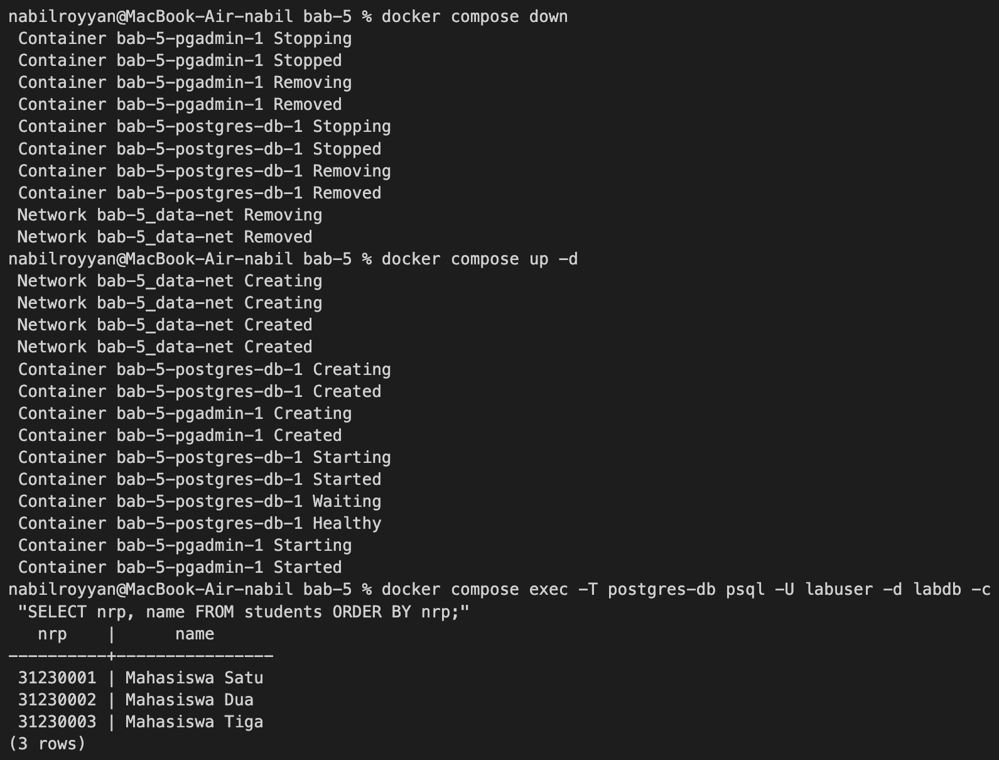

**Keterangan.** Setelah container dibuat ulang **tanpa** menghapus volume, record `31230003` tetap ada. Ini membuktikan data tersimpan pada named volume `pg-data`, bukan pada layer container.

### 21. Backup

```bash
./scripts/backup.sh
ls -lh backup/
sha256sum --check backup/*.dump.sha256
```

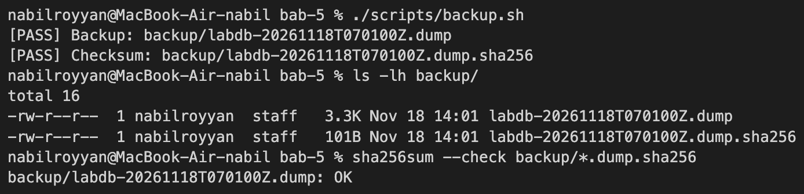

**Keterangan.** Dump dibuat (>0 byte, ~3.3K), checksum dihitung, dan verifikasi checksum bernilai `OK`. Backup dinyatakan sah bukan hanya karena file ada, tetapi karena ukurannya valid dan checksum cocok.

### 22. Restore Test

```bash
latest_dump="$(find backup -maxdepth 1 -name '*.dump' -type f | sort | tail -n 1)"
./scripts/restore-test.sh "$latest_dump"
```

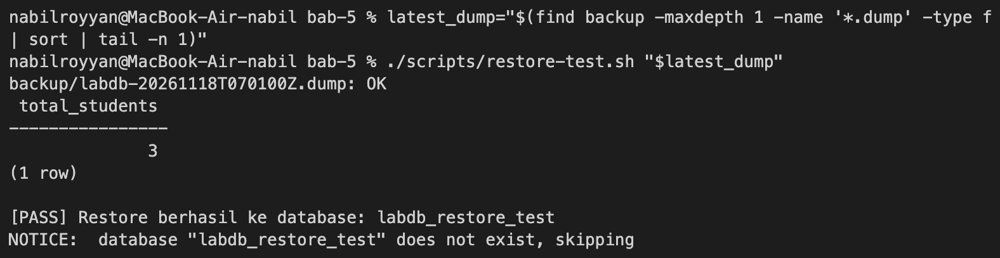

**Keterangan.** Checksum diverifikasi lebih dulu, lalu dump dipulihkan ke database `labdb_restore_test` yang terpisah. Hasil `total_students = 3` dan pesan `[PASS]`.

### 23. Verifikasi Hasil Restore

```bash
docker compose exec -T postgres-db psql -U labuser -d labdb_restore_test -c "SELECT nrp, name FROM students ORDER BY nrp;"
```

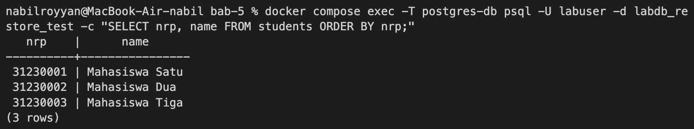

**Keterangan.** Ketiga record (termasuk `31230003`) ada pada database hasil restore — bukti backup dapat dipulihkan dan tidak sekadar ada.

### 24. Status Stack

```bash
docker compose ps
```

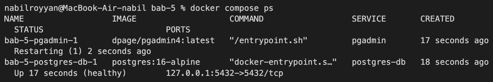

**Keterangan.** PostgreSQL tetap sehat dengan published port lokal.

### 25. Log PostgreSQL

```bash
docker compose logs postgres-db --tail 100
```

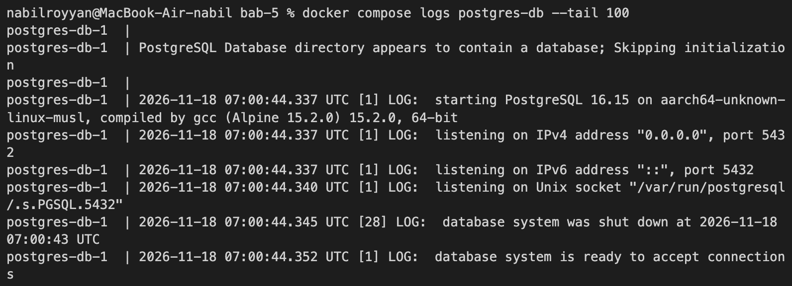

**Keterangan.** Log terakhir menunjukkan database siap menerima koneksi.

### 26. Monitoring Dasar

```bash
docker compose exec -T postgres-db pg_isready -U labuser -d labdb
docker compose exec -T postgres-db psql -U labuser -d labdb -c "SELECT version();"
docker volume ls
```

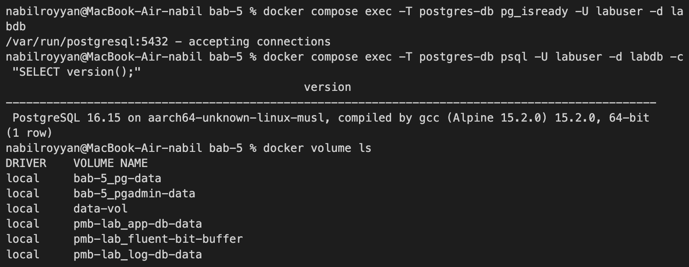

**Keterangan.** `pg_isready` menyatakan PostgreSQL menerima koneksi, `SELECT version();` menampilkan versi server, dan `docker volume ls` menampilkan volume project.

### 27. Diagnosis Kegagalan pgAdmin

```bash
docker compose ps
docker compose logs pgadmin --tail 25
```

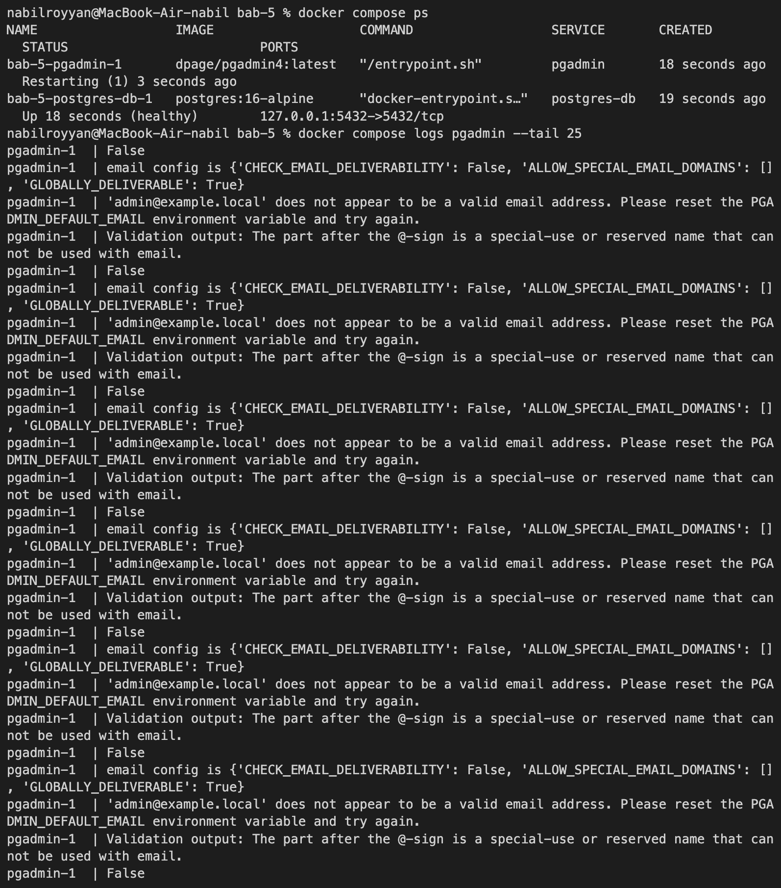

**Keterangan.** Ditemukan akar masalah: pgAdmin menolak `PGADMIN_DEFAULT_EMAIL=admin@example.local` dengan pesan `'admin@example.local' does not appear to be a valid email address ... The part after the @-sign is a special-use or reserved name`. Domain `.local` (RFC 6762) tidak dianggap valid, sehingga container masuk crash-loop `Restarting (1)`.

### 28. Perbaikan pgAdmin

```bash
sed -i '' 's/@example.local/@example.com/' .env .env.example
docker compose up -d pgadmin
docker compose ps
curl -s -o /dev/null -w 'HTTP %{http_code}\n' http://localhost:5050/login
```

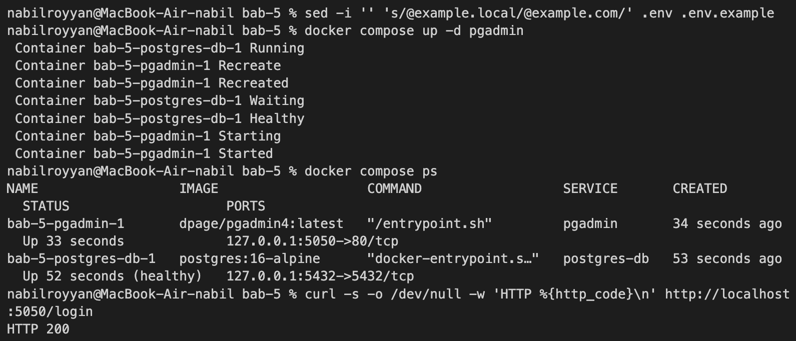

**Keterangan.** Email diubah menjadi `admin@example.com` yang valid, container pgAdmin dibuat ulang dan sekarang berstatus `Up` dengan port `127.0.0.1:5050->80/tcp`. Endpoint login mengembalikan `HTTP 200`, membuktikan pgAdmin berjalan. Dengan `Host: postgres-db` pada `servers.json`, pgAdmin kini dapat menjangkau database.

### 29. Cleanup — Hentikan Container

```bash
docker compose down
```

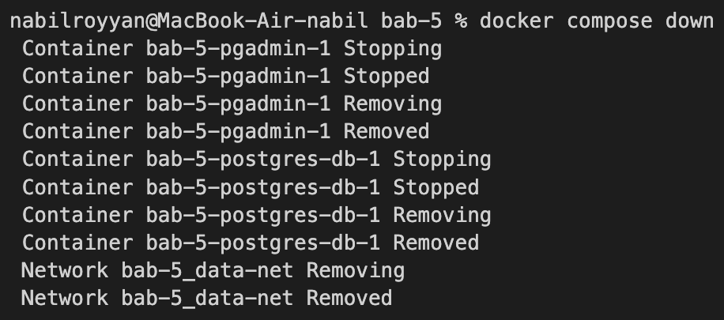

**Keterangan.** Container dan network dihapus, data pada volume tetap dipertahankan.

### 30. Cleanup — Hapus Database Uji

```bash
docker compose up -d postgres-db
docker compose exec -T postgres-db dropdb -U labuser --if-exists labdb_restore_test
```

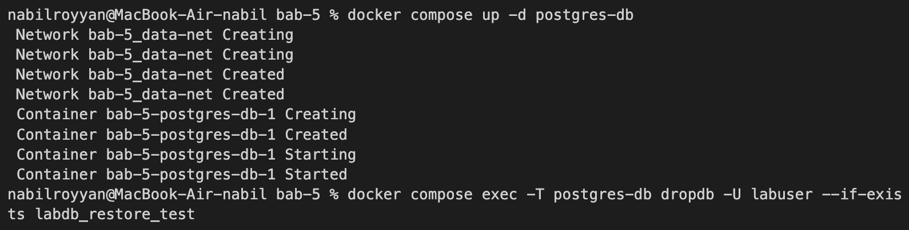

**Keterangan.** Database hasil restore-test dihapus karena bersifat sementara.

### 31. Cleanup — Hapus Volume

```bash
docker compose down -v
```

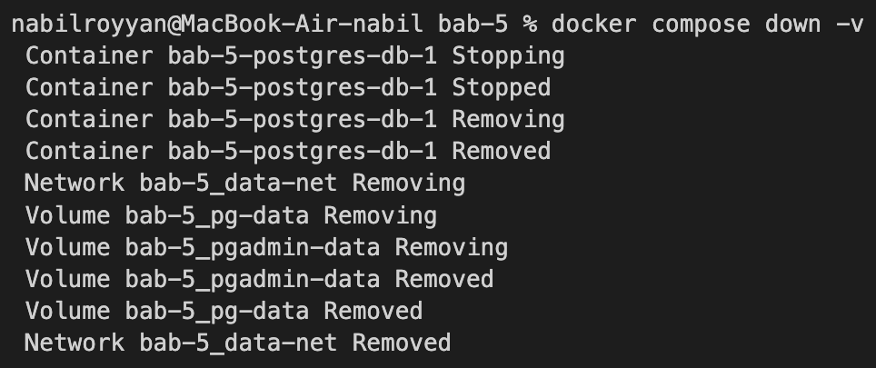

**Keterangan.** Volume `pg-data` dan `pgadmin-data` dihapus. Perintah ini destruktif dan hanya dijalankan karena data laboratorium tidak lagi diperlukan.

## Hasil Uji Penerimaan

| Pemeriksaan | Hasil pada laporan |
| --- | --- |
| `docker compose config` valid | Lulus |
| PostgreSQL berstatus healthy | Lulus |
| Tabel `students` dan data awal tersedia | Lulus |
| pgAdmin berjalan | Gagal pada konfigurasi awal (email `.local` ditolak), lulus setelah diperbaiki |
| Data bertahan setelah `down` lalu `up` | Lulus |
| Backup tidak kosong | Lulus (~3.3K) |
| Checksum backup valid | Lulus |
| Restore ke `labdb_restore_test` | Lulus, 3 record |
| Isi hasil restore sesuai sumber | Lulus |
| Credential dan dump tidak masuk repo | Lulus (`.gitignore`) |

## Analisis dan Evaluasi

**Persistensi dan keamanan data.** Named volume memisahkan data dari lifecycle container: `docker compose down` aman, sedangkan `down -v` menghapus data. Pemisahan restore-test ke database berbeda mencegah uji restore merusak data aktif.

**Backup yang dapat dipercaya.** Keberadaan file tidak cukup; ukuran > 0, checksum, dan uji restore harus dibuktikan. Checksum mendeteksi korupsi, dan restore-test membuktikan dump benar-benar dapat dipulihkan.

**Validasi konfigurasi pihak ketiga.** Kegagalan pgAdmin menunjukkan bahwa nilai yang "terlihat wajar" (`admin@example.local`) dapat ditolak oleh validasi pihak ketiga. Diagnosis dilakukan dengan membaca log container, bukan menebak. Pelajaran: periksa output `docker compose ps` dan `logs` saat container tidak stabil.

**Risiko keamanan.** Published port PostgreSQL dibatasi ke `127.0.0.1`. Untuk lingkungan mirip produksi: hapus published port database, gunakan secret manager untuk password, jalankan pgAdmin di belakang proxy dengan TLS, dan ganti seluruh credential contoh.

## Rangkuman

PostgreSQL dalam container dapat dijalankan dengan volume persisten, diinisialisasi otomatis lewat script, dan dikelola lewat pgAdmin. Backup `pg_dump` beserta checksum dan uji restore membentuk alur pemulihan yang dapat dibuktikan. Dua temuan nyata — halaman statis Bab 3 dan validasi email pgAdmin — menegaskan pentingnya menjalankan dan memeriksa setiap langkah, bukan mengandalkannya begitu saja.
