# LAPORAN BAB 6

## Centralized Logging dengan Fluent Bit dan PostgreSQL

**Mata Kuliah:** DevOps  
**Nama:** MUHAMMAD NABIL ROYYAN
**NRP:** 3126640032 

## Pendahuluan

*Centralized logging* adalah pendekatan mengumpulkan log dari banyak sumber ke satu tempat penyimpanan terpusat agar mudah dicari, dianalisis, dan diaudit. Pada praktikum ini, log dari tiga container generator dikirim oleh Docker *logging driver* `fluentd` ke **Fluent Bit**, lalu disimpan pada **PostgreSQL** dalam kolom bertipe **JSONB**. Laporan mengikuti `cheatsheets/bab-06-cs.md` dan dijalankan pada Terminal macOS di `~/docker-lab/bab-6`.

Catatan penting: yang menjalankan logging driver adalah **Docker Engine**, bukan container generator, sehingga `fluentd-address` menunjuk port yang dipublikasikan di host (`127.0.0.1:24224`). PostgreSQL tidak dipublikasikan ke host dan hanya dijangkau Fluent Bit lewat jaringan internal `logging-net`.

## Laporan Praktikum

### 1. Menyiapkan Direktori Bab 6

```bash
mkdir -p ~/docker-lab/bab-6/{init,fluent-bit,queries,scripts}
cd ~/docker-lab/bab-6
ls
```

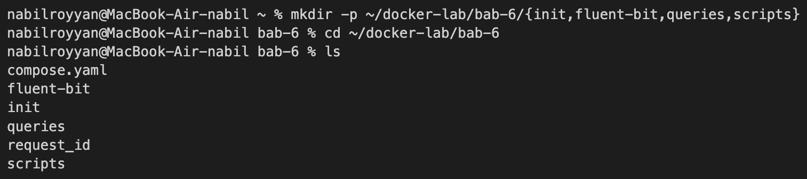

**Keterangan.** Membuat folder `init`, `fluent-bit`, `queries`, dan `scripts` lalu masuk ke direktori kerja.

### 2. Berkas `.env.example`

```bash
nano .env.example
```

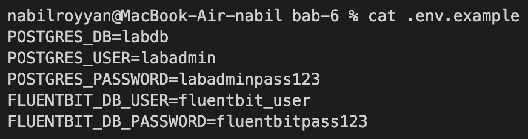

**Keterangan.** Template variabel: database dan admin PostgreSQL (`labdb`/`labadmin`), serta akun ingest Fluent Bit (`fluentbit_user`). `.env` bukan secret manager dan nilai ini hanya untuk lab.

### 3. Mengaktifkan `.env`

```bash
cp .env.example .env
chmod 600 .env
ls -l .env
```

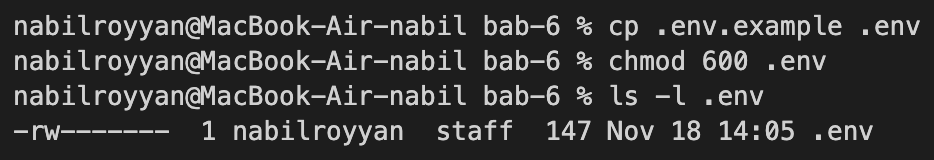

**Keterangan.** `.env` dibuat dari template dengan permission `600` agar credential tidak mudah dibaca.

### 4. Berkas `.gitignore`

```bash
nano .gitignore
```

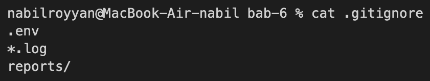

**Keterangan.** Mencegah `.env`, berkas log, dan folder `reports/` masuk repository.

### 5. Berkas `compose.yaml`

```bash
nano compose.yaml
```

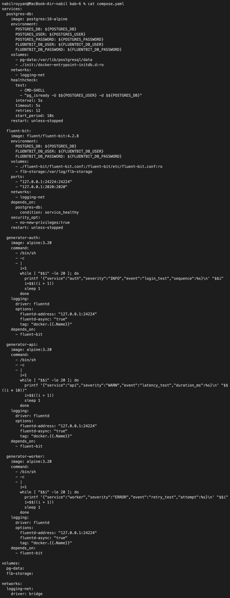

**Keterangan.** Lima service: `postgres-db` (volume `pg-data`, init script, healthcheck `pg_isready`, tanpa published port), `fluent-bit` (konfigurasi read-only, volume buffer `flb-storage`, port loopback `24224` dan `2020`, `no-new-privileges`), serta tiga generator `alpine:3.20` yang mencetak satu baris JSON per detik dan mengirim log lewat driver `fluentd` (`fluentd-async: "true"`, `tag: "docker.{{.Name}}"`).

### 6. Berkas `init/01-init-logging.sh`

```bash
nano init/01-init-logging.sh
```

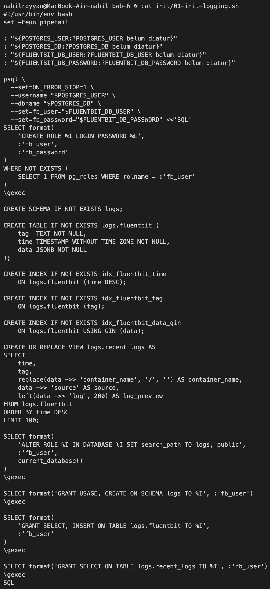

**Keterangan.** Skrip init yang dijalankan PostgreSQL saat volume masih kosong. Skrip memvalidasi variabel, membuat role Fluent Bit (`CREATE ROLE ... LOGIN PASSWORD` dengan `format()` dan `\gexec`), membuat schema `logs` dan tabel `logs.fluentbit` (`tag TEXT`, `time TIMESTAMP`, `data JSONB`), membuat tiga indeks (termasuk GIN pada JSONB), membuat view `logs.recent_logs`, serta mengatur `search_path` dan GRANT.

### 7. Berkas `fluent-bit/fluent-bit.conf`

```bash
nano fluent-bit/fluent-bit.conf
```

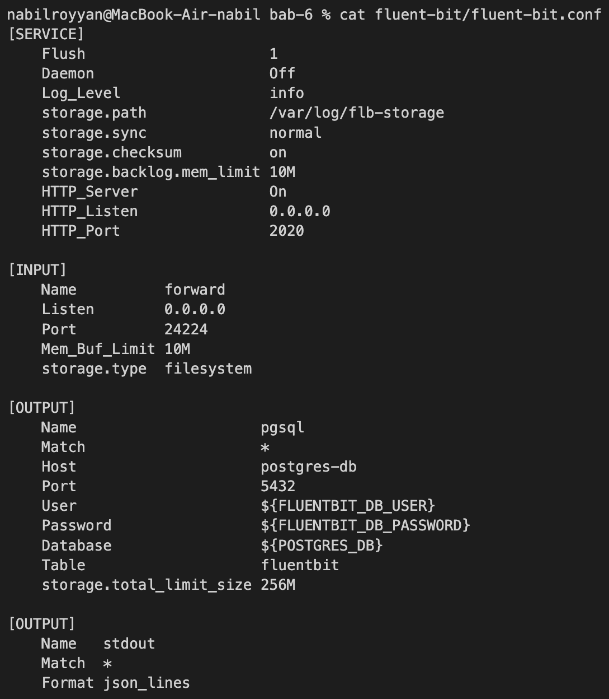

**Keterangan.** `[SERVICE]` mengaktifkan buffer filesystem, checksum, dan HTTP server monitoring di port 2020. `[INPUT] forward` menerima protokol Forward pada port 24224 dengan `storage.type filesystem`. `[OUTPUT] pgsql` menulis ke `postgres-db:5432` tabel `fluentbit` dengan akun Fluent Bit. `[OUTPUT] stdout` menambah jalur observasi.

### 8. Berkas `queries/analysis.sql`

```bash
nano queries/analysis.sql
```

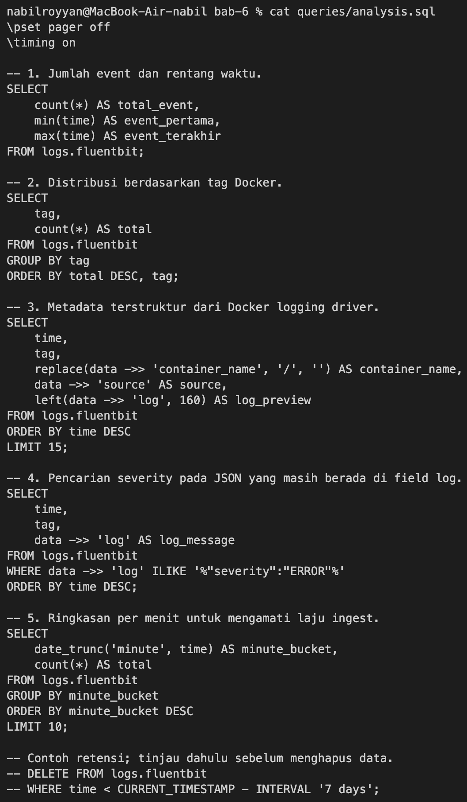

**Keterangan.** Lima query analisis: jumlah event & rentang waktu, distribusi per tag, metadata terstruktur, pencarian severity `ERROR`, dan laju ingest per menit, plus contoh query retensi yang dikomentari.

### 9. Berkas `scripts/generate-logs.sh`

```bash
nano scripts/generate-logs.sh
```

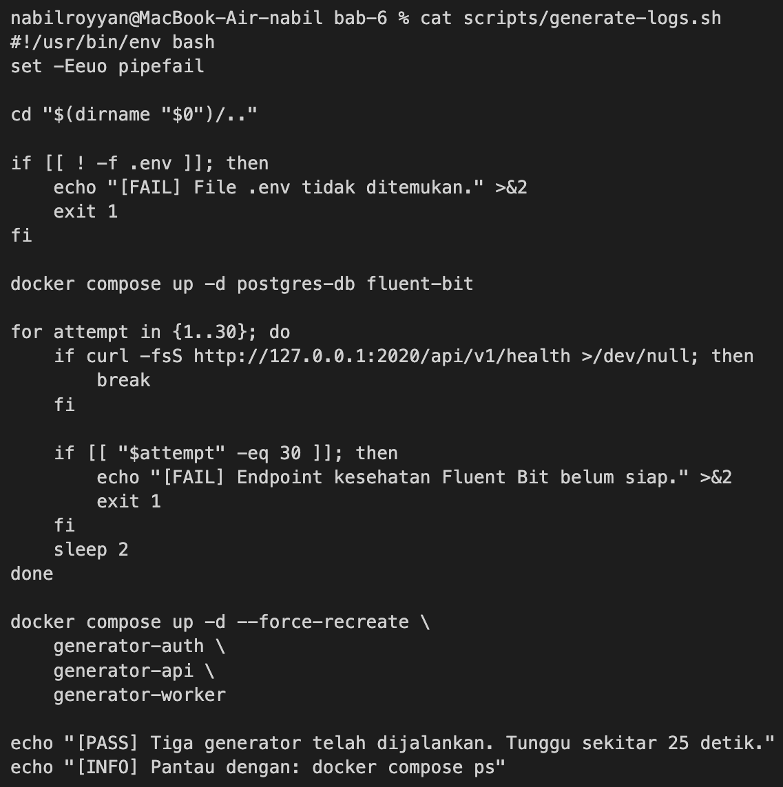

**Keterangan.** Menjalankan `postgres-db` dan `fluent-bit`, menunggu endpoint kesehatan Fluent Bit siap, lalu menjalankan ulang ketiga generator dengan `--force-recreate` agar menghasilkan event baru.

### 10. Berkas `scripts/test-buffering.sh`

```bash
nano scripts/test-buffering.sh
```

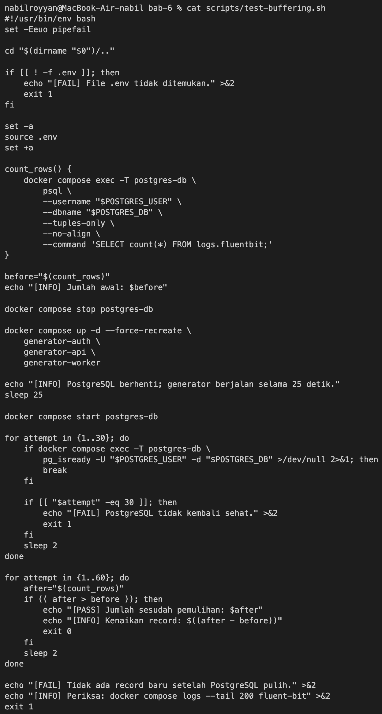

**Keterangan.** Menghitung jumlah record awal, menghentikan PostgreSQL, menjalankan generator saat database mati (±25 detik), menyalakan kembali PostgreSQL, lalu memantau kenaikan jumlah record. Membuktikan Fluent Bit menahan event di buffer lalu mengirimkannya setelah backend pulih.

### 11. Memberi Izin Eksekusi

```bash
chmod +x init/01-init-logging.sh
chmod +x scripts/generate-logs.sh scripts/test-buffering.sh
ls -l init scripts
```

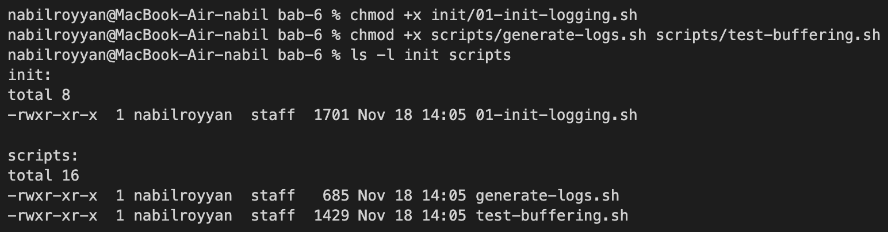

**Keterangan.** Ketiga skrip dijadikan executable.

### 12. Validasi Sintaks Skrip

```bash
bash -n init/01-init-logging.sh && echo 'init/01-init-logging.sh OK'
bash -n scripts/generate-logs.sh && echo 'generate-logs.sh OK'
bash -n scripts/test-buffering.sh && echo 'test-buffering.sh OK'
```

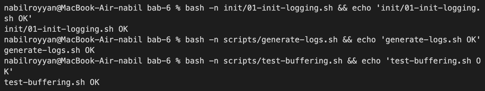

**Keterangan.** `bash -n` memeriksa sintaks tanpa menjalankan; tidak ada galat pada ketiga skrip.

### 13. Validasi Konfigurasi Compose

```bash
docker compose config --quiet; echo "exit=$?"
docker compose config --services
```

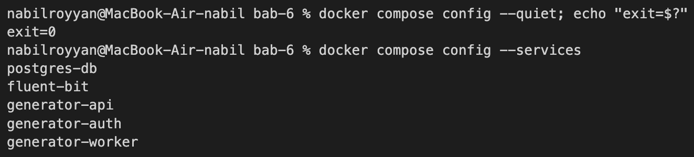

**Keterangan.** `config --quiet` mengembalikan `exit=0` (YAML dan interpolasi valid). `config --services` menampilkan kelima service: `fluent-bit`, `generator-api`, `generator-auth`, `generator-worker`, dan `postgres-db`.

### 14. Menjalankan PostgreSQL dan Fluent Bit

```bash
docker compose up -d postgres-db fluent-bit
```

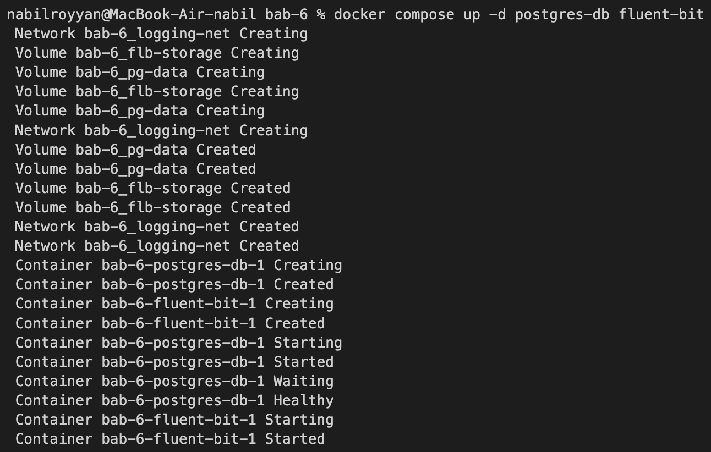

**Keterangan.** Menjalankan PostgreSQL dan Fluent Bit. PostgreSQL mencapai `Healthy` lebih dulu karena `depends_on` pada Fluent Bit.

### 15. Log Startup Fluent Bit

```bash
docker compose logs --tail 100 fluent-bit
```

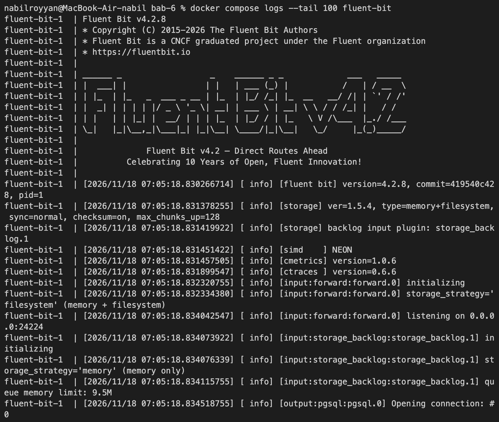

**Keterangan.** Fluent Bit v4.2.8 berjalan, storage `memory+filesystem` aktif, input `forward` mendengarkan pada `0.0.0.0:24224`, dan output `pgsql` membuka koneksi. Tidak ada galat plugin.

### 16. Menjalankan Generator Log

```bash
./scripts/generate-logs.sh
```

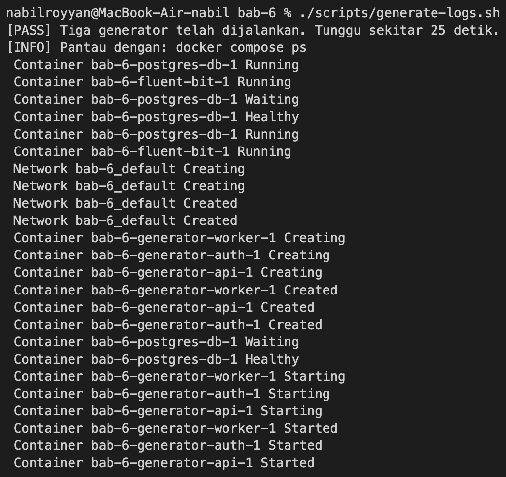

**Keterangan.** Skrip menunggu endpoint kesehatan Fluent Bit lalu membuat ulang ketiga generator; dicetak `[PASS] Tiga generator telah dijalankan`.

### 17. Status Semua Container

```bash
docker compose ps --all
```

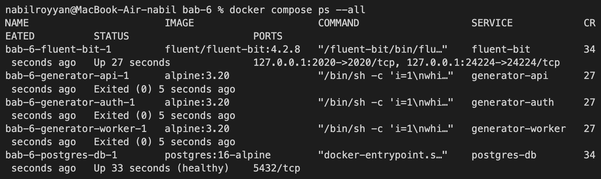

**Keterangan.** `fluent-bit` dan `postgres-db (healthy)` berstatus `Up`, sedangkan ketiga generator berstatus `Exited (0)` — normal karena generator selesai setelah ±20 detik.

### 18. Monitoring Fluent Bit — Health

```bash
curl -fsS http://127.0.0.1:2020/api/v1/health
```

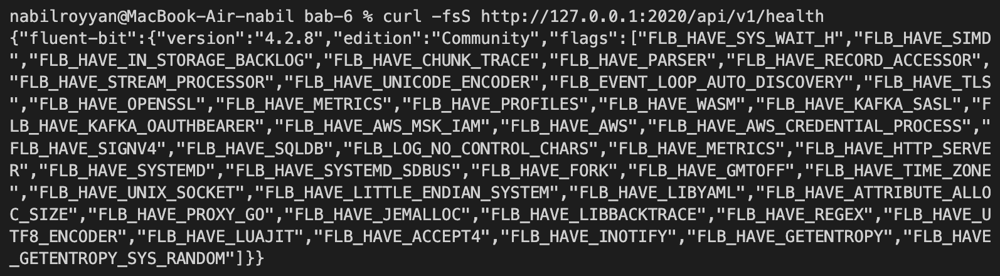

**Keterangan.** Endpoint kesehatan mengembalikan JSON berisi versi 4.2.8 dan daftar kemampuan build, menandakan collector sehat.

### 19. Monitoring Fluent Bit — Metrics

```bash
curl -fsS http://127.0.0.1:2020/api/v1/metrics
```

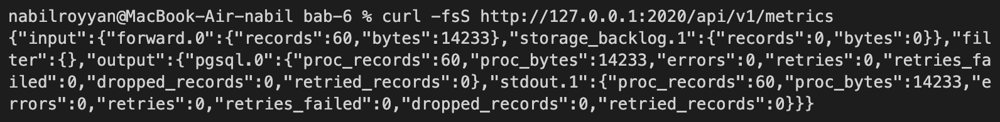

**Keterangan.** Menampilkan metrik input/output (jumlah record, retry, galat). Endpoint hanya diikat ke loopback sehingga tidak terbuka ke jaringan.

### 20. Analisis Record dengan `analysis.sql`

```bash
set -a; source .env; set +a
docker compose exec -T postgres-db psql --username "$POSTGRES_USER" --dbname "$POSTGRES_DB" --file /dev/stdin < queries/analysis.sql
```

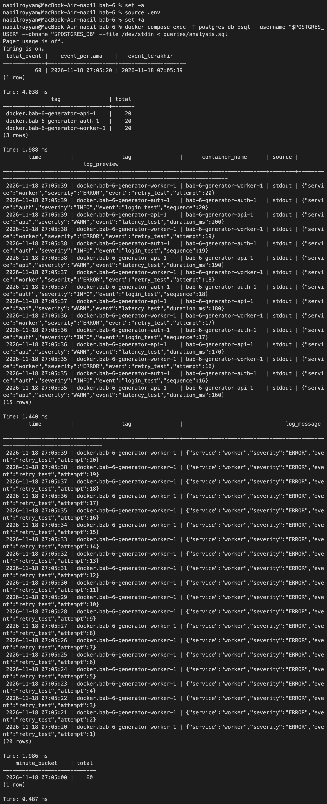

**Keterangan.** Terlihat total 60 event dalam rentang 07:05:20–07:05:39, distribusi merata 20 per tag (`generator-api`, `generator-auth`, `generator-worker`), metadata `container_name`/`source`/`log_preview` terisi, pencarian severity `ERROR` mengembalikan 20 baris `generator-worker`, dan laju ingest per menit sebesar 60.

### 21. View `logs.recent_logs`

```bash
set -a; source .env; set +a
docker compose exec -T postgres-db psql --username "$POSTGRES_USER" --dbname "$POSTGRES_DB" --command "TABLE logs.recent_logs;"
```

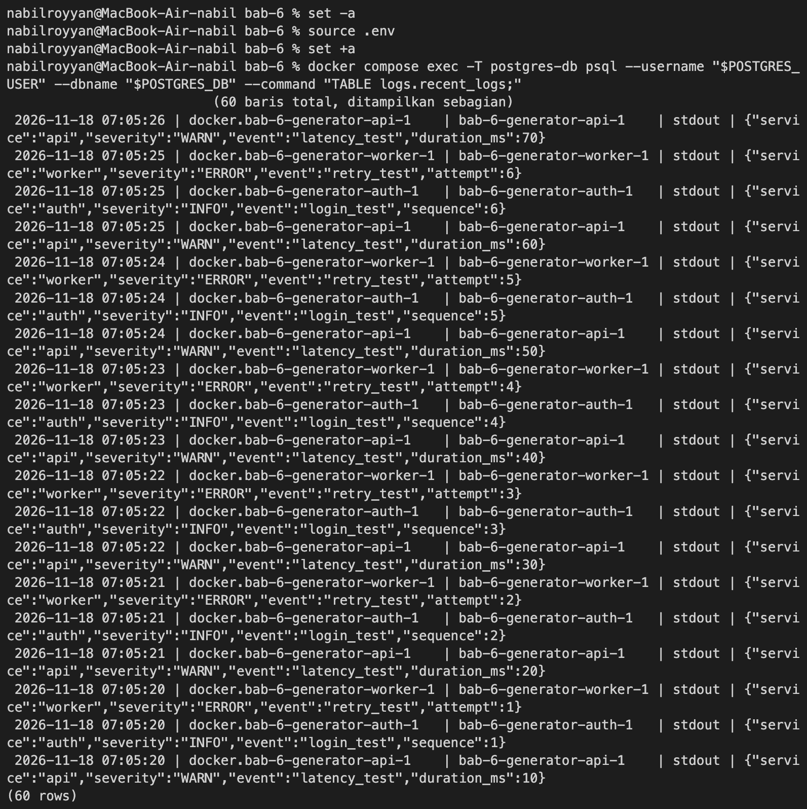

**Keterangan.** View menyajikan 100 log terbaru (di sini 60 baris) dengan kolom yang mudah dibaca; ditampilkan sebagian.

### 22. Verifikasi Tipe JSONB

```bash
set -a; source .env; set +a
docker compose exec -T postgres-db psql --username "$POSTGRES_USER" --dbname "$POSTGRES_DB" --command "SELECT pg_typeof(data), count(*) FROM logs.fluentbit GROUP BY pg_typeof(data);"
```

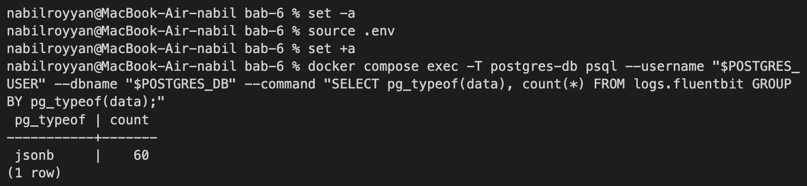

**Keterangan.** `pg_typeof(data)` bernilai `jsonb` untuk 60 record — kolom log tersimpan sebagai JSONB sesuai kontrak plugin.

### 23. Uji Buffering dan Pemulihan

```bash
./scripts/test-buffering.sh
```

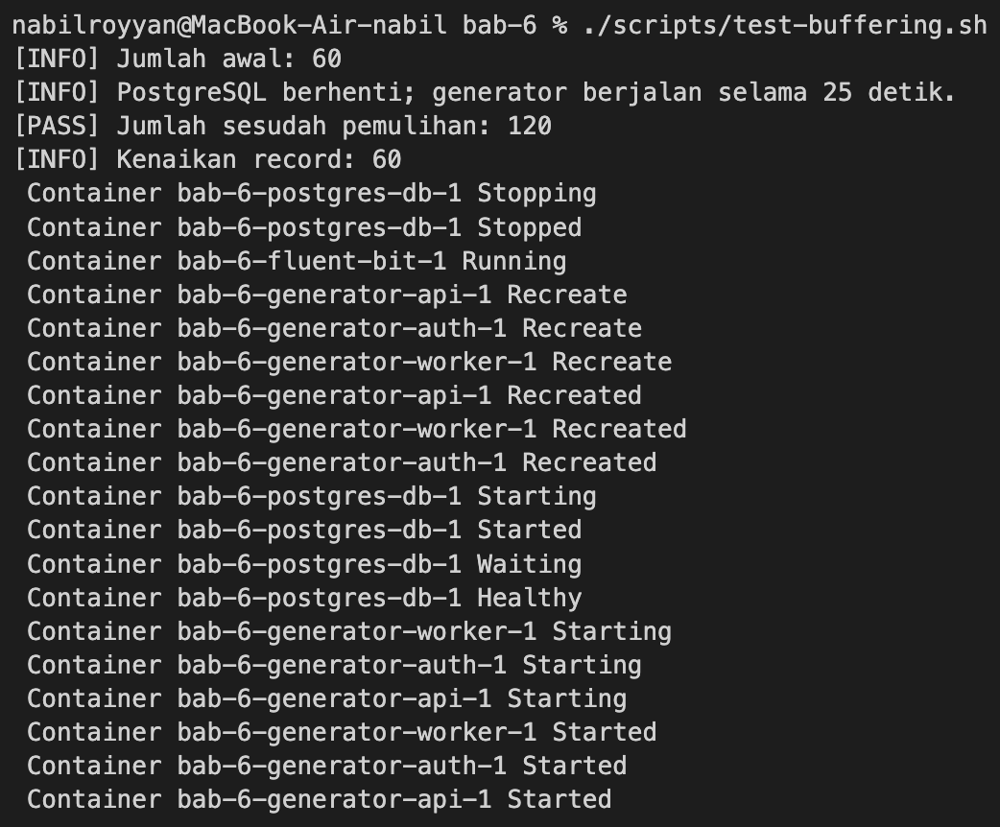

**Keterangan.** Jumlah awal 60 record. Setelah PostgreSQL dihentikan, generator berjalan 25 detik, lalu PostgreSQL dinyalakan kembali. Hasilnya `[PASS] Jumlah sesudah pemulihan: 120` dengan kenaikan 60 record — Fluent Bit menahan event selama backend mati dan mengirimkannya setelah pulih. Ini membuktikan pemulihan skala lab, **bukan** jaminan *exactly-once*.

### 24. Log Fluent Bit Setelah Uji

```bash
docker compose logs --tail 200 fluent-bit
```

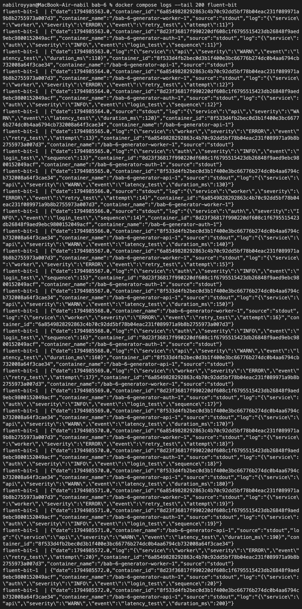

**Keterangan.** Log menunjukkan retry koneksi output saat PostgreSQL berhenti lalu kembali normal setelah pulih. Ditampilkan sebagian.

### 25. Daftar Volume

```bash
docker volume ls
```

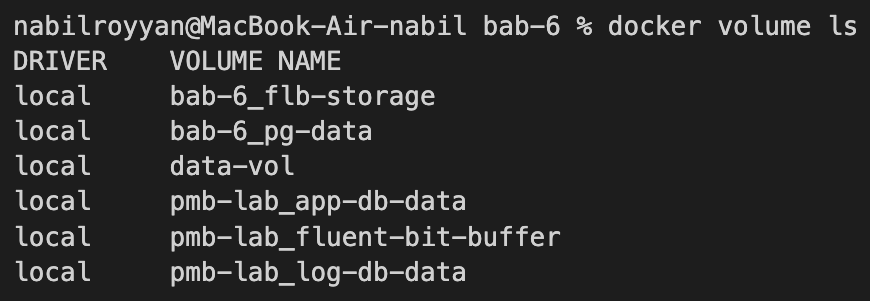

**Keterangan.** Terlihat volume `bab-6_pg-data` (data PostgreSQL) dan `bab-6_flb-storage` (buffer backlog Fluent Bit).

### 26. Cleanup — Hentikan Container

```bash
docker compose down --remove-orphans
```

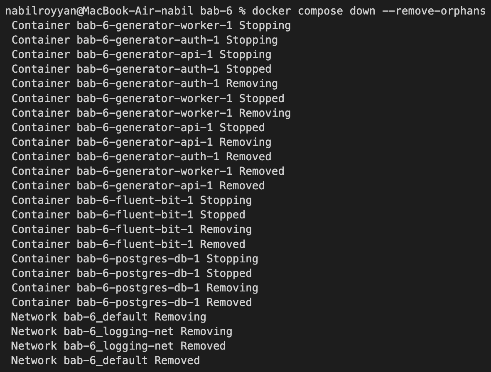

**Keterangan.** Menghentikan dan menghapus container serta network tanpa menghapus volume.

### 27. Cleanup — Hapus Volume

```bash
docker compose down --volumes --remove-orphans
```

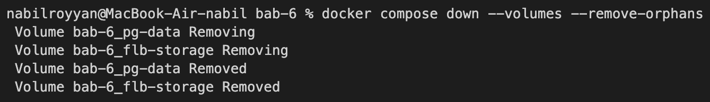

**Keterangan.** Menghapus volume `pg-data` dan `flb-storage`. Perintah destruktif, dijalankan setelah evidence tersimpan.

## Hasil Uji Penerimaan

| No. | Skenario | Evidence | Hasil |
|---:|---|---|---|
| 1 | Validasi Compose | `docker compose config --quiet` | Lulus (exit 0) |
| 2 | Kesehatan backend | `docker compose ps` | PostgreSQL `healthy` |
| 3 | Kesehatan collector | `/api/v1/health` | HTTP 2xx |
| 4 | Tiga sumber log | `GROUP BY tag` | 3 tag, 20 masing-masing |
| 5 | Struktur record | Query metadata | `container_name`, `source`, `log` terisi |
| 6 | Penyimpanan JSONB | `pg_typeof(data)` | `jsonb` (60 record) |
| 7 | Pemulihan output | `test-buffering.sh` | `[PASS]` 60 → 120 |
| 8 | Pembatasan jaringan | tidak ada published port | Hanya internal `logging-net` |

## Analisis dan Evaluasi

**Alur pipeline.** Docker Engine (bukan container) mengirim log generator lewat driver `fluentd` ke port 24224 host, diterima Fluent Bit, lalu ditulis ke PostgreSQL dalam kolom JSONB. Metadata Docker (`container_name`, `source`) tersimpan terstruktur, sedangkan pesan aplikasi JSON masih berupa string di `data.log`.

**Ketahanan buffering.** Saat PostgreSQL berhenti, Fluent Bit menahan event pada buffer filesystem (`flb-storage`) dan melakukan retry. Setelah backend pulih, seluruh 60 event baru tersimpan. Namun sifatnya *at-least-once*: retry dapat menduplikasi, dan buffer penuh/disk gagal tetap dapat menghilangkan event.

**Observabilitas dan keamanan.** Endpoint monitoring Fluent Bit (2020) dan input Forward (24224) hanya diikat ke `127.0.0.1`. PostgreSQL tanpa published port. Untuk produksi: aktifkan TLS pada Forward, pisahkan proses bootstrap schema dari akun ingest, gunakan secret manager, dan siapkan kebijakan retensi.

## Rangkuman

Pipeline centralized logging Fluent Bit → PostgreSQL berhasil dibangun dan dibuktikan end-to-end pada Docker Desktop macOS: 60 record terekam sebagai JSONB, tiga sumber log terdistribusi merata, dan mekanisme buffering memulihkan 60 event tambahan setelah PostgreSQL sempat mati. Praktikum menegaskan pentingnya evidence terukur (jumlah baris, tipe kolom, kenaikan record) alih-alih sekadar ketiadaan pesan galat.
