# LAPORAN BAB 7

## Monitoring Resource dengan Prometheus, cAdvisor, Node Exporter, dan Grafana

**Mata Kuliah:** DevOps  
**Nama:** MUHAMMAD NABIL ROYYAN
**NRP:** 3126640032 

## Pendahuluan

Bab ini membangun stack monitoring: **Prometheus** sebagai penyimpan time series, **Node Exporter** dan **cAdvisor** sebagai exporter, **Grafana** sebagai visualisasi, serta generator beban untuk menguji alert. Laporan mengikuti `cheatsheets/bab-07-cs.md` dan dijalankan pada Terminal macOS (Docker Desktop) di `~/docker-lab/bab-7`. Setiap subbab memuat satu perintah, tangkapan layar keluaran aslinya, dan keterangannya.

> **Batas interpretasi.** Pada Docker Desktop, Node Exporter dan cAdvisor terutama mengamati mesin virtual Linux tempat Docker Engine berjalan, bukan seluruh resource native macOS. Dua kendala platform muncul dan didokumentasikan pada subbab 21 dan 26–28.

## Laporan Praktikum

### 1. Menyiapkan Direktori Bab 7

```bash
mkdir -p ~/docker-lab/bab-7/{prometheus/rules,prometheus/tests,grafana/provisioning/datasources,grafana/provisioning/dashboards,grafana/dashboards,scripts,reports}
cd ~/docker-lab/bab-7
find . -maxdepth 3 -type d | sort
```

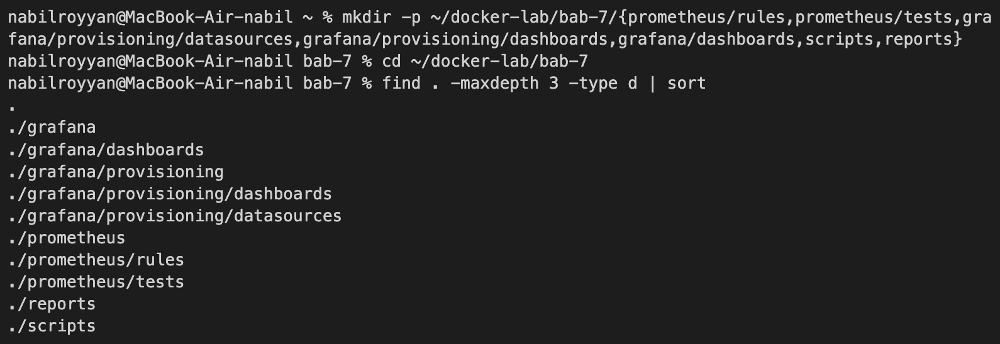

**Keterangan.** Membuat seluruh struktur folder (`prometheus/rules`, `prometheus/tests`, `grafana/provisioning/...`, `grafana/dashboards`, `scripts`, `reports`).

### 2. Berkas `.env.example`

```bash
nano .env.example
```

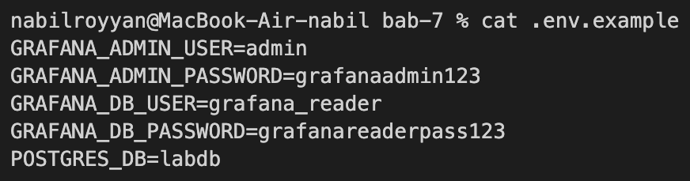

**Keterangan.** Template akun admin Grafana dan akun read-only database untuk integrasi opsional Bab 6.

### 3. Mengaktifkan `.env`

```bash
cp .env.example .env
chmod 600 .env
ls -l .env
```

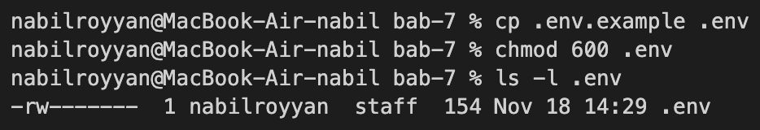

**Keterangan.** `.env` dibuat dengan permission `600`.

### 4. Berkas `.gitignore`

```bash
nano .gitignore
```

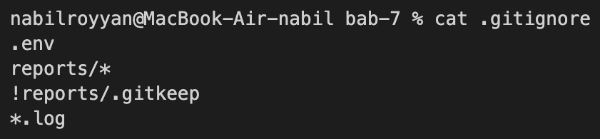

**Keterangan.** Mencegah `.env`, isi `reports/`, dan berkas log masuk repository.

### 5. Berkas `compose.yaml`

```bash
nano compose.yaml
```

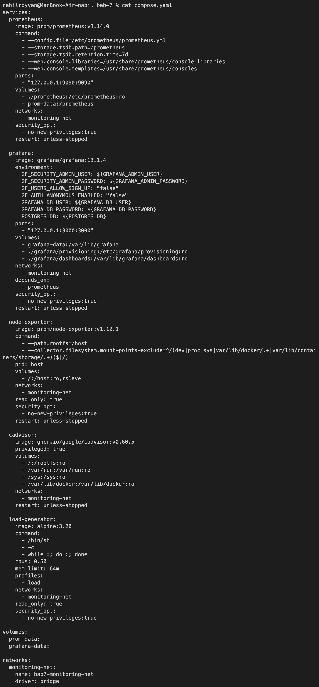

**Keterangan.** Lima service: `prometheus` (retensi 7d, port loopback 9090), `grafana` (provisioning datasource & dashboard, port loopback 3000), `node-exporter` (`pid: host`, mount host read-only), `cadvisor` (privileged), dan `load-generator` (profil `load`, `cpus: 0.50`, `mem_limit: 64m`). Jaringan diberi nama eksplisit `bab7-monitoring-net`.

### 6. Berkas `prometheus/prometheus.yml`

```bash
nano prometheus/prometheus.yml
```

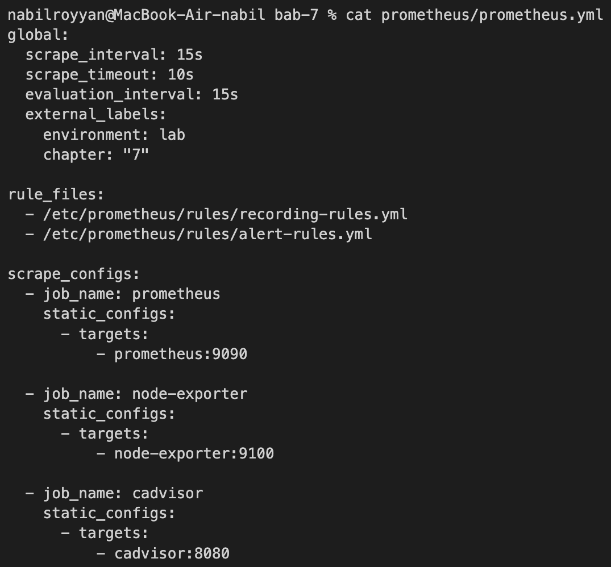

**Keterangan.** Mengatur interval scrape/evaluasi 15 detik, dua rule file, dan tiga job scrape: `prometheus`, `node-exporter:9100`, dan `cadvisor:8080`.

### 7. Berkas `prometheus/rules/recording-rules.yml`

```bash
nano prometheus/rules/recording-rules.yml
```

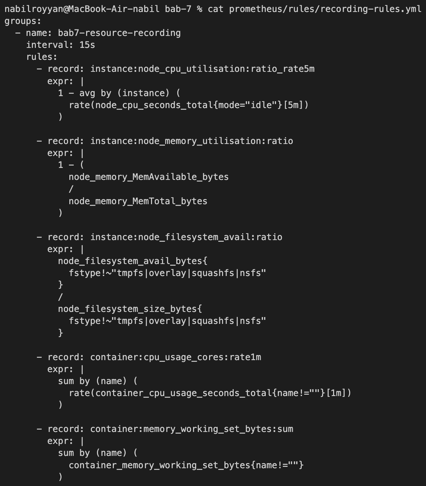

**Keterangan.** Lima recording rule: utilisasi CPU host, utilisasi memori host, rasio filesystem, CPU container (`container:cpu_usage_cores:rate1m`), dan memori container.

### 8. Berkas `prometheus/rules/alert-rules.yml`

```bash
nano prometheus/rules/alert-rules.yml
```

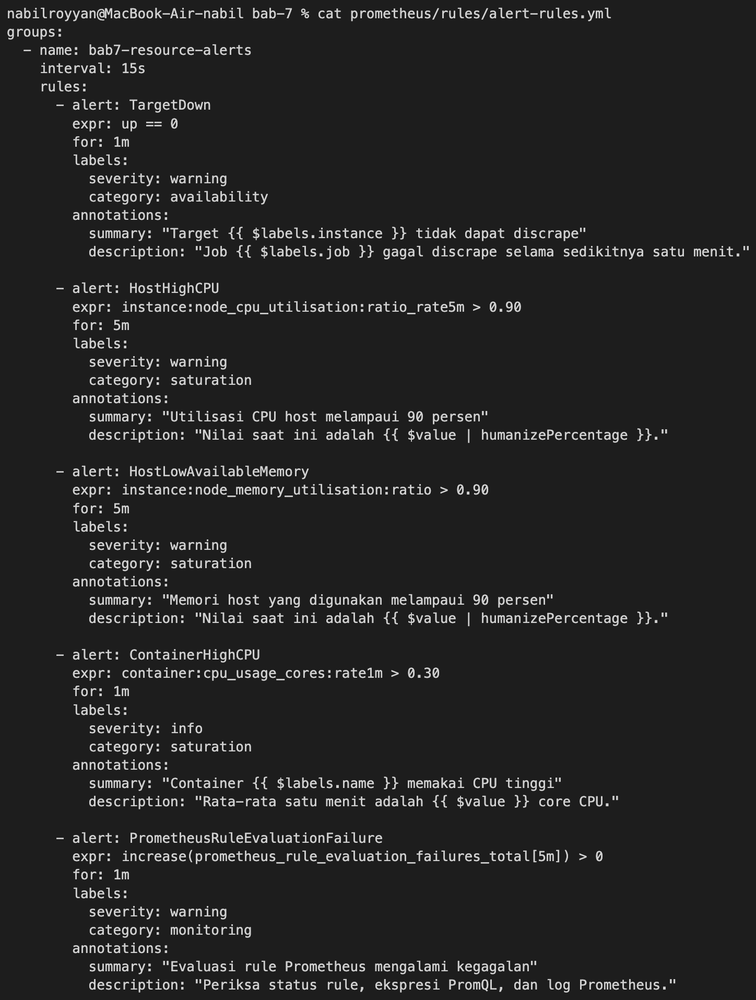

**Keterangan.** Lima alert: `TargetDown`, `HostHighCPU`, `HostLowAvailableMemory`, `ContainerHighCPU`, dan `PrometheusRuleEvaluationFailure`.

### 9. Berkas `prometheus/tests/rules.test.yml`

```bash
nano prometheus/tests/rules.test.yml
```

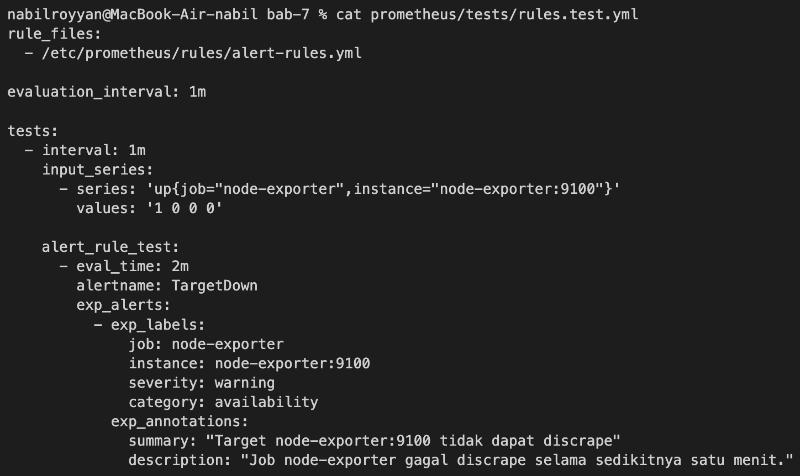

**Keterangan.** Unit test untuk alert `TargetDown` memakai input series `up` bernilai `1 0 0 0`.

### 10. Berkas `grafana/provisioning/datasources/datasources.yml`

```bash
nano grafana/provisioning/datasources/datasources.yml
```

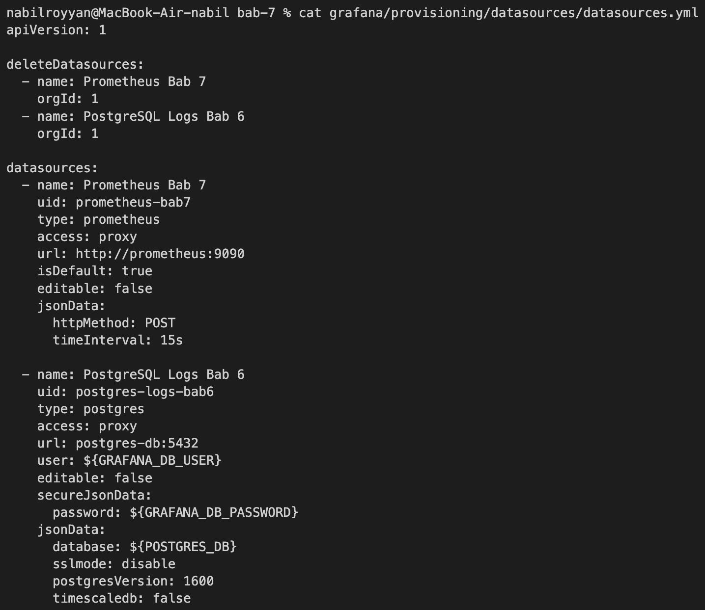

**Keterangan.** Provisioning dua datasource: Prometheus (`prometheus-bab7`) dan PostgreSQL Bab 6 (opsional).

### 11. Berkas `grafana/provisioning/dashboards/provider.yml`

```bash
nano grafana/provisioning/dashboards/provider.yml
```

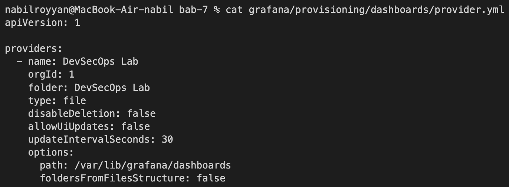

**Keterangan.** Provider dashboard berbasis file, `allowUiUpdates: false` agar sumbernya tetap dari JSON.

### 12. Berkas `grafana/dashboards/bab-7-overview.json`

```bash
nano grafana/dashboards/bab-7-overview.json
```

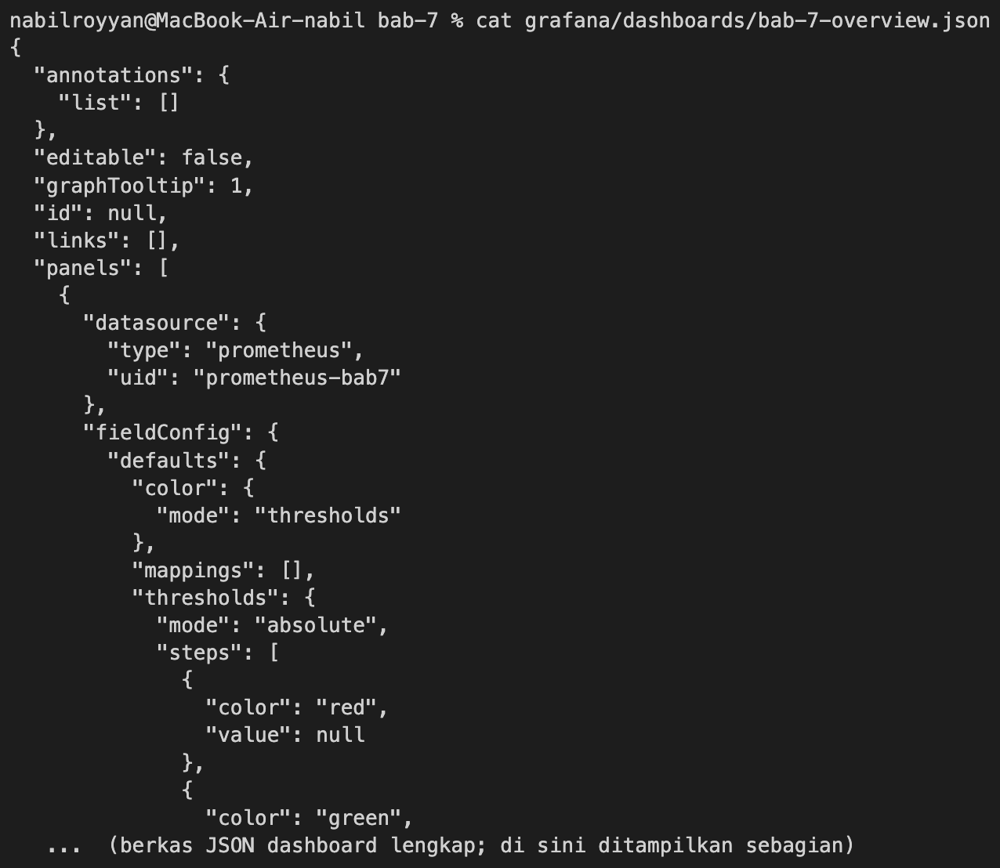

**Keterangan.** Dashboard lima panel (jumlah target up, CPU host, memori host, Top 5 CPU container, Top 5 memori container). Screenshot menampilkan sebagian karena berkas JSON panjang.

### 13. Berkas `scripts/verify-stack.sh`

```bash
nano scripts/verify-stack.sh
```

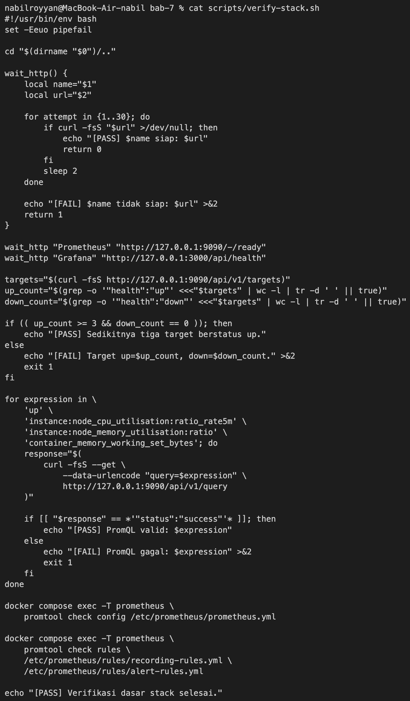

**Keterangan.** Menunggu kesiapan Prometheus dan Grafana, memeriksa target up/down, memvalidasi empat ekspresi PromQL lewat API, lalu menjalankan `promtool check config` dan `promtool check rules`.

### 14. Berkas `scripts/connect-bab6.sh`

```bash
nano scripts/connect-bab6.sh
```

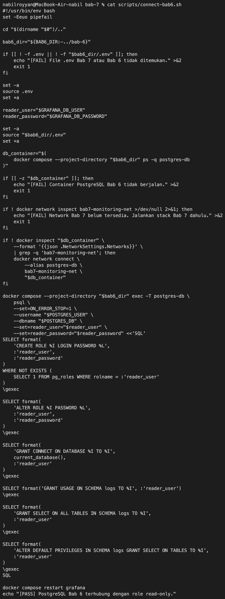

**Keterangan.** Integrasi opsional: menghubungkan Grafana ke PostgreSQL Bab 6 dengan role read-only, memakai network tambahan alih-alih mempublikasikan port database.

### 15. Izin Eksekusi dan Validasi Statis

```bash
chmod +x scripts/verify-stack.sh scripts/connect-bab6.sh
bash -n scripts/verify-stack.sh && echo 'verify-stack.sh OK'
bash -n scripts/connect-bab6.sh && echo 'connect-bab6.sh OK'
docker compose config --quiet; echo "exit=$?"
python3 -m json.tool grafana/dashboards/bab-7-overview.json >/dev/null && echo 'dashboard JSON valid'
```

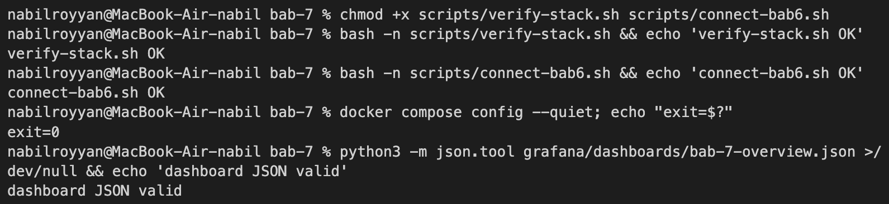

**Keterangan.** Kedua skrip lolos `bash -n`, Compose valid (`exit=0`), dan JSON dashboard valid.

### 16. Validasi Konfigurasi Prometheus

```bash
docker compose run --rm --no-deps --entrypoint /bin/promtool prometheus check config /etc/prometheus/prometheus.yml
```

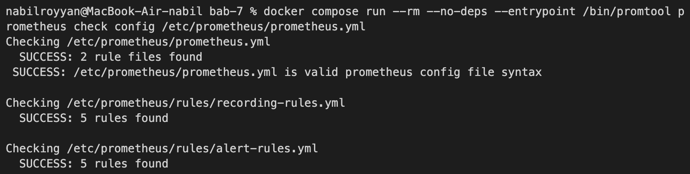

**Keterangan.** `SUCCESS` — dua rule file ditemukan (5 recording + 5 alert) dan sintaks konfigurasi valid.

### 17. Unit Test Rule

```bash
docker compose run --rm --no-deps --entrypoint /bin/promtool prometheus test rules /etc/prometheus/tests/rules.test.yml
```

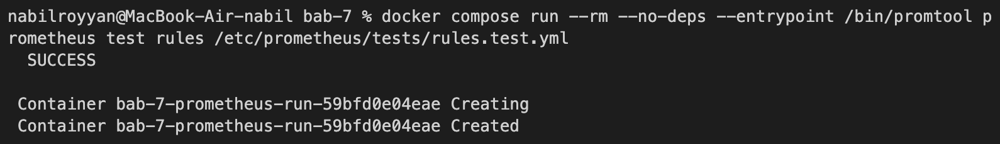

**Keterangan.** `SUCCESS` — logika alert `TargetDown` lolos unit test.

### 18. Mengunduh Image

```bash
docker compose pull
```

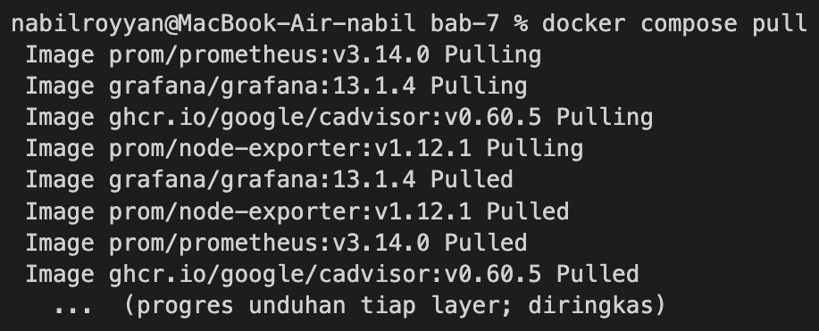

**Keterangan.** Mengunduh keempat image yang di-pin. (Progres per layer diringkas.)

### 19. Menjalankan Stack

```bash
docker compose up -d
```

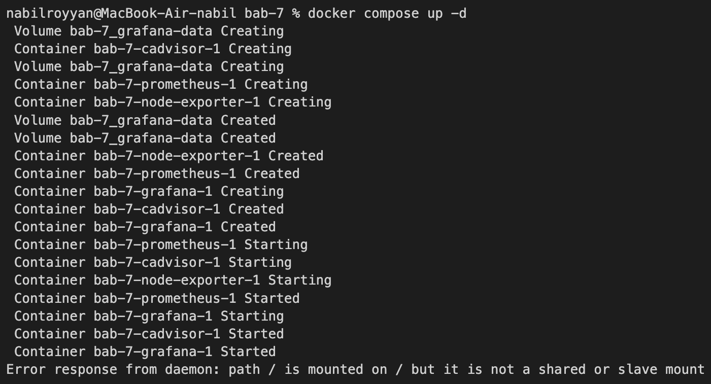

**Keterangan.** Prometheus dan cAdvisor berjalan, tetapi `node-exporter` gagal: `Error response from daemon: path / is mounted on / but it is not a shared or slave mount`. Karena error itu, Grafana belum ikut dijalankan.

### 20. Status Container (Sebelum Perbaikan)

```bash
docker compose ps
```

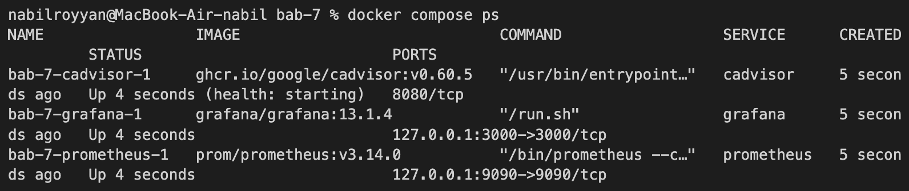

**Keterangan.** Hanya `prometheus` dan `cadvisor` yang berjalan; `node-exporter` dan `grafana` belum berjalan.

### 21. Perbaikan Mount Node Exporter

```bash
sed -i '' 's#/:/host:ro,rslave#/:/host:ro#' compose.yaml
docker compose up -d
docker compose ps
```

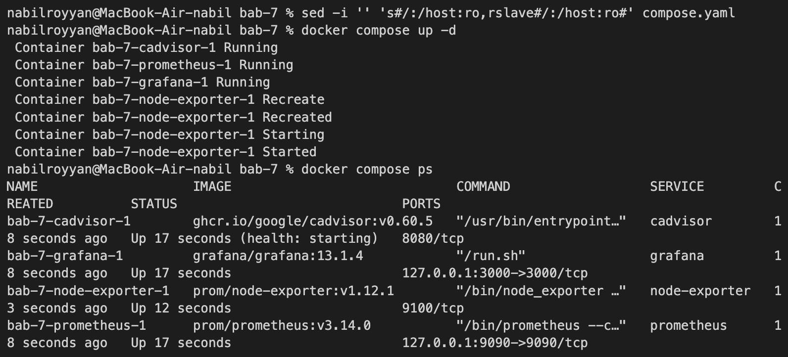

**Keterangan.** Akar masalah: Docker Desktop tidak mendukung propagasi mount `rslave` untuk `pid: host` (persis gejalanya sesuai tabel troubleshooting cheatsheet). Mengubah `- /:/host:ro,rslave` menjadi `- /:/host:ro` membuat `node-exporter` berjalan. Kini keempat service `Up`, termasuk Grafana.

### 22. Verifikasi Stack

```bash
./scripts/verify-stack.sh
```

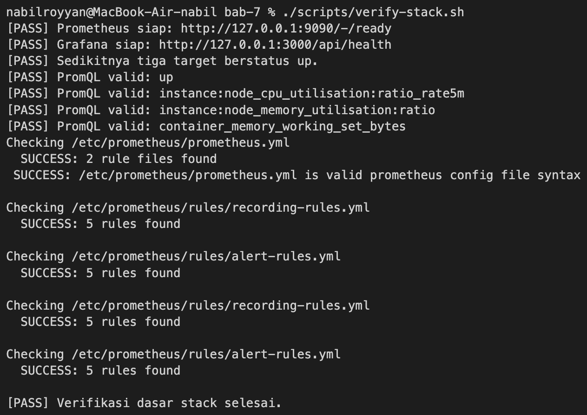

**Keterangan.** Seluruh pemeriksaan `[PASS]`: Prometheus dan Grafana siap, sedikitnya tiga target up, empat ekspresi PromQL valid, serta `promtool check config`/`check rules` sukses.

### 23. Query PromQL — Target

```bash
curl -fsS -G --data-urlencode 'query=up' http://127.0.0.1:9090/api/v1/query | jq -r ".data.result | map([.metric.job, .metric.instance, .value[1]]) | .[] | @tsv"
```

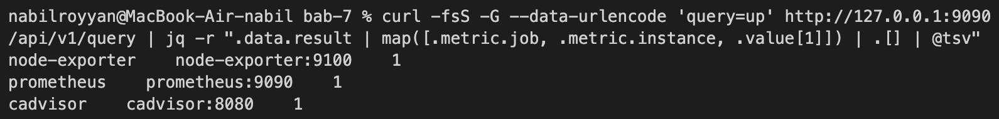

**Keterangan.** Ketiga target (`node-exporter`, `cadvisor`, `prometheus`) bernilai `1` — semua berhasil discrape.

### 24. Query PromQL — CPU Host

```bash
curl -fsS -G --data-urlencode 'query=instance:node_cpu_utilisation:ratio_rate5m * 100' http://127.0.0.1:9090/api/v1/query | jq -r ".data.result | map([.metric.instance, .value[1]]) | .[] | @tsv"
```

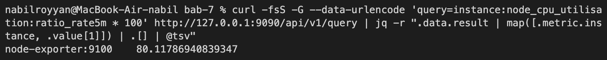

**Keterangan.** Recording rule CPU host menghasilkan nilai (≈80,8%), membuktikan rule berjalan.

### 25. Menjalankan Generator Beban

```bash
docker compose --profile load up -d load-generator
```

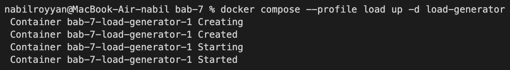

**Keterangan.** Menjalankan container busy-loop dengan batas 0,5 core CPU.

### 26. Query CPU Container (Rule Cheatsheet)

```bash
curl -fsS -G --data-urlencode 'query=container:cpu_usage_cores:rate1m{name=~".*load-generator.*"}' http://127.0.0.1:9090/api/v1/query | jq -r ".data.result | map([.metric.name, .value[1]]) | .[] | @tsv"
```

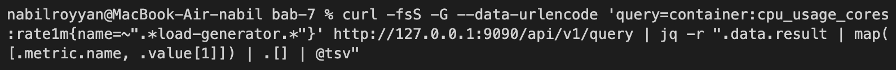

**Keterangan.** Hasil kosong. Akar masalah: cAdvisor v0.60.5 pada Docker Desktop mengekspor `container_cpu_usage_seconds_total` dengan label `id` (mis. `/docker/<hash>`), **bukan** label `name`. Karena recording rule memakai `{name!=""}`, series tidak terbentuk sehingga query kosong.

### 27. Query CPU Container (Koreksi)

```bash
curl -fsS -G --data-urlencode 'query=topk(3, sum by (id) (rate(container_cpu_usage_seconds_total[1m])))' http://127.0.0.1:9090/api/v1/query | jq -r ".data.result | map([.metric.id, .value[1]]) | .[] | @tsv"
```

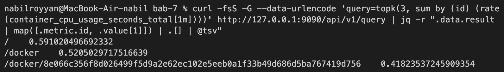

**Keterangan.** Mengganti agregasi `by (name)` menjadi `by (id)` membuat metrik terbaca: terlihat container dengan pemakaian tertinggi (≈0,42 core) — membuktikan metrik container tersedia dan hanya berbeda label. Memetakan `id` ke nama container memerlukan metadata tambahan (mis. join dengan `container_last_seen`).

### 28. Alert `ContainerHighCPU`

```bash
curl -fsS -G --data-urlencode 'query=ALERTS{alertname="ContainerHighCPU"}' http://127.0.0.1:9090/api/v1/query | jq -r ".data.result | map([.metric.alertname, .metric.alertstate, .value[1]]) | .[] | @tsv"
```

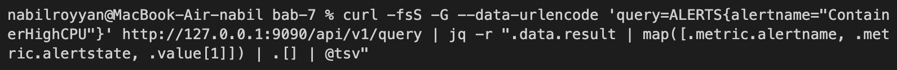

**Keterangan.** Kosong, konsekuensi dari subbab 26: alert `ContainerHighCPU` memakai recording rule berbasis label `name` yang tidak terbentuk, sehingga tidak pernah firing pada versi cAdvisor ini.

### 29. Menghentikan Generator Beban

```bash
docker compose --profile load stop load-generator
docker compose --profile load rm -f load-generator
```

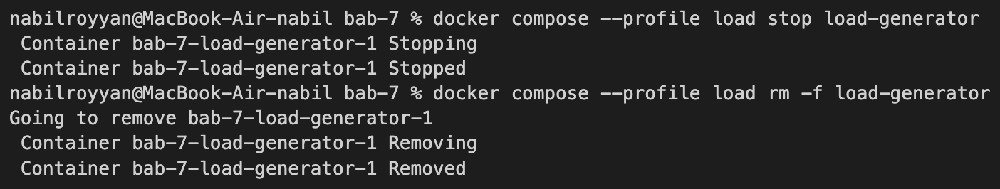

**Keterangan.** Generator dihentikan dan dihapus setelah evidence diperoleh.

### 30. Negative Test — Hentikan Node Exporter

```bash
docker compose stop node-exporter
```

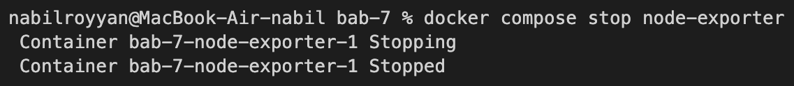

**Keterangan.** Mensimulasikan kegagalan target agar alert `TargetDown` terpicu.

### 31. Memeriksa Target Down

```bash
curl -fsS -G --data-urlencode 'query=up{job="node-exporter"}' http://127.0.0.1:9090/api/v1/query | jq -r ".data.result | map([.metric.instance, .value[1]]) | .[] | @tsv"
```

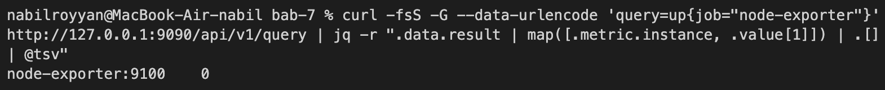

**Keterangan.** Nilai `up` untuk `node-exporter:9100` menjadi `0`.

### 32. Alert `TargetDown` Firing

```bash
curl -fsS -G --data-urlencode 'query=ALERTS{alertname="TargetDown"}' http://127.0.0.1:9090/api/v1/query | jq -r ".data.result | map([.metric.alertname, .metric.alertstate, .value[1]]) | .[] | @tsv"
```

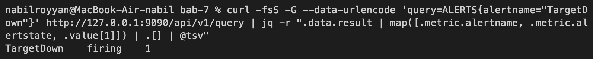

**Keterangan.** Alert `TargetDown` berstatus `firing` — membuktikan aturan `for: 1m` dan evaluasi berjalan.

### 33. Verifikasi Alert dari API Rules

```bash
curl -fsS http://127.0.0.1:9090/api/v1/rules | jq -r '.data.groups[].rules[] | select(.name=="TargetDown") | "\(.name)  state=\(.state)  alerts=\(.alerts|length)"'
```

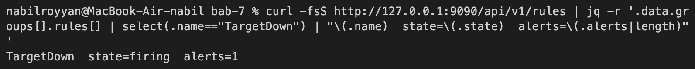

**Keterangan.** Konfirmasi tambahan dari API: `TargetDown state=firing alerts=1`.

### 34. Pemulihan Target

```bash
docker compose start node-exporter
sleep 25
curl -fsS -G --data-urlencode 'query=up{job="node-exporter"}' http://127.0.0.1:9090/api/v1/query | jq -r ".data.result | map([.metric.instance, .value[1]]) | .[] | @tsv"
```

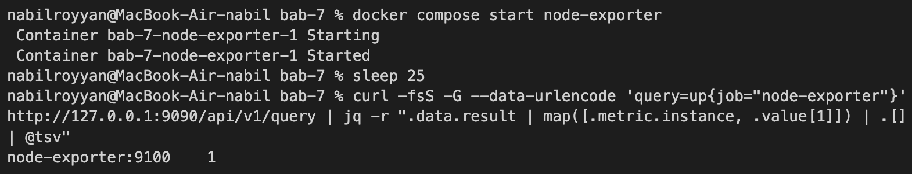

**Keterangan.** Setelah node-exporter dinyalakan kembali, `up` kembali bernilai `1` dalam satu-dua interval scrape; alert akan kembali nonaktif.

### 35. Integrasi Opsional Bab 6 (Dilewati)

```bash
./scripts/connect-bab6.sh
```

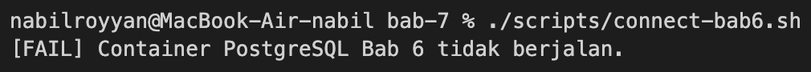

**Keterangan.** Script berhenti dengan aman karena stack Bab 6 tidak aktif (`[FAIL] Container PostgreSQL Bab 6 tidak berjalan`). Integrasi ini opsional; guard pada script mencegahnya menebak atau menghubungkan ke container yang salah.

### 36. Cleanup — Hentikan Stack

```bash
docker compose --profile load down --remove-orphans
```

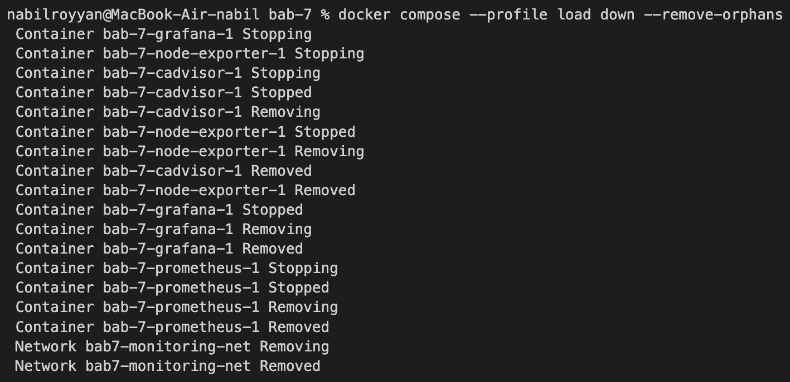

**Keterangan.** Menghentikan dan menghapus container serta network tanpa menghapus volume.

### 37. Cleanup — Hapus Volume

```bash
docker compose --profile load down --volumes --remove-orphans
```

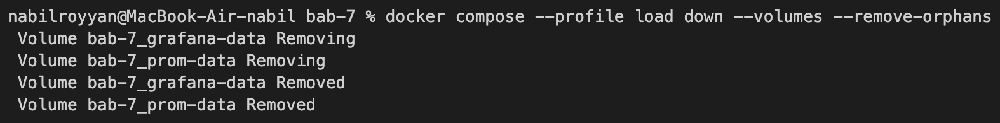

**Keterangan.** Menghapus volume `prom-data` dan `grafana-data` (time series dan konfigurasi lokal Grafana).

## Hasil Uji Penerimaan

| No. | Skenario | Evidence | Hasil |
|---:|---|---|---|
| 1 | Validasi Compose | `docker compose config --quiet` | Lulus (exit 0) |
| 2 | Unit test rule | `promtool test rules` | SUCCESS |
| 3 | Kesiapan Prometheus | `/-/ready` | HTTP 200 |
| 4 | Kesiapan Grafana | `/api/health` | HTTP 200 |
| 5 | Target scrape | `up` | 3 target UP |
| 6 | Host metrics | Query CPU host | Nilai ada (≈80,8%) |
| 7 | Container metrics | Query cAdvisor | Ada, tetapi berlabel `id` bukan `name` |
| 8 | Dashboard terprovisi | Provider + JSON valid | Terprovisi (data panel container terbatas karena isu label) |
| 9 | Load test | CPU container | Terukur (≈0,42 core) via koreksi `id` |
| 10 | Negative test | `TargetDown` | Pending → firing |
| 11 | Recovery | `up{job="node-exporter"}` | Kembali 1 |
| 12 | Integrasi Bab 6 | `connect-bab6.sh` | Dilewati (Bab 6 tidak aktif), guard bekerja |

## Analisis dan Evaluasi

**Dua kendala platform (bukan kesalahan konfigurasi logika).** (1) Propagasi mount `rslave` tidak didukung Docker Desktop sehingga node-exporter gagal start; perbaikannya menghapus `rslave`. (2) cAdvisor versi ini mengekspor metrik container dengan label `id`, bukan `name`, sehingga recording rule dan alert container yang bergantung pada label `name` kosong. Keduanya menunjukkan pentingnya memverifikasi asumsi terhadap perilaku runtime nyata.

**Nilai monitoring.** Recording rule CPU host terbukti bekerja dan alert `TargetDown` berubah state dengan benar ketika target mati lalu pulih. Ini membuktikan bagian deteksi masalah (availability) berfungsi, sementara bagian container perlu penyesuaian label.

**Catatan keamanan.** Endpoint exporter tidak dipublikasikan ke host; hanya Prometheus (9090) dan Grafana (3000) yang dibuka, itupun ke loopback. cAdvisor berjalan `privileged` dan `security_opt: no-new-privileges` diterapkan pada service lain. Untuk produksi: hindari cAdvisor privileged, aktifkan autentikasi/TLS pada Grafana, dan ganti seluruh credential contoh.

**Rekomendasi perbaikan.** Sesuaikan recording rule/alert container memakai label `id` dan tambahkan relabeling untuk memetakan `id` ke nama container, misalnya memakai `container_last_seen` atau label `container_label_com_docker_compose_service`.

## Rangkuman

Stack monitoring Prometheus + Grafana + Node Exporter + cAdvisor berhasil dibangun dan diuji pada Docker Desktop macOS. Host metrics dan mekanisme alert berjalan benar (termasuk negative test `TargetDown` yang firing). Dua keterbatasan platform — mount `rslave` dan label `name` pada cAdvisor — ditemukan, didiagnosis, dan didokumentasikan beserta perbaikannya. Kembali terbukti bahwa menjalankan dan memeriksa setiap langkah secara nyata lebih penting daripada mengandalkan asumsi konfigurasi.
