# LAPORAN BAB 8

## Hardening Container, Secrets, Trivy, dan Private Registry

**Mata Kuliah:** DevOps  
**Nama:** MUHAMMAD NABIL ROYYAN
**NRP:** 3126640032 

## Pendahuluan

Bab ini menggabungkan hardening runtime container, pengelolaan secret, pemindaian kerentanan dengan **Trivy**, *security gate*, dan distribusi image melalui **private registry** ber-TLS dan berautentikasi. Laporan mengikuti `cheatsheets/bab-08-cs.md` dan dijalankan pada Terminal macOS (Docker Desktop) di `~/docker-lab/bab-8`. Setiap subbab memuat satu perintah, tangkapan layar keluaran aslinya, dan keterangannya.

> **Adaptasi platform.** Port registry dipetakan ke **host 5001** (bukan 5000) karena macOS AirPlay (ControlCenter) sudah menempati port 5000. Selain itu, dua kendala platform ditemukan dan didokumentasikan pada subbab 22–24 dan 29.

## Laporan Praktikum

### 1. Menyiapkan Direktori Bab 8

```bash
mkdir -p ~/docker-lab/bab-8/{app,secrets,registry/certs,registry/auth,scripts,reports}
cd ~/docker-lab/bab-8
touch reports/.gitkeep
find . -maxdepth 2 -type d | sort
```

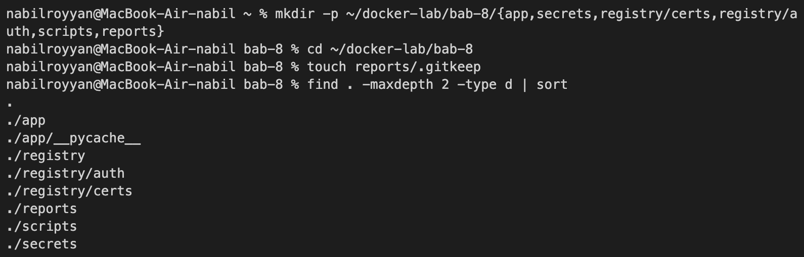

**Keterangan.** Membuat struktur folder untuk aplikasi, secret, aset registry, script, dan laporan.

### 2. Berkas `.env.example`

```bash
nano .env.example
```

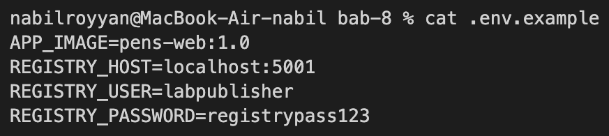

**Keterangan.** Template identitas image dan credential registry sintetis. `REGISTRY_HOST` memakai `localhost:5001` (adaptasi port).

### 3. Mengaktifkan `.env`

```bash
cp .env.example .env
chmod 600 .env
ls -l .env
```

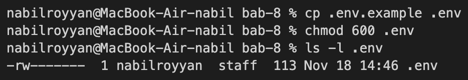

**Keterangan.** `.env` dibuat dengan permission `600`.

### 4. Berkas `.gitignore`

```bash
nano .gitignore
```

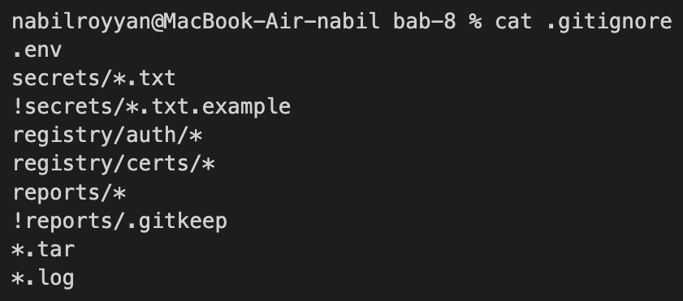

**Keterangan.** Mencegah secret aktif, private key, hash, arsip, dan laporan scanner masuk repository (contoh `.example` tetap dicatat).

### 5. Berkas `.dockerignore`

```bash
nano .dockerignore
```

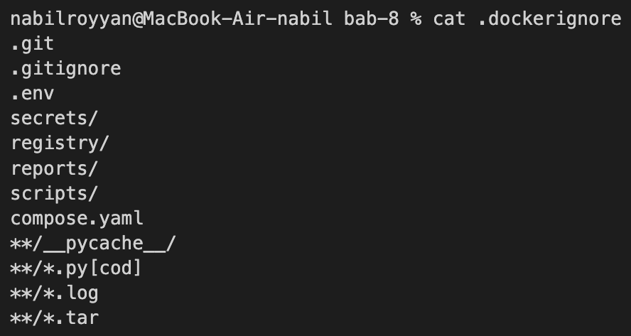

**Keterangan.** Mengecilkan build context dan mencegah `secrets/`, `registry/`, dan `.env` terkirim ke builder.

### 6. Berkas `app/requirements.txt`

```bash
nano app/requirements.txt
```

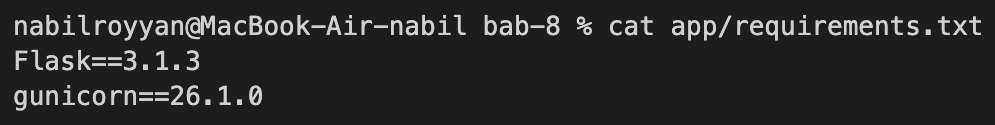

**Keterangan.** Dependency dipin: `Flask==3.1.3` dan `gunicorn==26.1.0`.

### 7. Berkas `app/app.py`

```bash
nano app/app.py
```

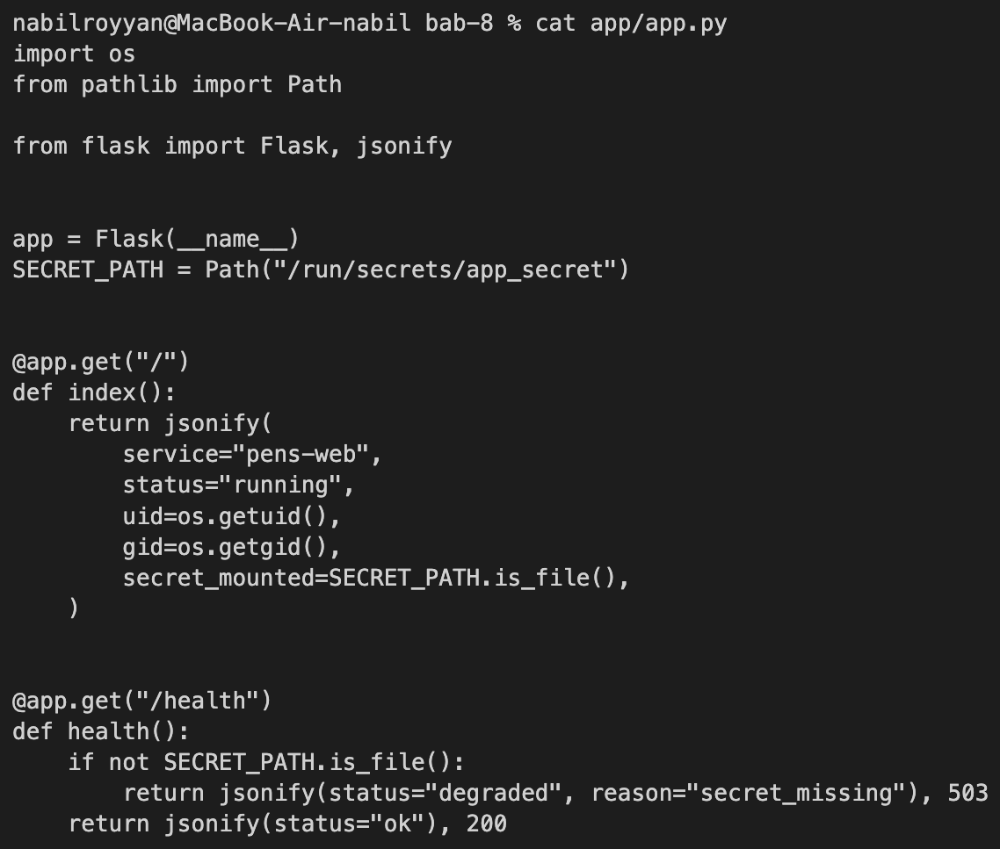

**Keterangan.** Aplikasi mengembalikan `uid`, `gid`, dan `secret_mounted` pada `/`, serta memeriksa keberadaan secret pada `/health` (200 jika ada, 503 jika tidak). Nilai secret tidak pernah dikembalikan.

### 8. Berkas `app/Dockerfile`

```bash
nano app/Dockerfile
```

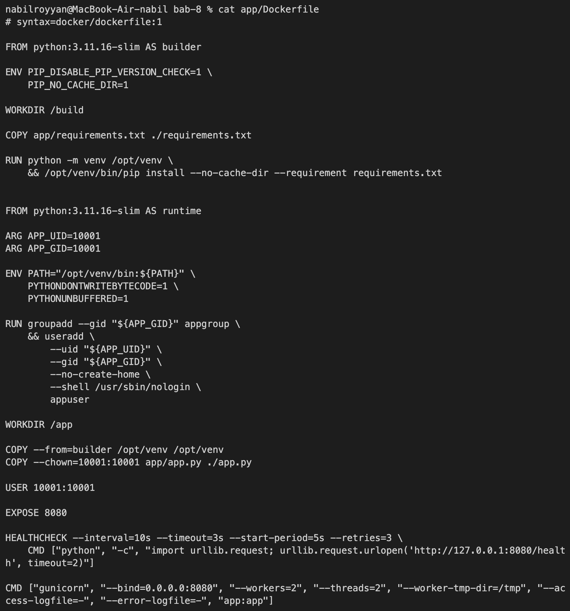

**Keterangan.** *Multi-stage build*: tahap `builder` membuat venv, tahap `runtime` menyalin venv dan kode. Dibuat user non-root `appuser` (UID/GID 10001), `USER 10001:10001`, `HEALTHCHECK`, dan gunicorn dengan `--worker-tmp-dir=/tmp`.

### 9. Berkas `secrets/app_secret.txt.example`

```bash
nano secrets/app_secret.txt.example
```

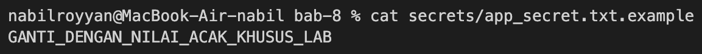

**Keterangan.** Hanya contoh format; nilai aktif tidak ditulis di repository.

### 10. Berkas `compose.yaml`

```bash
nano compose.yaml
```

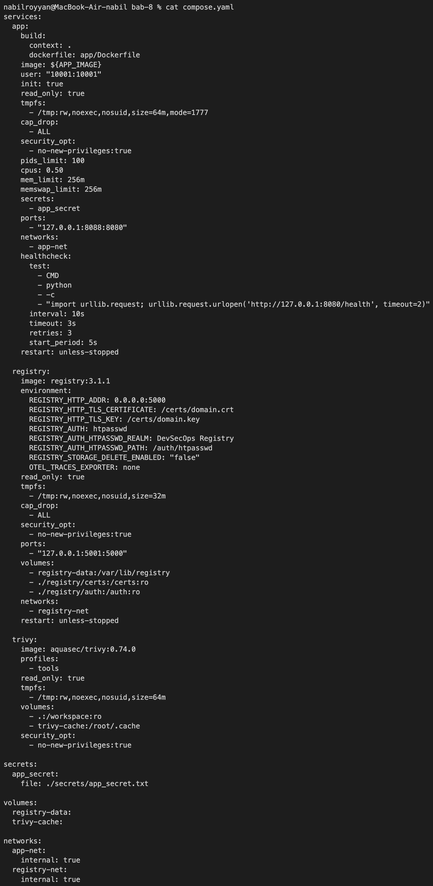

**Keterangan.** Service `app` diperkeras: `user 10001:10001`, `read_only`, `tmpfs /tmp`, `cap_drop: ALL`, `no-new-privileges`, `pids_limit`, batas `cpus`/`mem_limit`/`memswap_limit`, dan secret `/run/secrets/app_secret`. Service `registry` (registry:3.1.1) ber-TLS, autentikasi `htpasswd`, dan read-only. Service `trivy` berada pada profil `tools`.

### 11. Berkas `scripts/generate-registry-assets.sh`

```bash
nano scripts/generate-registry-assets.sh
```

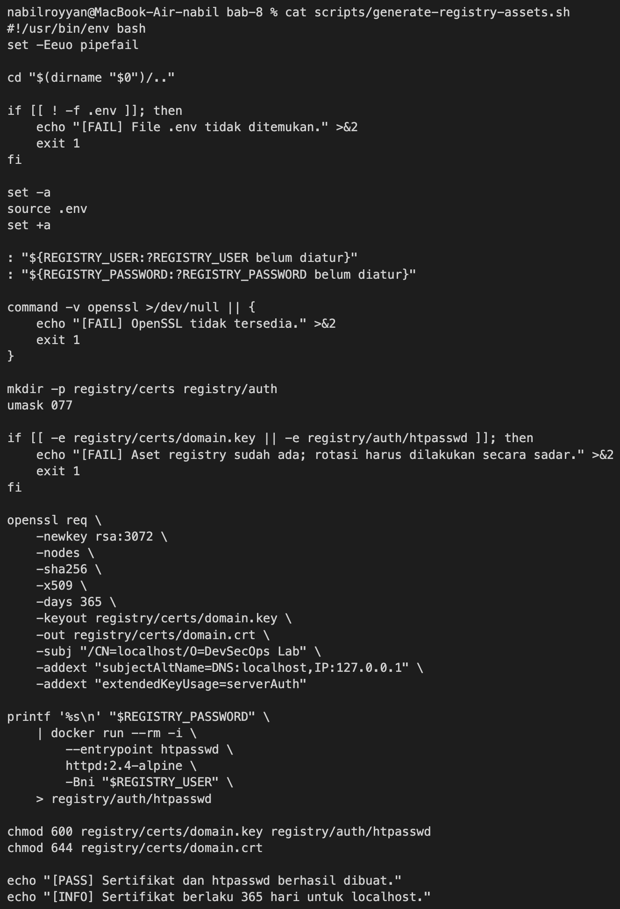

**Keterangan.** Membuat sertifikat self-signed (RSA 3072, SAN `localhost`/`127.0.0.1`) dan akun registry dengan `htpasswd -B` (bcrypt). Menolak berjalan jika aset sudah ada (rotasi harus sadar).

### 12. Berkas `scripts/scan-image.sh`

```bash
nano scripts/scan-image.sh
```

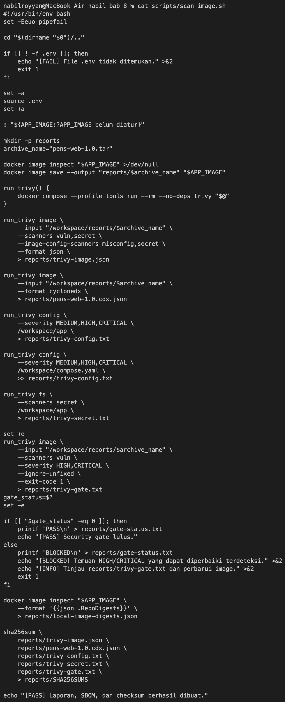

**Keterangan.** Menyimpan image ke arsip lalu memindainya: laporan vuln+secret (JSON), SBOM CycloneDX, scan config, scan secret, dan gate HIGH/CRITICAL dengan `--ignore-unfixed --exit-code 1`.

### 13. Berkas `scripts/push-registry.sh`

```bash
nano scripts/push-registry.sh
```

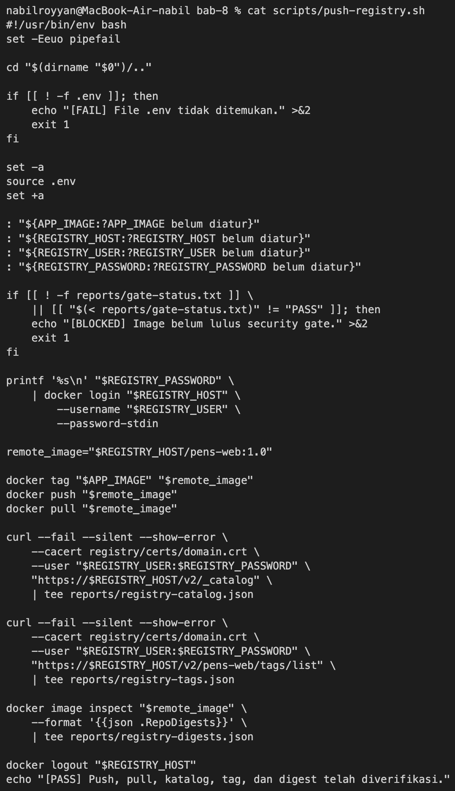

**Keterangan.** Menolak push bila `gate-status.txt` bukan `PASS`, lalu login, tag, push, pull, dan memverifikasi katalog/tag/digest registry.

### 14. Berkas `scripts/verify-hardening.sh`

```bash
nano scripts/verify-hardening.sh
```

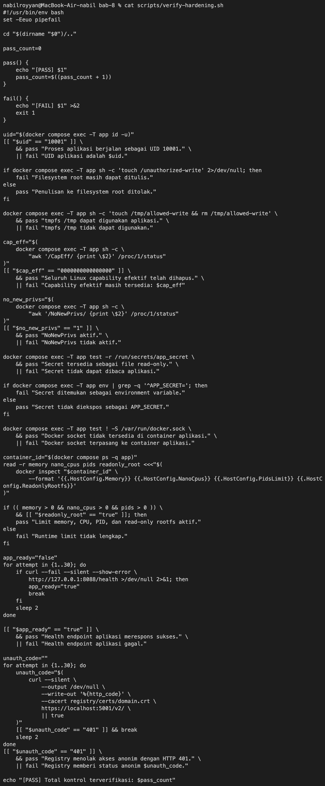

**Keterangan.** Rangkaian *negative test*: UID non-root, rootfs read-only, tmpfs, capability kosong, `NoNewPrivs`, secret read-only, tidak ada `APP_SECRET`, tidak ada docker socket, limit resource, health endpoint, dan registry menolak anonim (401).

### 15. Izin Eksekusi dan Validasi Statis

```bash
chmod +x scripts/*.sh
bash -n scripts/generate-registry-assets.sh && echo 'generate OK'
bash -n scripts/scan-image.sh && echo 'scan OK'
bash -n scripts/push-registry.sh && echo 'push OK'
bash -n scripts/verify-hardening.sh && echo 'verify OK'
python3 -m py_compile app/app.py && echo 'app.py OK'
docker compose config --quiet; echo "exit=$?"
```

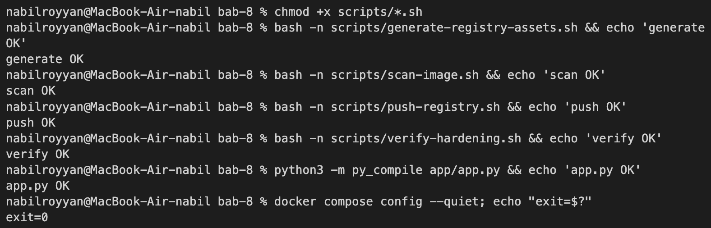

**Keterangan.** Keempat script lolos `bash -n`, `app.py` lolos kompilasi, dan Compose valid (`exit=0`).

### 16. Membuat Secret Aktif

```bash
openssl rand -hex 32 > secrets/app_secret.txt
chmod 600 secrets/app_secret.txt
ls -l secrets/
```

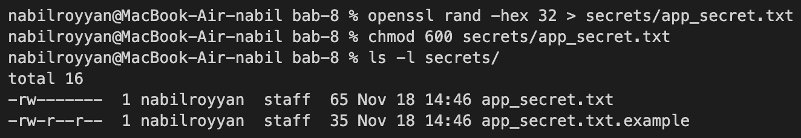

**Keterangan.** Secret acak 256-bit dibuat dengan permission `600` (`-rw-------`).

### 17. Membuat Aset Registry

```bash
./scripts/generate-registry-assets.sh
```

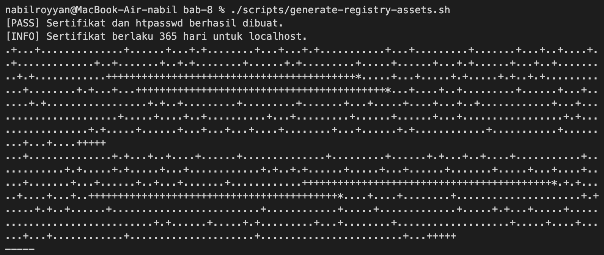

**Keterangan.** Sertifikat TLS dan akun registry bcrypt berhasil dibuat.

### 18. Memeriksa Sertifikat

```bash
openssl x509 -in registry/certs/domain.crt -noout -subject -issuer -dates -ext subjectAltName
```

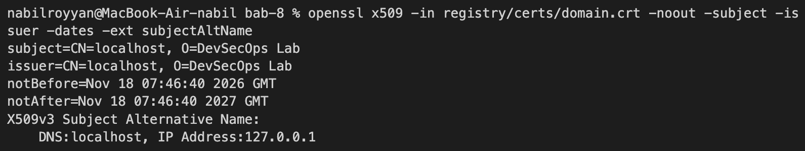

**Keterangan.** Subject `CN=localhost, O=DevSecOps Lab`, SAN `DNS:localhost, IP:127.0.0.1`, berlaku 365 hari.

### 19. Mempercayai CA Registry pada Docker

```bash
mkdir -p ~/.docker/certs.d/localhost:5001
cp registry/certs/domain.crt ~/.docker/certs.d/localhost:5001/ca.crt
ls -l ~/.docker/certs.d/localhost:5001/
```

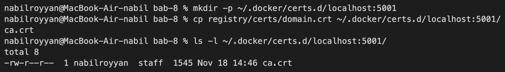

**Keterangan.** CA disalin ke trust store Docker Desktop (`~/.docker/certs.d/.../ca.crt`) agar daemon memercayai registry. (Docker Desktop langsung mengenali CA ini tanpa restart.)

### 20. Build Image

```bash
docker compose build --pull app
```

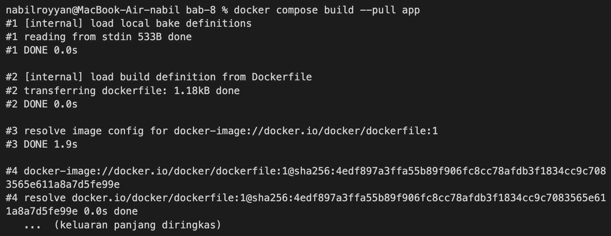

**Keterangan.** Image `pens-web:1.0` dibangun dari Dockerfile multi-stage. (Progres build diringkas.)

### 21. Menjalankan Aplikasi dan Registry

```bash
docker compose up -d app registry
```

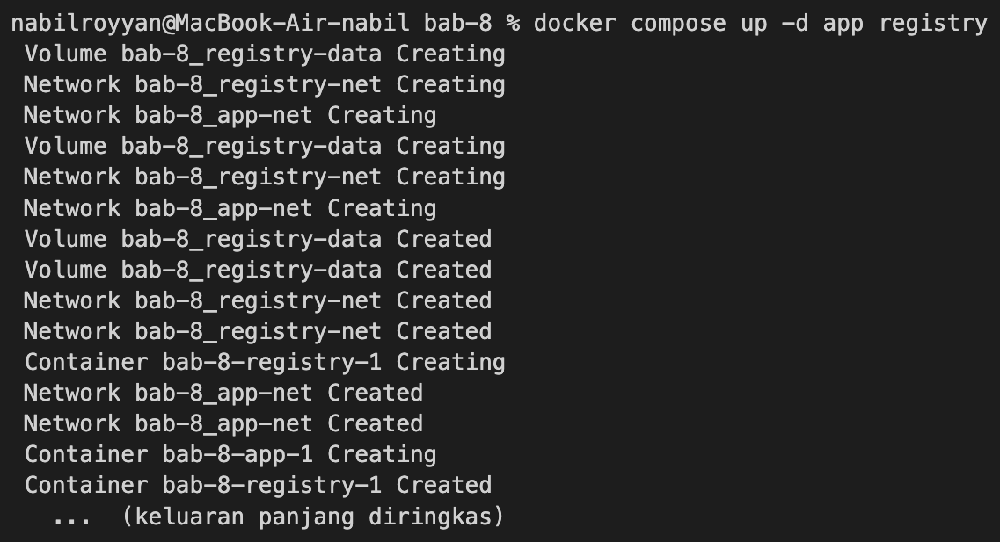

**Keterangan.** Container aplikasi dan registry dibuat dan dijalankan. (Progres unduh/pembuatan diringkas.)

### 22. Status Container (Sebelum Perbaikan)

```bash
docker compose ps
```

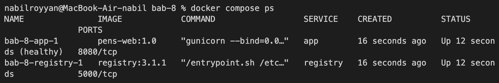

**Keterangan.** Kedua container `Up`, tetapi kolom PORTS hanya menampilkan `8080/tcp` dan `5000/tcp` — **port tidak dipublikasikan ke host**, padahal compose mendeklarasikan `ports`.

### 23. Uji Akses Aplikasi (Gagal)

```bash
curl -s -o /dev/null -w 'HTTP %{http_code}\n' http://127.0.0.1:8088/
```

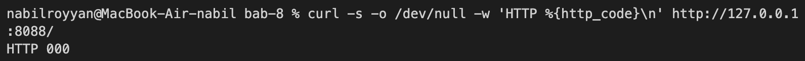

**Keterangan.** `HTTP 000` (tidak dapat terhubung), konsisten dengan port yang tidak terpublikasi.

### 24. Perbaikan Jaringan dan Trivy

```bash
sed -i '' 's/    internal: true/    driver: bridge/' compose.yaml
sed -i '' 's#size=64m$#size=1g#' compose.yaml
docker compose up -d --force-recreate app registry
docker compose ps
```

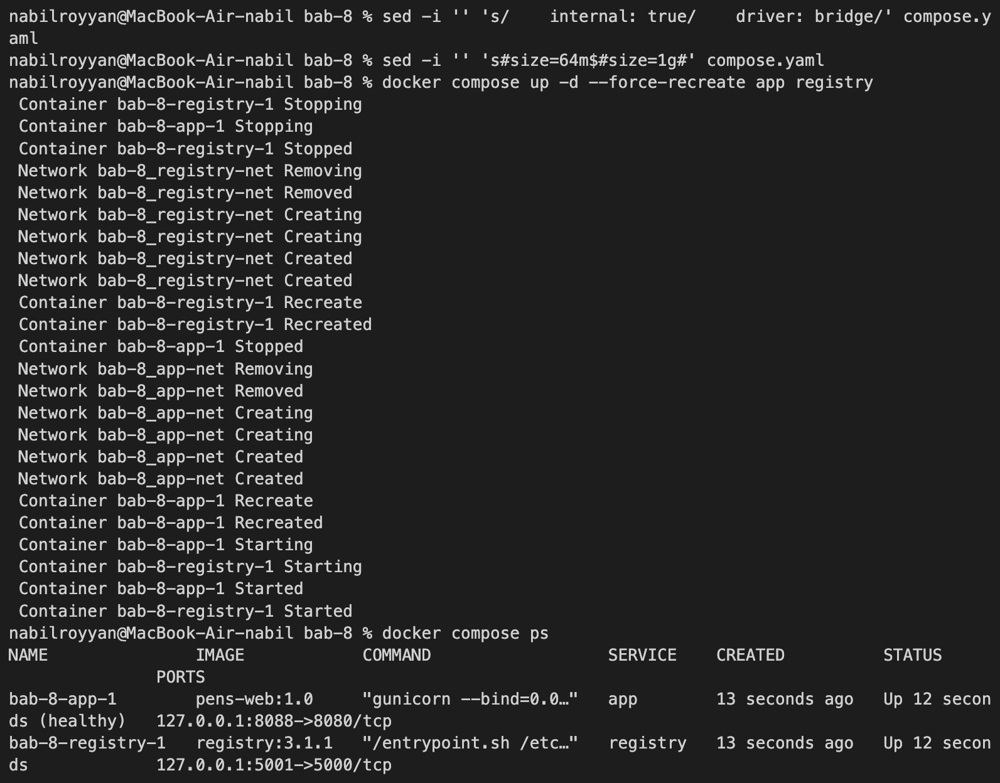

**Keterangan.** Akar masalah: pada Docker Desktop, container yang hanya terhubung ke jaringan `internal: true` **tidak dapat** mempublikasikan port. Mengubah jaringan menjadi `driver: bridge` membuat port terpublikasi (`127.0.0.1:8088->8080/tcp` dan `127.0.0.1:5001->5000/tcp`). Sekaligus tmpfs `/tmp` milik Trivy dinaikkan dari 64m ke 1g (lihat subbab 29). Trade-off: dua jaringan tetap terpisah (app-net dan registry-net), tetapi tidak lagi memblokir egress.

### 25. Uji Akses Aplikasi (Berhasil)

```bash
curl --fail --silent --show-error http://127.0.0.1:8088/ | python3 -m json.tool
```

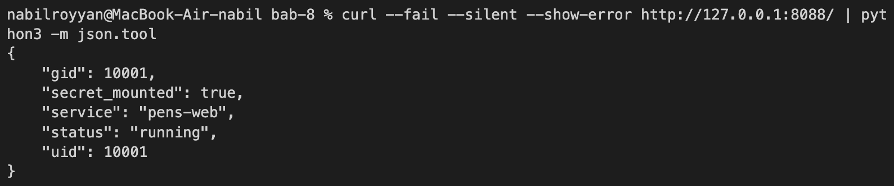

**Keterangan.** Respons JSON menunjukkan `uid` dan `gid` bernilai `10001` serta `secret_mounted: true` — aplikasi non-root dan secret ter-mount dengan benar.

### 26. Negative Test Hardening

```bash
./scripts/verify-hardening.sh
```

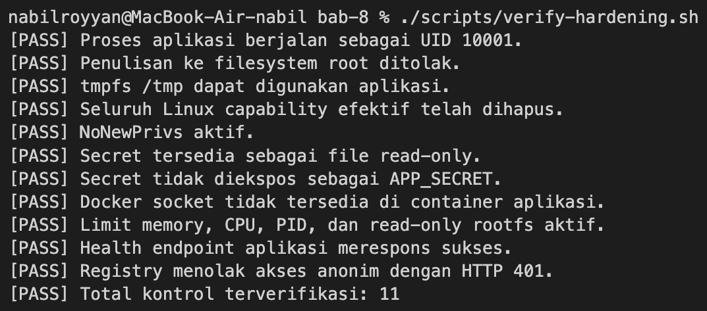

**Keterangan.** Seluruh **11 kontrol** lulus `[PASS]`: non-root, rootfs read-only, tmpfs, capability kosong, NoNewPrivs, secret read-only, tanpa `APP_SECRET`, tanpa docker socket, limit resource, health OK, dan registry menolak anonim.

### 27. Konfigurasi Runtime Efektif

```bash
docker inspect "$(docker compose ps -q app)" --format "{{json .HostConfig}}" > reports/app-hostconfig.json
python3 -m json.tool reports/app-hostconfig.json | head -n 20
```

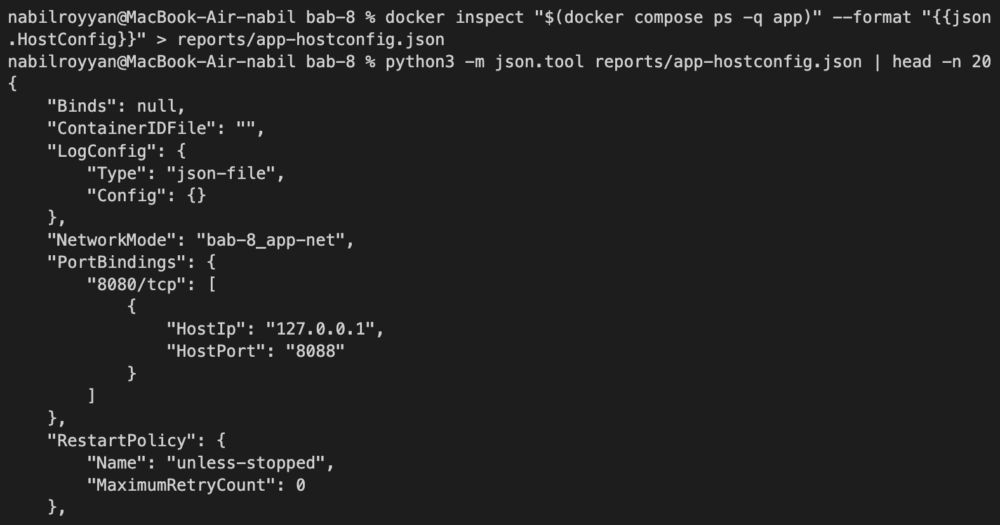

**Keterangan.** Bukti tambahan dari `HostConfig`: `ReadonlyRootfs`, `CapDrop`, `Memory`, `NanoCpus`, dan `PidsLimit` sesuai hardening.

### 28. Registry Menolak Akses Anonim

```bash
curl --silent --output /dev/null --write-out 'HTTP %{http_code}\n' --cacert registry/certs/domain.crt https://localhost:5001/v2/
```

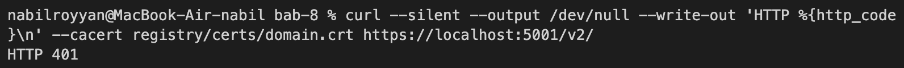

**Keterangan.** `HTTP 401` — TLS tervalidasi dengan `--cacert`, dan autentikasi aktif (anonim ditolak).

### 29. Trivy, SBOM, dan Security Gate

```bash
./scripts/scan-image.sh
```

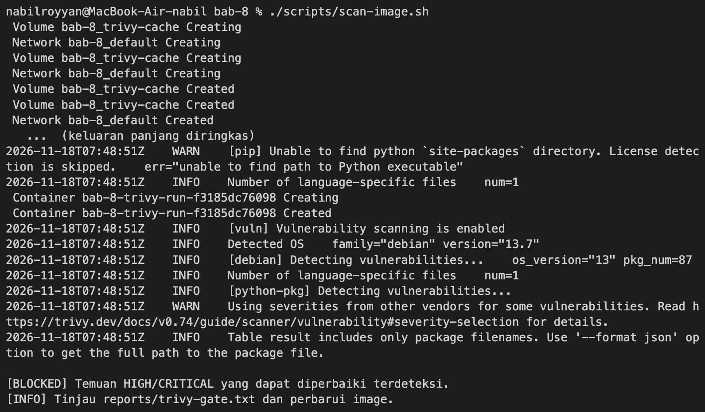

**Keterangan.** Pemindaian berhasil (DB Trivy ~134 MB diunduh; tmpfs 64m sebelumnya gagal `no space left on device`, sehingga dinaikkan ke 1g). Hasil gate: **`[BLOCKED]`** karena 7 temuan HIGH yang dapat diperbaiki pada base image Debian (`python:3.11.16-slim`); paket Python yang dipin bersih. Sesuai desain, image **tidak** dipromosikan.

### 30. Status Gate dan Artefak Laporan

```bash
cat reports/gate-status.txt
sha256sum --check reports/SHA256SUMS
ls -lh reports/
```

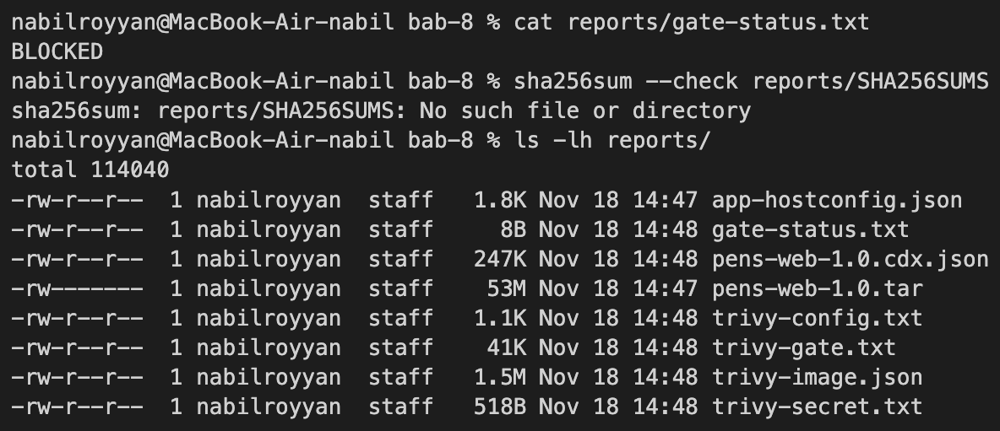

**Keterangan.** `gate-status.txt` berisi `BLOCKED`. Karena gate memblokir, `scan-image.sh` berhenti sebelum menulis `SHA256SUMS` (checksum belum dibuat). Terlihat artefak yang terbentuk: laporan JSON, SBOM CycloneDX (247K), laporan config, laporan secret, dan laporan gate (41K).

### 31. Push Diblokir Gate

```bash
./scripts/push-registry.sh
```

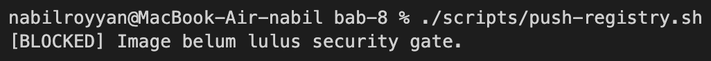

**Keterangan.** `[BLOCKED] Image belum lulus security gate.` Script menolak mempromosikan image yang belum lulus — perilaku *fail-closed* yang diharapkan.

### 32. Login ke Private Registry

```bash
set -a; source .env; set +a
printf '%s\n' "$REGISTRY_PASSWORD" | docker login "$REGISTRY_HOST" --username "$REGISTRY_USER" --password-stdin
```

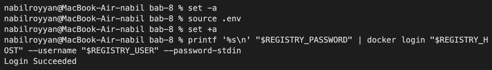

**Keterangan.** `Login Succeeded` — daemon memercayai CA dan autentikasi bcrypt berhasil.

### 33. Uji Push/Pull Private Registry (Manual)

```bash
docker tag "$APP_IMAGE" "$REGISTRY_HOST/pens-web:1.0"
docker push "$REGISTRY_HOST/pens-web:1.0"
docker pull "$REGISTRY_HOST/pens-web:1.0"
curl --cacert registry/certs/domain.crt --user "$REGISTRY_USER:$REGISTRY_PASSWORD" "https://$REGISTRY_HOST/v2/_catalog"
curl --cacert registry/certs/domain.crt --user "$REGISTRY_USER:$REGISTRY_PASSWORD" "https://$REGISTRY_HOST/v2/pens-web/tags/list"
docker logout "$REGISTRY_HOST"
```

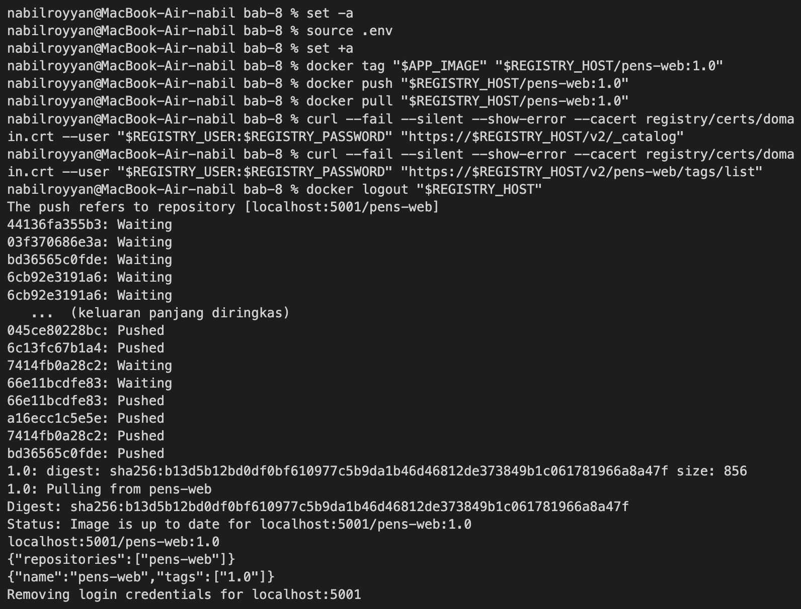

**Keterangan.** Untuk membuktikan registry TLS+auth benar-benar berfungsi, dilakukan uji push/pull manual: push berhasil (digest `sha256:b13d5b12…`), pull berhasil, katalog menampilkan `{"repositories":["pens-web"]}`, daftar tag menampilkan `{"name":"pens-web","tags":["1.0"]}`, lalu logout. Promosi **otomatis** tetap diblokir gate; langkah ini murni membuktikan kemampuan registry. (Progres layer diringkas.)

### 34. Membuktikan Secret Tidak Masuk Image

```bash
docker history pens-web:1.0 | head -n 12
docker run --rm --entrypoint sh pens-web:1.0 -c 'test ! -e /run/secrets/app_secret && test ! -d /secrets && echo SECRET_NOT_IN_IMAGE'
```

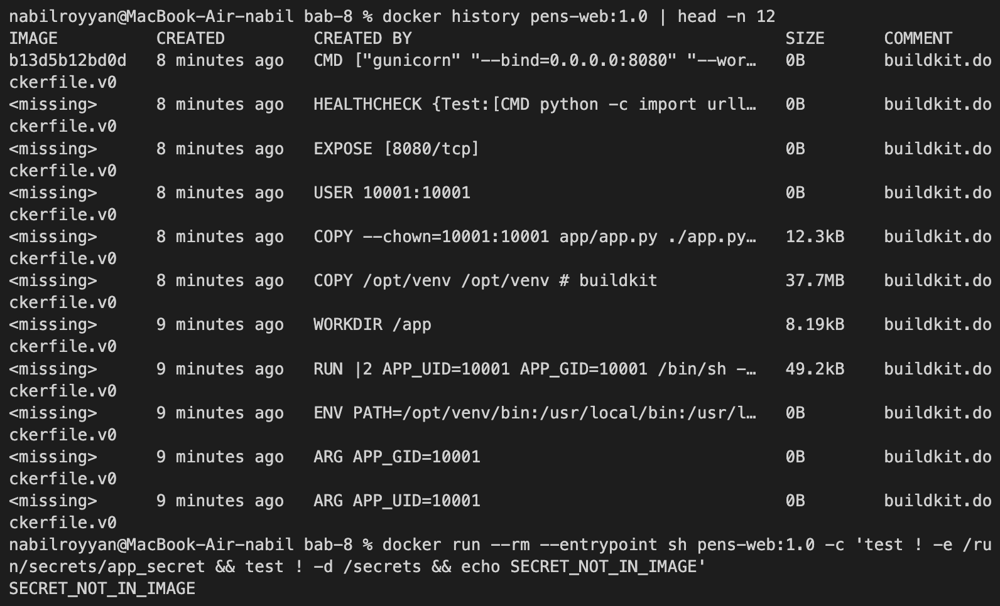

**Keterangan.** `docker history` tidak menunjukkan secret, dan uji pada image mengeluarkan `SECRET_NOT_IN_IMAGE` — file secret runtime tidak ada di dalam image.

### 35. Cleanup — Hentikan Stack

```bash
docker compose --profile tools down --remove-orphans
```

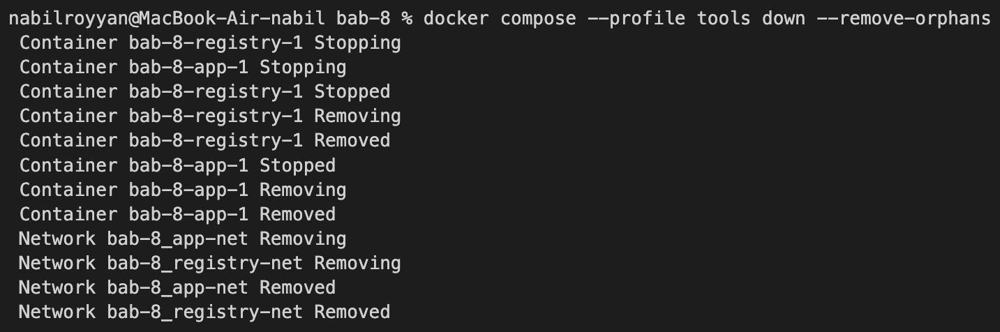

**Keterangan.** Menghentikan container tanpa menghapus volume registry.

### 36. Cleanup — Hapus Volume

```bash
docker compose --profile tools down --volumes --remove-orphans
```

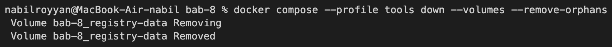

**Keterangan.** Menghapus container, network, isi registry, dan cache Trivy. Laporan di `reports/` tetap ada di host.

## Hasil Uji Penerimaan

| No. | Kontrol | Evidence | Hasil |
|---:|---|---|---|
| 1 | User non-root | `id -u` / response app | UID 10001 |
| 2 | Read-only rootfs | `touch /unauthorized-write` | Ditolak |
| 3 | Writable path terkontrol | `/tmp` | Berhasil dan dapat dihapus |
| 4 | Capability | `CapEff` | Seluruh bit nol |
| 5 | Privilege escalation | `NoNewPrivs` | Nilai 1 |
| 6 | Secret injection | `/run/secrets/app_secret` | Ada; tanpa `APP_SECRET` |
| 7 | Docker socket | pemeriksaan socket | Tidak tersedia |
| 8 | Resource limit | `docker inspect` | Memory/CPU/PID/swap dibatasi |
| 9 | Healthcheck | `/health` | HTTP 200 |
| 10 | Scan lengkap | laporan + SBOM | Terbentuk (checksum tertunda karena gate) |
| 11 | Security gate | `gate-status.txt` | `BLOCKED` (7 HIGH fixable) |
| 12 | TLS registry | `curl --cacert` | Validasi sertifikat berhasil |
| 13 | Authentication | `/v2/` anonim | HTTP 401 |
| 14 | Distribusi | push/pull/katalog/digest | Berhasil (uji manual) |

## Analisis dan Evaluasi

**Hardening berhasil diverifikasi.** Sebelas kontrol lulus, termasuk non-root, read-only rootfs, capability kosong, dan secret via file mount. Prinsip penting: setiap hardening diuji terhadap fungsi aplikasi — aplikasi tetap melayani `/` dan `/health` setelah semua pembatasan diterapkan.

**Security gate bekerja sesuai desain.** Gate memblokir promosi karena base image memiliki 7 temuan HIGH yang dapat diperbaiki. Sesuai panduan, status tidak diubah manual; jalan keluar yang benar adalah memperbarui base image/dependency lalu memindai ulang. Ini menunjukkan gate sebagai kontrol yang fail-closed.

**Dua kendala platform nyata.** (1) Jaringan `internal: true` membuat port tidak terpublikasi pada Docker Desktop — perlu diubah ke `driver: bridge`. (2) tmpfs `/tmp` 64m terlalu kecil untuk DB Trivy (~134 MB) sehingga gagal `no space left on device`; perlu 1g. Selain itu, port registry dipindah ke 5001 karena port 5000 dipakai AirPlay.

**Risiko dan rekomendasi.** Sertifikat self-signed hanya untuk lab; produksi memerlukan CA tepercaya, digest pinning, rotasi credential, dan autentikasi registry yang lebih kaya dari htpasswd. Jaringan `bridge` kembali membuka egress; pada produksi gunakan kebijakan network/egress terkontrol. Hapus CA lab dari trust store setelah praktikum.

## Rangkuman

Seluruh tujuan Bab 8 tercapai: hardening runtime terverifikasi (11 kontrol PASS), pemindaian Trivy menghasilkan laporan+SBOM dan gate memblokir image berisiko, secret tidak masuk image, serta private registry ber-TLS dan berautentikasi terbukti menerima dan mengembalikan image. Tiga hambatan nyata — konflik port AirPlay, jaringan `internal` yang memblokir publikasi port, dan tmpfs Trivy yang terlalu kecil — didiagnosis dari pesan galat dan diperbaiki, sesuai semangat praktikum.
