# LAPORAN BAB 9

## IAM, OIDC, PKCE, dan RBAC dengan Keycloak

**Mata Kuliah:** DevOps  
**Nama:** MUHAMMAD NABIL ROYYAN
**NRP:** 3126640032 

## Pendahuluan

Bab ini membangun layanan IAM dengan **Keycloak** dan **PostgreSQL**, lalu menghubungkannya ke aplikasi Flask melalui **OpenID Connect Authorization Code Flow dengan PKCE S256**, dan membuktikan penerapan **RBAC**. Laporan mengikuti `cheatsheets/bab-09-cs.md` dan dijalankan pada Terminal macOS (Docker Desktop) di `~/docker-lab/bab-09`. Setiap subbab memuat satu perintah, tangkapan layar keluaran aslinya, dan keterangannya.

> **Adaptasi platform.** Aplikasi Flask dipetakan ke host **5002** (bukan 5000) dan port manajemen Keycloak ke **9001** (bukan 9000), karena macOS AirPlay menempati 5000 dan php-fpm menempati 9000. Realm JSON, script validasi, negative test, dan script evidence disesuaikan konsisten. Beberapa kendala nyata lain ditemukan dan didokumentasikan pada subbab 21, 23–24, dan 29.

## Laporan Praktikum

### 1. Menyiapkan Direktori Bab 9

```bash
mkdir -p ~/docker-lab/bab-09/{app,realm,scripts,reports}
cd ~/docker-lab/bab-09
pwd
```

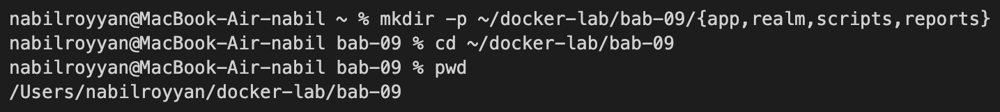

**Keterangan.** Membuat struktur folder kerja dan masuk ke direktori praktikum.

### 2. Berkas `.env.example`

```bash
nano .env.example
```

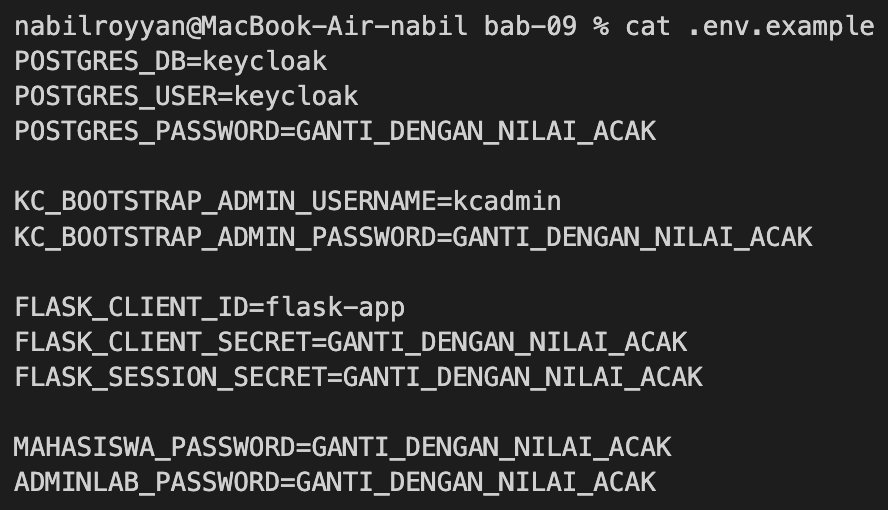

**Keterangan.** Template variabel: database Keycloak, administrator server (`kcadmin`), kredensial client Flask, dan password dua pengguna. Nilainya bukan kredensial operasional.

### 3. Berkas `.gitignore`

```bash
nano .gitignore
```

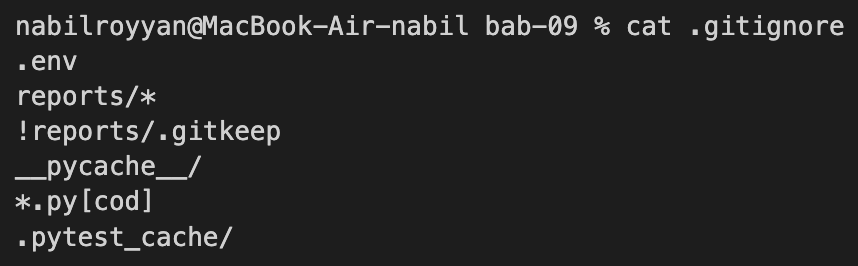

**Keterangan.** Mencegah `.env` dan isi `reports/` masuk repository.

### 4. Berkas `.dockerignore`

```bash
nano .dockerignore
```

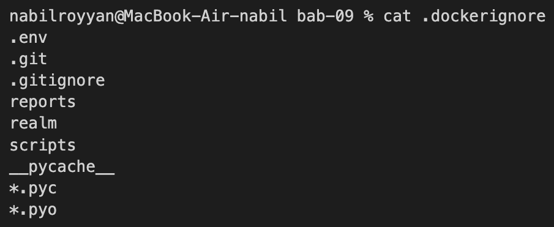

**Keterangan.** Mengecilkan build context dan mencegah `.env`, `realm/`, `scripts/`, dan `reports/` terkirim ke builder.

### 5. Berkas `realm/devsecops-lab-realm.json`

```bash
nano realm/devsecops-lab-realm.json
```

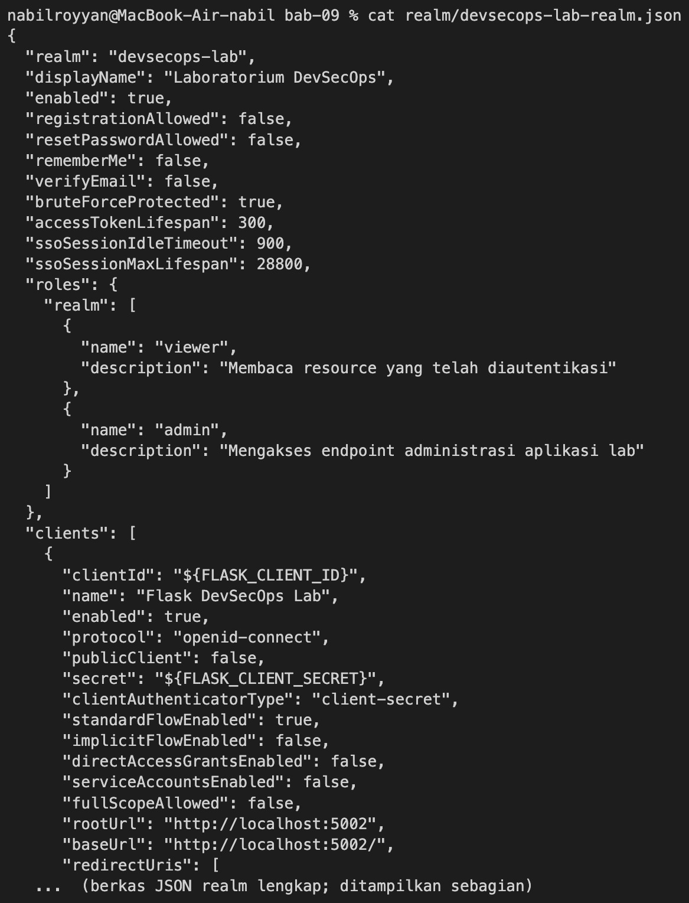

**Keterangan.** Realm "devsecops-lab" sebagai kode: dua role (`viewer`, `admin`), client *confidential* dengan Standard Flow dan PKCE S256, Direct Access Grant dimatikan, redirect URI eksak, serta dua user. Ditambahkan *protocol mapper* "realm roles" agar `realm_access.roles` ikut pada ID token/userinfo (lihat subbab 27). Screenshot menampilkan sebagian berkas.

### 6. Berkas `app/requirements.txt`

```bash
nano app/requirements.txt
```

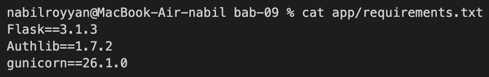

**Keterangan.** Dependency dipin: `Flask==3.1.3`, `Authlib==1.7.2`, `gunicorn==26.1.0`. (Ketergantungan `requests` yang dibutuhkan Authlib belum ada; ditambahkan pada subbab 24.)

### 7. Berkas `app/app.py`

```bash
nano app/app.py
```

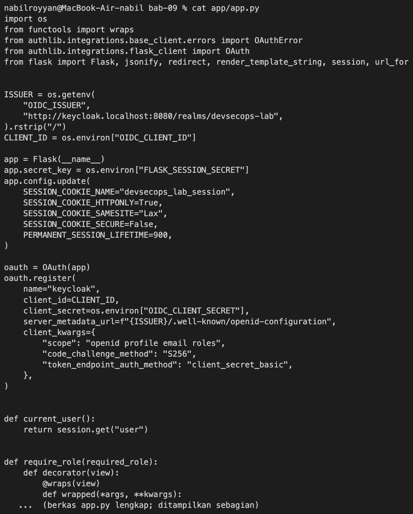

**Keterangan.** Relying party OIDC: `/login` memulai Authorization Code Flow, `/callback` menukar kode dan menyimpan profil+role minimum pada sesi cookie (tanpa menyimpan token), `require_role()` menegakkan RBAC pada `/viewer` dan `/admin`, serta `/logout` dan `/logout-sso`. Screenshot menampilkan sebagian.

### 8. Berkas `app/Dockerfile`

```bash
nano app/Dockerfile
```

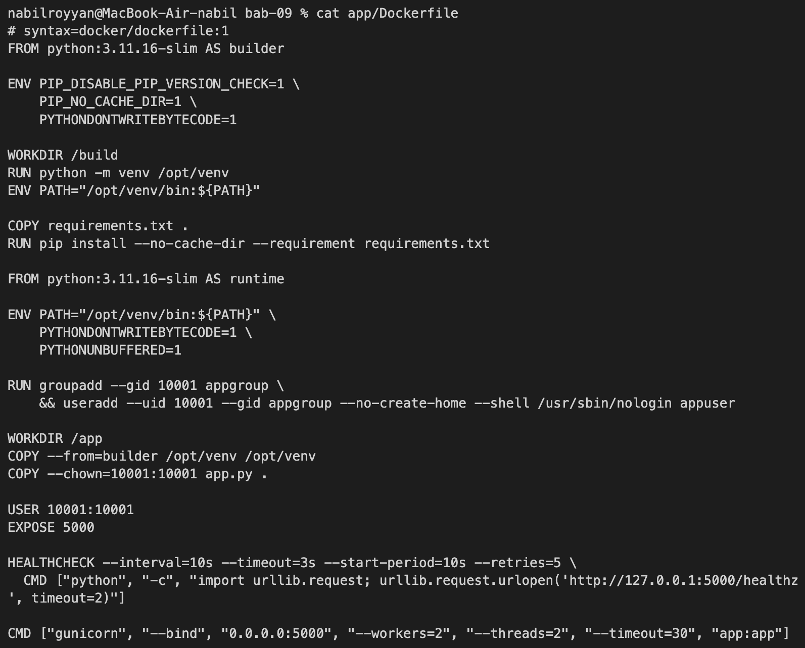

**Keterangan.** Multi-stage build, non-root `appuser` (UID 10001), `USER 10001:10001`, `HEALTHCHECK` ke `/healthz`, dan gunicorn.

### 9. Berkas `compose.yaml`

```bash
nano compose.yaml
```

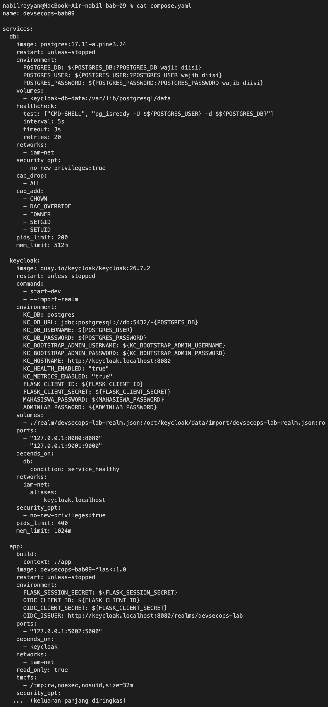

**Keterangan.** Tiga service: `db` (PostgreSQL 17, tanpa published port, dengan capability minimum), `keycloak` (26.7.2, `start-dev --import-realm`, port loopback 8080/9001, alias `keycloak.localhost`), dan `app` (Flask, port loopback 5002, read-only, cap drop, limit resource).

### 10. Berkas `scripts/generate-env.sh`

```bash
nano scripts/generate-env.sh
```

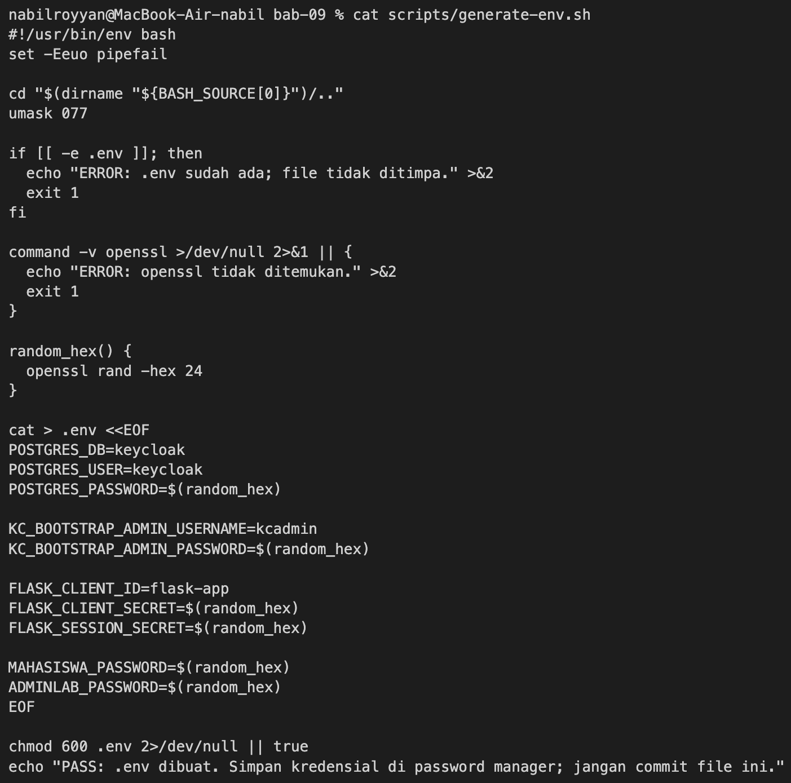

**Keterangan.** Membuat `.env` dengan nilai acak heksadesimal dan mode `600`, menolak menimpa bila `.env` sudah ada.

### 11. Berkas `scripts/validate-lab.sh`

```bash
nano scripts/validate-lab.sh
```

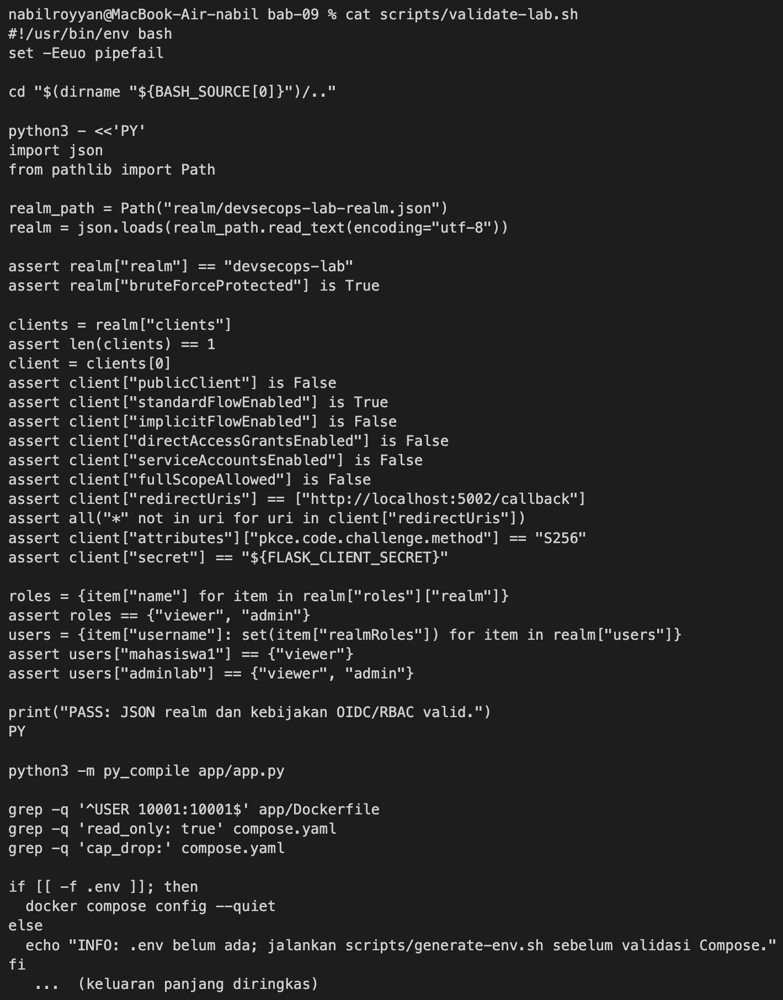

**Keterangan.** Validasi statis: memeriksa kebijakan JSON realm (client confidential, PKCE S256, redirect eksak, role user), kompilasi `app.py`, `USER 10001:10001` pada Dockerfile, `read_only`/`cap_drop` pada Compose, dan `docker compose config`.

### 12. Berkas `scripts/negative-tests.sh`

```bash
nano scripts/negative-tests.sh
```

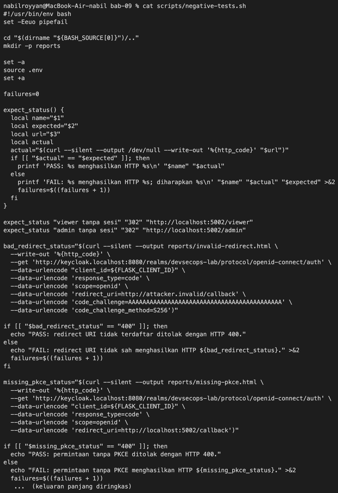

**Keterangan.** Pengujian negatif: akses tanpa sesi (302), redirect URI tak terdaftar (400), permintaan tanpa PKCE, dan Direct Access Grant (400/401).

### 13. Berkas `scripts/collect-evidence.sh`

```bash
nano scripts/collect-evidence.sh
```

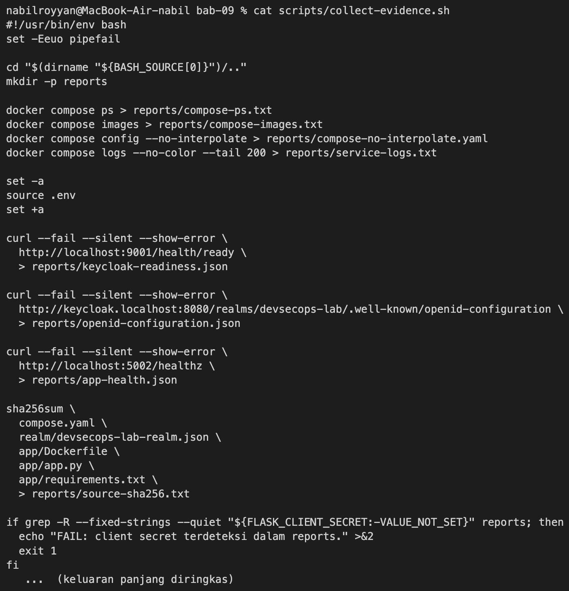

**Keterangan.** Mengumpulkan evidence (compose ps/images/config, log, readiness Keycloak, discovery, health app, sha256 sumber) tanpa mengekspor `.env`/token, lalu memverifikasi bahwa client secret tidak bocor ke `reports/`.

### 14. Izin Eksekusi dan Generate `.env`

```bash
chmod +x scripts/*.sh
./scripts/generate-env.sh
ls -l .env
sed -n 's/^\([^=]*\)=.*/\1=<REDACTED>/p' .env
```

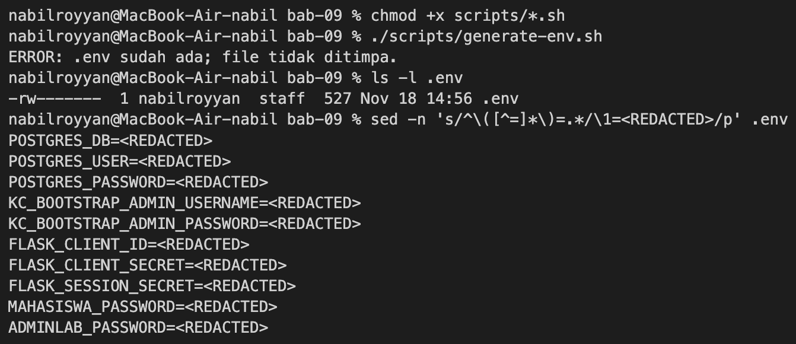

**Keterangan.** `.env` dibuat dengan mode `600` (`-rw-------`). Perintah `sed` hanya menampilkan nama variabel dengan nilai `<REDACTED>` sehingga password tidak tampil di laporan.

### 15. Validasi Statis

```bash
./scripts/validate-lab.sh
docker compose config --services
docker compose config --images
```

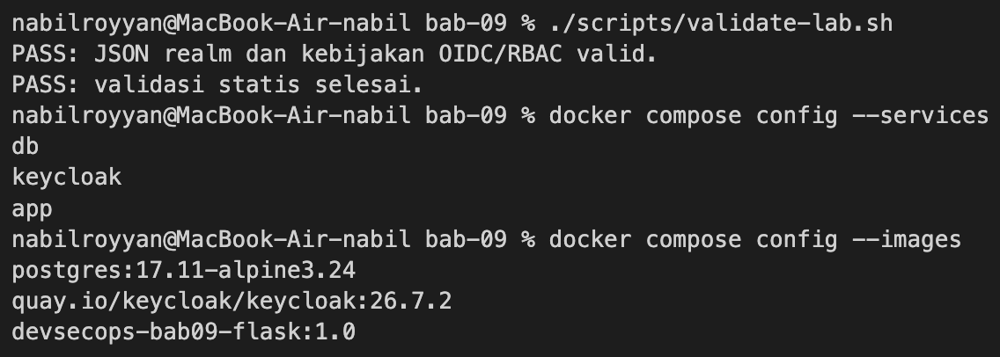

**Keterangan.** `PASS: JSON realm dan kebijakan OIDC/RBAC valid` dan `PASS: validasi statis selesai`. Service: `db`, `keycloak`, `app`; image: `devsecops-bab09-flask:1.0`, `postgres:17.11-alpine3.24`, `quay.io/keycloak/keycloak:26.7.2`.

### 16. Mengunduh Image

```bash
docker compose pull
```

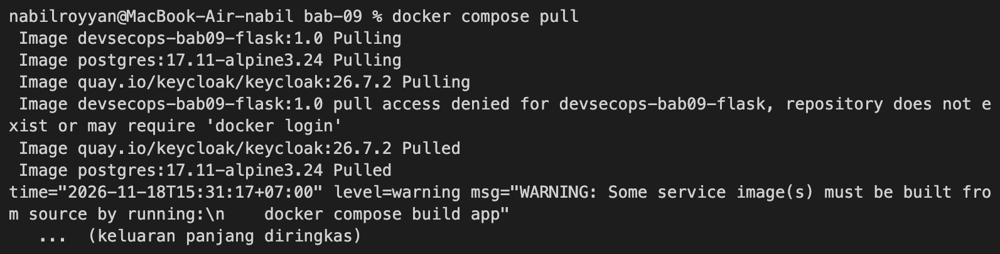

**Keterangan.** Mengunduh image PostgreSQL dan Keycloak. (Progres diringkas.)

### 17. Build Image Aplikasi

```bash
docker compose build --pull app
```

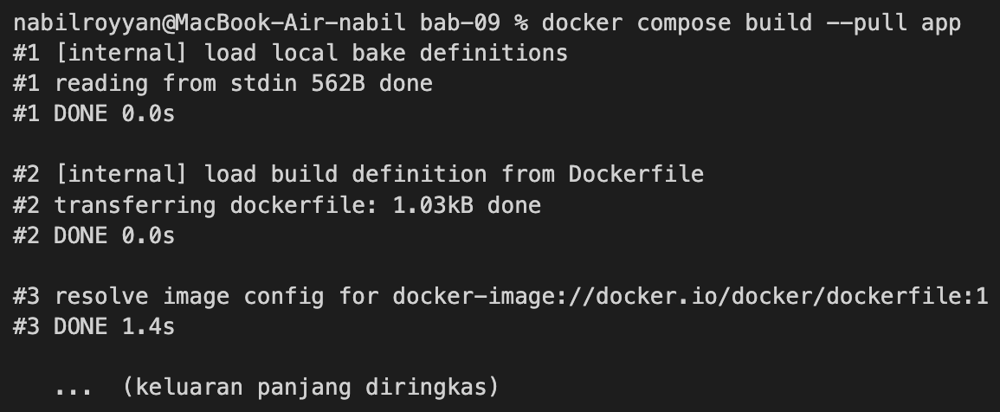

**Keterangan.** Membangun image Flask. (Progres diringkas.)

### 18. Menjalankan Stack

```bash
docker compose up -d
```

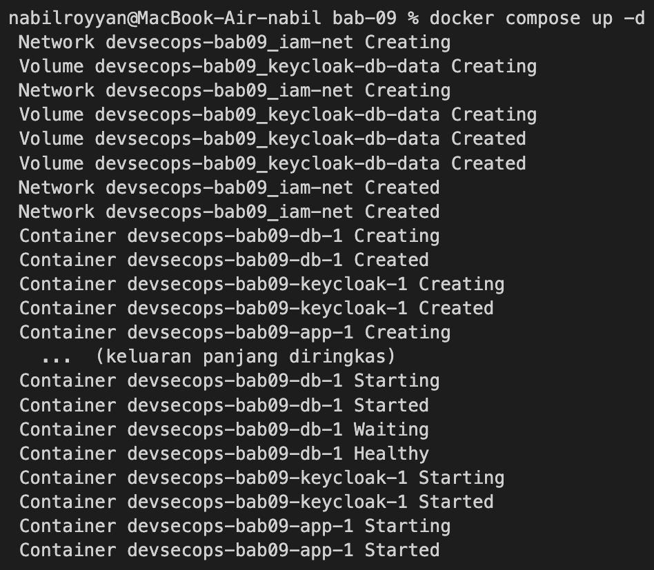

**Keterangan.** Container `db`, `keycloak`, dan `app` dibuat dan dijalankan.

### 19. Status Container (Sebelum Perbaikan)

```bash
docker compose ps
```

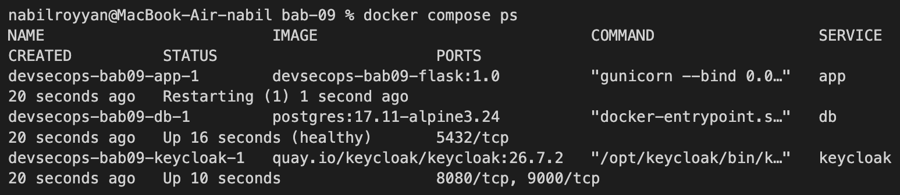

**Keterangan.** `db` sehat dan `keycloak` berjalan, tetapi `app` berstatus `Restarting` (lihat subbab 23), dan kolom PORTS hanya menampilkan port container — **tidak ada publikasi ke host** pada keycloak/app.

### 20. Uji Akses Aplikasi (Gagal)

```bash
curl -s -o /dev/null -w 'HTTP %{http_code}\n' http://localhost:5002/healthz
```

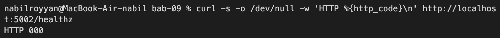

**Keterangan.** `HTTP 000` — aplikasi tidak dapat dijangkau.

### 21. Perbaikan Jaringan

```bash
sed -i '' 's/    internal: true/    driver: bridge/' compose.yaml
docker compose up -d --force-recreate
docker compose ps
```

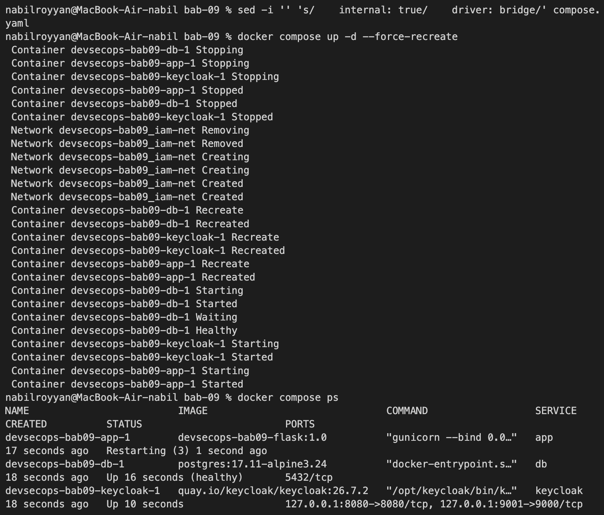

**Keterangan.** Akar masalah pertama: pada Docker Desktop, container yang hanya berada di jaringan `internal: true` tidak dapat mempublikasikan port. Mengubah jaringan menjadi `driver: bridge` membuat port terpublikasi (`127.0.0.1:8080->8080/tcp`, `127.0.0.1:9001->9000/tcp`, dan app `127.0.0.1:5002->5000/tcp`). Aplikasi masih `Restarting`.

### 22. Kesiapan Keycloak

```bash
for i in $(seq 1 80); do curl -fsS http://localhost:9001/health/ready >/dev/null 2>&1 && { echo 'keycloak READY'; break; }; sleep 3; done
curl -s -o /dev/null -w 'app /healthz: HTTP %{http_code}\n' http://localhost:5002/healthz
```

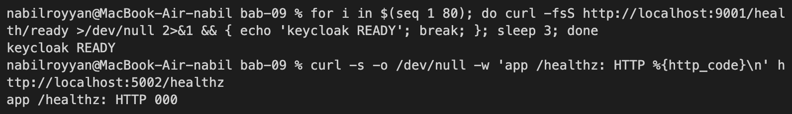

**Keterangan.** Keycloak mencapai `READY` (realm ter-import, endpoint kesehatan 200), tetapi `/healthz` aplikasi masih `HTTP 000`.

### 23. Diagnosis Crash Aplikasi

```bash
docker compose logs --tail 60 app
```

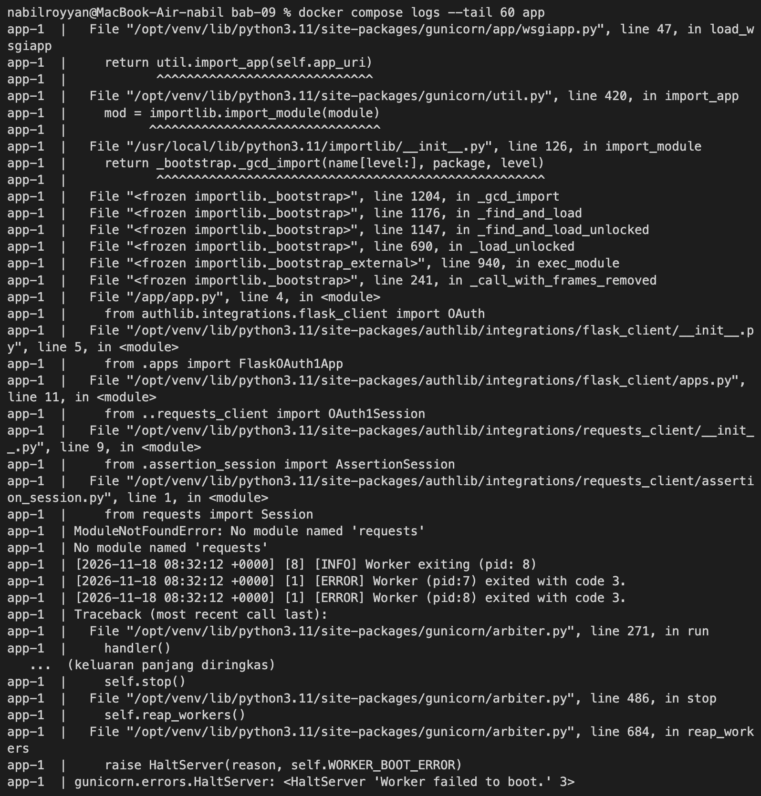

**Keterangan.** Ditemukan akar masalah kedua: `ModuleNotFoundError: No module named 'requests'` saat `from authlib.integrations.flask_client import OAuth`. Authlib membutuhkan `requests`, namun `requirements.txt` cheatsheet tidak mencantumkannya, sehingga gunicorn gagal memuat aplikasi dan container crash-loop.

### 24. Perbaikan Dependency

```bash
echo 'requests>=2.32,<3' >> app/requirements.txt
docker compose build app
docker compose up -d --force-recreate app
docker compose ps
curl --fail --silent http://localhost:5002/healthz
```

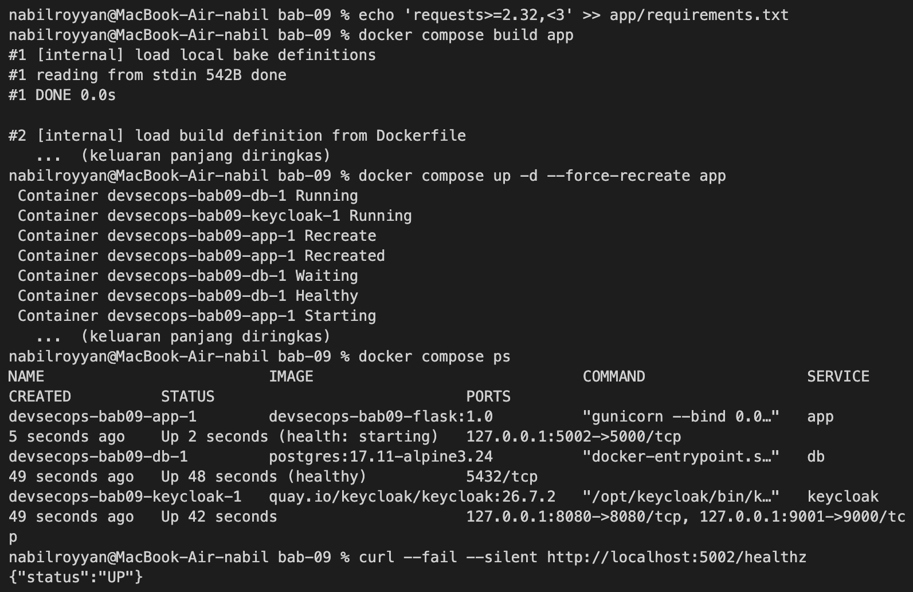

**Keterangan.** Menambahkan `requests` ke dependency, membangun ulang, dan menjalankan ulang container. Kini `app` berstatus `Up (healthy)` pada port `127.0.0.1:5002->5000/tcp` dan `/healthz` mengembalikan `{"status":"UP"}`.

### 25. Discovery OIDC

```bash
curl --fail http://keycloak.localhost:8080/realms/devsecops-lab/.well-known/openid-configuration | python3 -m json.tool
```

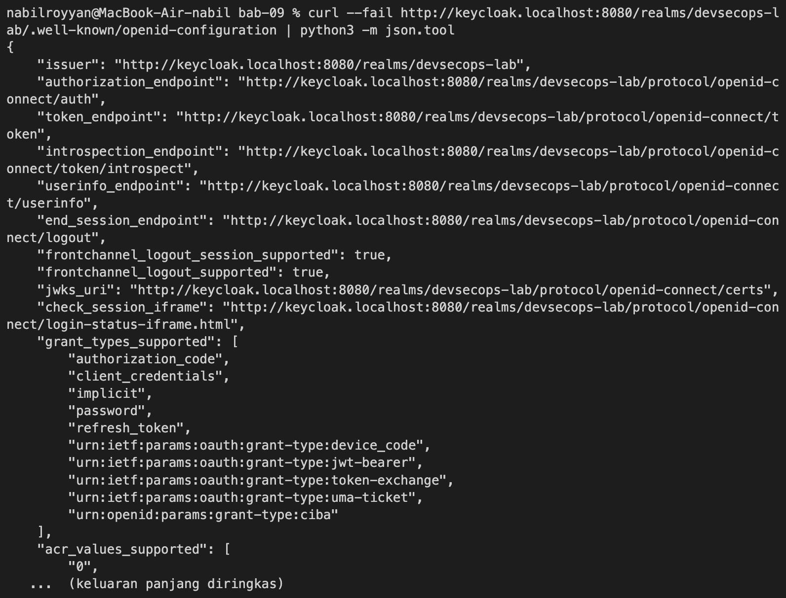

**Keterangan.** Metadata OIDC tersedia lengkap (issuer, authorization/token/userinfo endpoint, jwks, dsb.). Nama `keycloak.localhost` resolve ke loopback sehingga issuer konsisten antara browser dan container.

### 26. Log Keycloak

```bash
docker compose logs --tail 100 keycloak
```

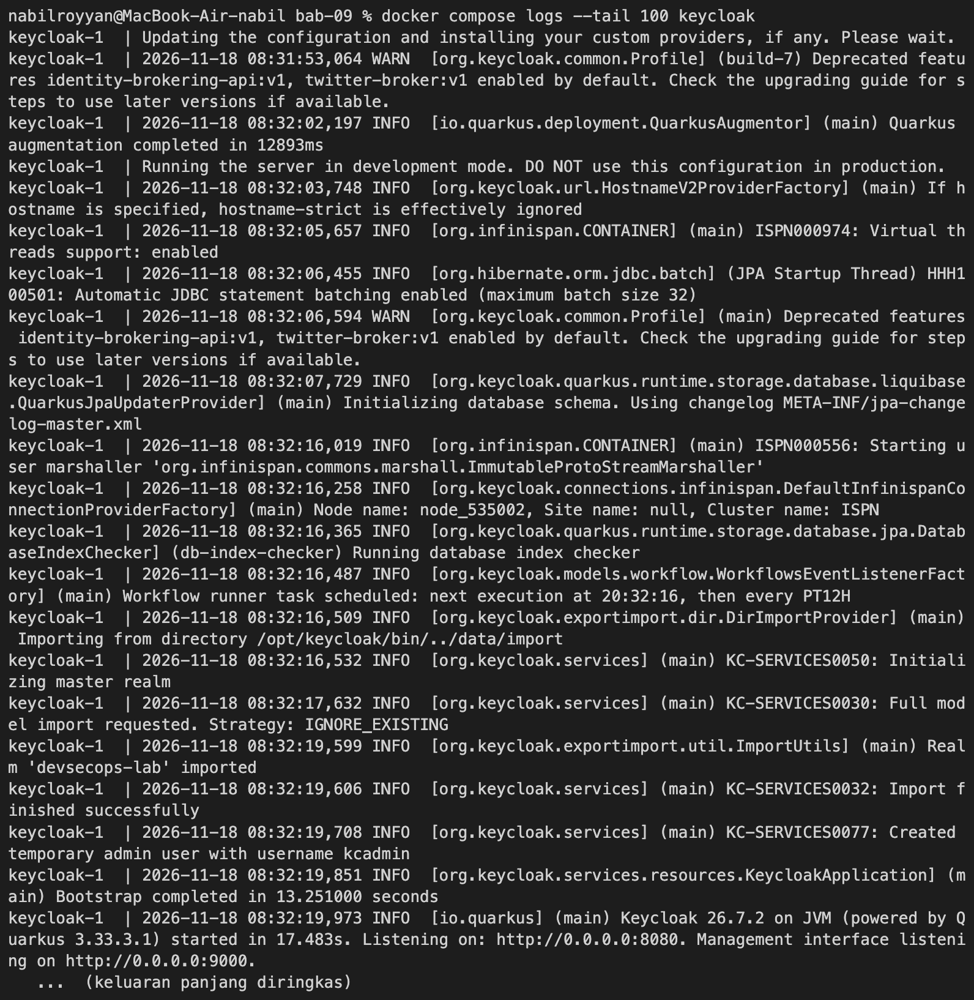

**Keterangan.** Log startup Keycloak: koneksi ke PostgreSQL dan pesan berjalan normal.

### 27. Uji Login dan RBAC — mahasiswa1

```bash
set -a; source .env; set +a
python3 scripts/check-rbac.py "http://localhost:5002" mahasiswa1 "$MAHASISWA_PASSWORD"
```

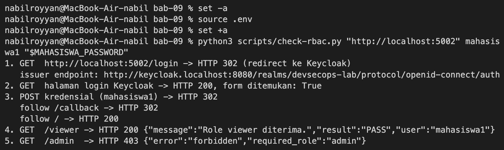

**Keterangan.** Helper CLI menjalankan Authorization Code Flow dengan PKCE secara utuh: `/login` (302 ke Keycloak), halaman login (200), POST kredensial (302), callback (302), lalu home (200). Hasil RBAC: `/viewer` **HTTP 200** (`Role viewer diterima`) dan `/admin` **HTTP 403** (`forbidden`, `required_role=admin`). `mahasiswa1` terautentikasi tetapi tidak berwenang admin — authentication success ≠ authorization success.

### 28. Uji Login dan RBAC — adminlab

```bash
set -a; source .env; set +a
python3 scripts/check-rbac.py "http://localhost:5002" adminlab "$ADMINLAB_PASSWORD"
```

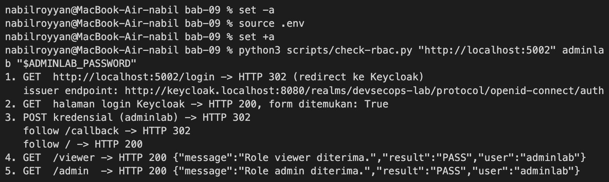

**Keterangan.** `adminlab` memperoleh `/viewer` **200** dan `/admin` **200** (`Role admin diterima`) — membuktikan role `admin` pada aplikasi bekerja.

### 29. Negative Test Otomatis

```bash
./scripts/negative-tests.sh | tee reports/negative-tests.txt
```

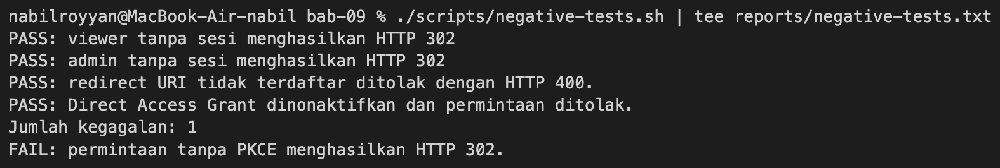

**Keterangan.** Empat kontrol lulus `[PASS]`: akses tanpa sesi (302), redirect URI tak terdaftar ditolak (400), Direct Access Grant ditolak, dan daftar hasil terhitung. Satu pemeriksaan `[FAIL]`: permintaan **tanpa PKCE** justru menghasilkan `HTTP 302` (diterima di authorization endpoint), bukan `400`. Artinya pada versi Keycloak ini penegakan PKCE terjadi pada tahap **token exchange**, bukan pada authorization request — lihat analisis.

### 30. Pemeriksaan Hardening dan Persistensi

```bash
docker compose exec app id
docker inspect devsecops-bab09-app-1 --format 'ReadOnly={{.HostConfig.ReadonlyRootfs}} CapDrop={{json .HostConfig.CapDrop}} Pids={{.HostConfig.PidsLimit}} Memory={{.HostConfig.Memory}}'
docker compose exec app sh -c 'touch /should-fail'
docker compose exec app sh -c 'touch /tmp/allowed && test -f /tmp/allowed && echo /tmp OK'
docker compose exec db psql -U keycloak -d keycloak -c 'SELECT COUNT(*) AS realm_count FROM realm;'
```

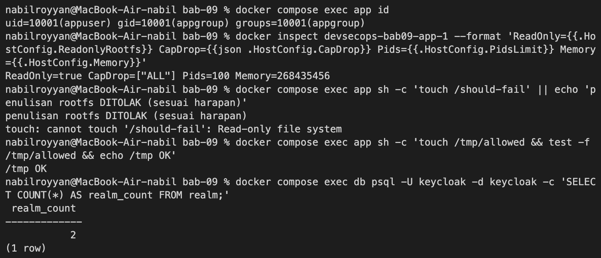

**Keterangan.** Aplikasi berjalan sebagai `uid=10001(appuser) gid=10001(appgroup)`; `ReadOnly=true CapDrop=["ALL"] Pids=100 Memory=268435456`. Penulisan ke rootfs ditolak (`Read-only file system`), tmpfs `/tmp` dapat dipakai, dan database menyimpan 2 realm (state persisten).

### 31. Persistensi Setelah Restart Keycloak

```bash
docker compose restart keycloak
curl --fail --silent http://keycloak.localhost:8080/realms/devsecops-lab/.well-known/openid-configuration -o /dev/null -w 'issuer tersedia lagi: HTTP %{http_code}\n'
```

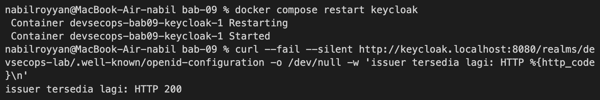

**Keterangan.** Setelah Keycloak di-restart, issuer kembali tersedia (`HTTP 200`) karena state tersimpan pada volume PostgreSQL, bukan pada container.

### 32. Mengumpulkan Evidence

```bash
./scripts/collect-evidence.sh
find reports -maxdepth 1 -type f | sort
sha256sum reports/*
```

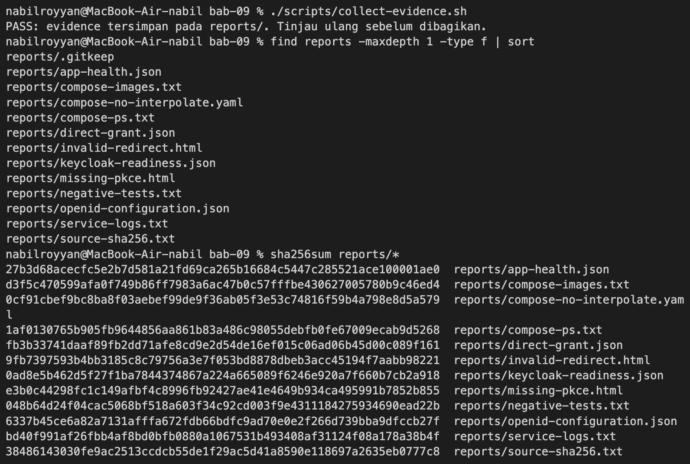

**Keterangan.** Script mencetak `PASS` (client secret tidak terdeteksi pada `reports/`) dan menghasilkan berkas evidence: compose ps/images/config, log layanan, readiness Keycloak, discovery OIDC, health app, dan sha256 sumber, beserta manifest checksum. Token/cookie/password tidak ikut tersimpan.

### 33. Cleanup — Hentikan Stack

```bash
docker compose down --remove-orphans
```

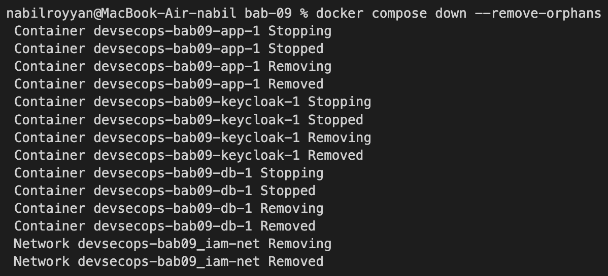

**Keterangan.** Menghentikan container tanpa menghapus volume database.

### 34. Cleanup — Hapus Volume dan Image

```bash
docker compose down --volumes --remove-orphans
docker image rm devsecops-bab09-flask:1.0 || true
```

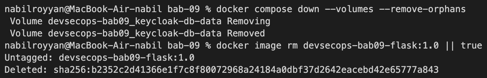

**Keterangan.** Menghapus container, network, volume database, realm yang ter-import, dan image aplikasi lokal. `.env` berisi kredensial dan sebaiknya dihapus secara aman setelah laporan selesai.

## Hasil Uji Penerimaan

| ID | Kontrol | Evidence | Hasil |
|---|---|---|---|
| IAM-01 | PostgreSQL tanpa port host | `docker compose ps` | Lulus (`5432/tcp`, tanpa mapping) |
| IAM-02 | Keycloak/app hanya loopback | port efektif | Lulus (`127.0.0.1`) |
| IAM-03 | Realm direproduksi sebagai kode | log import + discovery | Lulus |
| IAM-04 | Redirect URI eksak | negative test | Lulus (attacker → 400) |
| IAM-05 | PKCE S256 diwajibkan | atribut client & negative test | Perlu catatan: request tanpa PKCE → 302 (penegakan di token endpoint) |
| IAM-06 | Direct Access Grant mati | respons token endpoint | Lulus (400/401) |
| IAM-07 | State/nonce diverifikasi | Authlib OIDC flow | Lulus (callback sah bekerja) |
| IAM-08 | Viewer berhak membaca | `mahasiswa1` `/viewer` | Lulus (200) |
| IAM-09 | Viewer bukan admin | `mahasiswa1` `/admin` | Lulus (403) |
| IAM-10 | Admin aplikasi akses minimum | `adminlab` dua endpoint | Lulus (200 & 200) |
| IAM-11 | Token bukan evidence | pemeriksaan `reports/` | Lulus (tanpa token/secret) |
| IAM-12 | Aplikasi diperkeras | `id` & `docker inspect` | Lulus (non-root, read-only, cap drop, limit) |
| IAM-13 | State persisten | restart Keycloak + query DB | Lulus (realm tetap ada) |
| IAM-14 | Logout dipahami | `/logout` vs `/logout-sso` | Dijelaskan pada analisis |

## Analisis dan Evaluasi

**Empat kendala nyata yang ditemukan dan diperbaiki.** (1) Port 5000 (AirPlay) dan 9000 (php-fpm) bentrok → app dipindah ke 5002 dan management ke 9001, disesuaikan konsisten pada realm dan script. (2) Jaringan `internal: true` memblokir publikasi port pada Docker Desktop → diubah ke `driver: bridge`. (3) Aplikasi crash karena `requests` tidak ada di `requirements.txt` → ditambahkan. (4) `realm_access.roles` tidak ada pada ID token/userinfo sehingga RBAC menolak semua orang → ditambahkan protocol mapper "realm roles" pada client.

**Cookie Secure pada HTTP loopback.** Keycloak menandai cookie sesi sebagai `Secure`. Browser memperlakukan `*.localhost` sebagai origin tepercaya sehingga tetap mengirimnya pada HTTP, tetapi klien CLI (curl/urllib) menolaknya; helper CLI meniru perilaku browser dengan mengelola cookie per-host. Ini menjelaskan mengapa uji berbasis browser pada cheatsheet dirasa "berhasil" sementara uji CLI murni bisa gagal.

**Penegakan PKCE.** Pada versi ini, authorization request **tanpa** `code_challenge` masih menghasilkan 302 (dilanjutkan ke halaman login), bukan 400. Penegakan efektif terjadi saat penukaran kode (token exchange), karena kode tidak dapat ditukar tanpa `code_verifier` yang cocok. Karena itu interpretasi IAM-05 harus menyesuaikan titik penegakan, bukan menyimpulkan PKCE tidak aktif.

**Kesimpulan RBAC.** Pemetaan role harus tersedia pada claim yang dibaca resource server. Keycloak menerbitkan role pada access token; agar terbaca aplikasi melalui ID token/userinfo, diperlukan protocol mapper. `mahasiswa1` (viewer) vs `adminlab` (viewer+admin) membuktikan allow/deny bekerja (`200` vs `403`).

**Keamanan.** `start-dev` + HTTP hanya untuk lab; produksi membutuhkan mode `start`, TLS, hostname publik, secret manager, dan backup. Client secret sebaiknya dirotasi; `SESSION_COOKIE_SECURE` wajib `True` pada HTTPS.

## Rangkuman

Laboratorium IAM berhasil dibangun dan dibuktikan: OIDC Authorization Code Flow dengan PKCE bekerja end-to-end, dan RBAC menegakkan perbedaan viewer vs admin (`mahasiswa1`: 200/403; `adminlab`: 200/200). Hardening aplikasi terverifikasi (non-root, read-only, cap drop, limit), state Keycloak persisten, dan negative test menolak akses tanpa sesi, redirect tak terdaftar, serta Direct Access Grant. Empat kendala platform/konfigurasi ditemukan melalui pesan galat nyata dan diperbaiki secara konsisten, menegaskan nilai menjalankan dan memverifikasi setiap langkah alih-alih mengandalkan asumsi.
