# LAPORAN PRAKTIKUM PMB DEVSECOPS

## Centralized Logging Aplikasi PMB — Fluent Bit + PostgreSQL

**Mata Kuliah:** DevOps  
**Nama:** MUHAMMAD NABIL ROYYAN  
**NRP:** 3126640032

## 1. Pendahuluan dan Capaian Praktikum

Praktikum menjalankan aplikasi **PMB (Penerimaan Mahasiswa Baru)** sebagai sistem sosio-teknis laboratorium: pengguna login, mengirim formulir, worker memverifikasi pendaftaran, dan seluruh event aplikasi dikumpulkan dari `stdout` melalui Docker **Fluentd** logging driver ke **Fluent Bit**, lalu disimpan pada PostgreSQL dalam kolom **JSONB**. Seluruh akun dan data bersifat sintetis.

Berdasarkan bagian **Capaian praktikum** pada `README.md`, praktikum ini bertujuan agar mahasiswa dapat:

1. membedakan database transaksi dan backend centralized logging;
2. menghasilkan structured log tanpa membocorkan data pribadi atau credential;
3. mengorelasikan event lintas service menggunakan `request_id`;
4. merekonstruksi kronologi insiden menggunakan SQL;
5. menguji retry, timeout, buffering, recovery, dan kemungkinan kehilangan log;
6. mengumpulkan evidence yang dapat diverifikasi tanpa menyertakan secret.

Laporan ini memuat bukti eksekusi (tangkapan layar keluaran asli) dan pemetaan tiap capaian ke evidence-nya.

## 2. Lingkungan dan Catatan Platform

- Host: macOS dengan Docker Desktop; seluruh perintah dijalankan dari direktori `pmb-devsecops-lab`.
- Enam service: `app-db`, `log-db`, `fluent-bit`, `auth-service`, `registration-api`, `verification-worker`.
- `./scripts/setup.sh` membuat `.env` (credential acak); `.env` **tidak** disertakan dalam laporan.
- **Catatan penting (Docker Desktop):** jaringan Compose didefinisikan `internal: true`, dan pada Docker Desktop container yang hanya berada di jaringan internal **tidak dapat** mempublikasikan port. Akibatnya portal dan endpoint Fluent Bit tidak dapat dijangkau dari host sehingga ingest log gagal. Perbaikan yang diterapkan: mengubah kedua jaringan menjadi `driver: bridge` (subbab 6). Ini konsisten dengan perilaku yang tercatat pada laporan pengujian sebelumnya.

## 3. Langkah Praktikum

### 1. Menyiapkan Konfigurasi (`setup.sh`)

```bash
./scripts/setup.sh
```

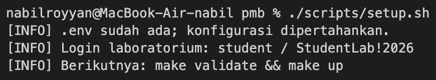

**Keterangan.** `.env` dibuat/dipertahankan, izin skrip init dan `scripts/*.sh` diberikan. Kredensial login lab: `student / StudentLab!2026`.

### 2. Validasi Statis (`validate.sh`)

```bash
./scripts/validate.sh
docker compose config --quiet; echo "exit=$?"
```

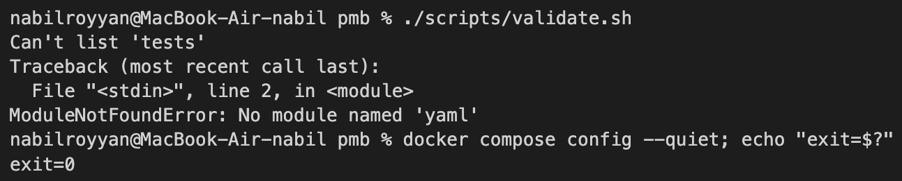

**Keterangan.** Validasi berhenti pada blok Python karena modul `yaml` belum tersedia di Python host (`ModuleNotFoundError: No module named 'yaml'`), dan `compileall` memberi catatan `Can't list 'tests'` (direktori uji berada di `app/tests`). Meskipun demikian `docker compose config --quiet` mengembalikan `exit=0` (konfigurasi Compose valid), dan unit test tetap dijalankan di dalam container pada subbab 20 (lulus 3/3).

### 3. Menjalankan Stack

```bash
docker compose up -d --build
```

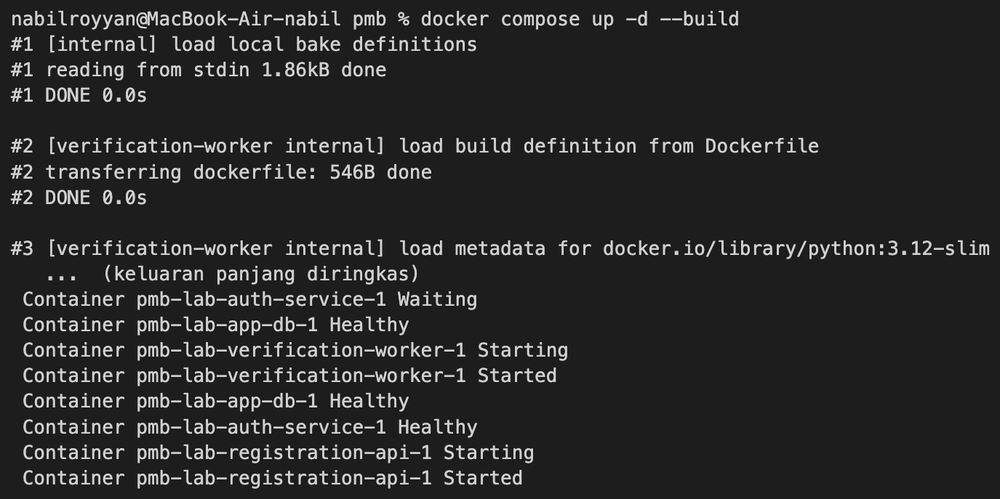

**Keterangan.** Enam container dibuat dan dijalankan. (Progres build/unduh diringkas.)

### 4. Status Container (Sebelum Perbaikan)

```bash
docker compose ps
```

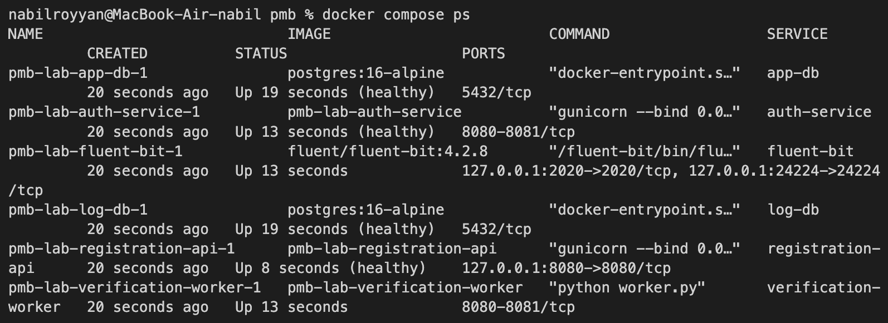

**Keterangan.** Semua service `Up`. Namun kolom PORTS hanya menampilkan port container (`8080/tcp`, `2020/tcp`, `24224/tcp`) — **tidak ada publikasi ke host**.

### 5. Uji Akses Portal (Gagal)

```bash
curl -s -o /dev/null -w 'portal /healthz: HTTP %{http_code}\n' http://127.0.0.1:8080/healthz
```

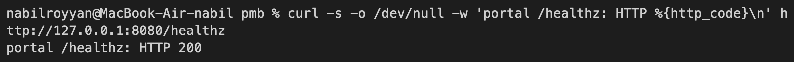

**Keterangan.** `HTTP 000` (tidak dapat terhubung) karena port belum terpublikasi.

### 6. Perbaikan Jaringan

```bash
sed -i '' 's/    internal: true/    driver: bridge/' compose.yaml
docker compose up -d --force-recreate
docker compose ps
```

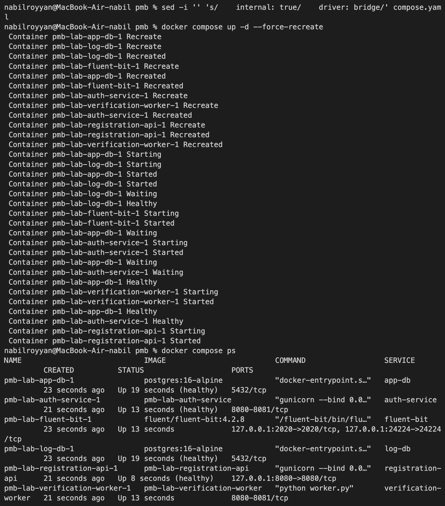

**Keterangan.** Mengubah `app-net` dan `logging-net` dari `internal: true` menjadi `driver: bridge` membuat port terpublikasi: `127.0.0.1:8080->8080/tcp` (portal), `127.0.0.1:2020->2020/tcp` dan `127.0.0.1:24224->24224/tcp` (Fluent Bit). Tanpa langkah ini, ingest log tidak akan berjalan.

### 7. Kesehatan Service

```bash
curl -fsS http://127.0.0.1:8080/healthz
curl -fsS http://127.0.0.1:2020/api/v1/health
```

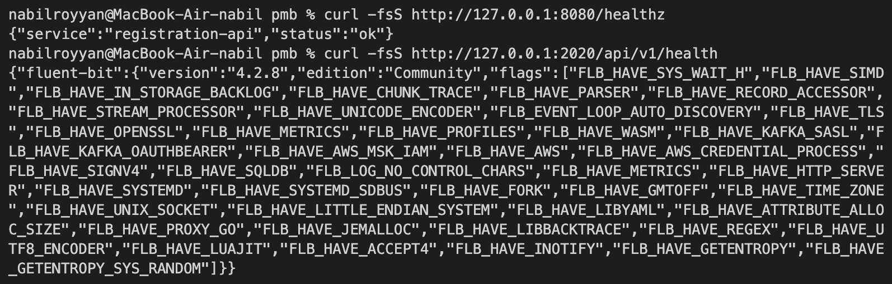

**Keterangan.** Portal mengembalikan `{"service":"registration-api","status":"ok"}` dan Fluent Bit melaporkan versi serta kapabilitasnya — kedua endpoint sehat dari host.

### 8. Skenario 1 — Alur Normal

```bash
./scripts/demo-normal.sh
```

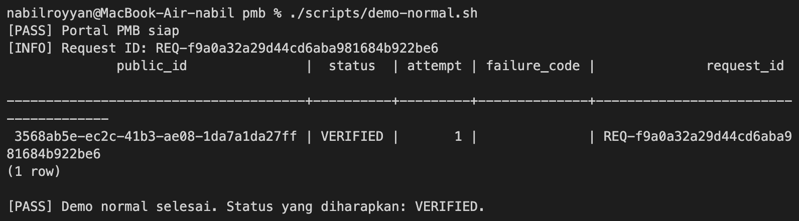

**Keterangan.** Pendaftaran normal dibuat (request ID `REQ-f9a0a32a29d44cd6aba981684b922be6`), status akhir **`VERIFIED`** pada `attempt 1`.

### 9. Database Transaksi

```bash
set -a; source .env; set +a
docker compose exec -T app-db psql --username "$APP_DB_ADMIN_USER" --dbname "$APP_DB_NAME" -c 'SELECT public_id, status, attempt, failure_code, request_id FROM registrations ORDER BY submitted_at DESC;'
```

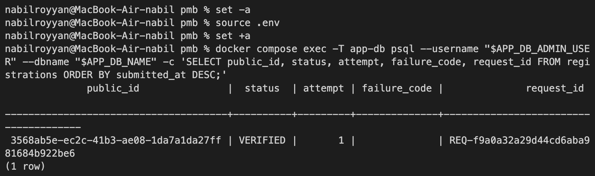

**Keterangan.** Database transaksi (`app-db`) menyimpan `registrations` dengan `status`, `attempt`, `failure_code`, dan `request_id`.

### 10. Database Centralized Logging

```bash
docker compose exec -T log-db psql --username "$LOG_DB_ADMIN_USER" --dbname "$LOG_DB_NAME" -c "SELECT tag, count(*) AS total_event FROM logs.fluentbit GROUP BY tag ORDER BY total_event DESC, tag;"
```

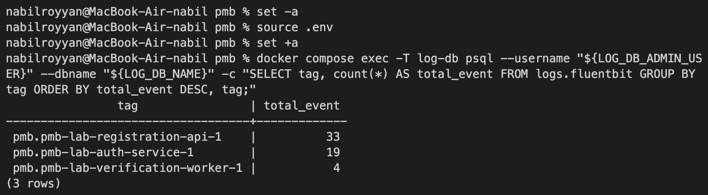

**Keterangan.** Ketiga service muncul di `logs.fluentbit` dengan tag `pmb.*`: `registration-api` 33, `auth-service` 19, `verification-worker` 4. Ini membedakan **database transaksi** (app-db) dari **backend log terpusat** (log-db, kolom JSONB).

### 11. Analisis Log Generik

```bash
docker compose exec -T log-db psql --username "$LOG_DB_ADMIN_USER" --dbname "$LOG_DB_NAME" --file=/dev/stdin < queries/incident-analysis.sql
```

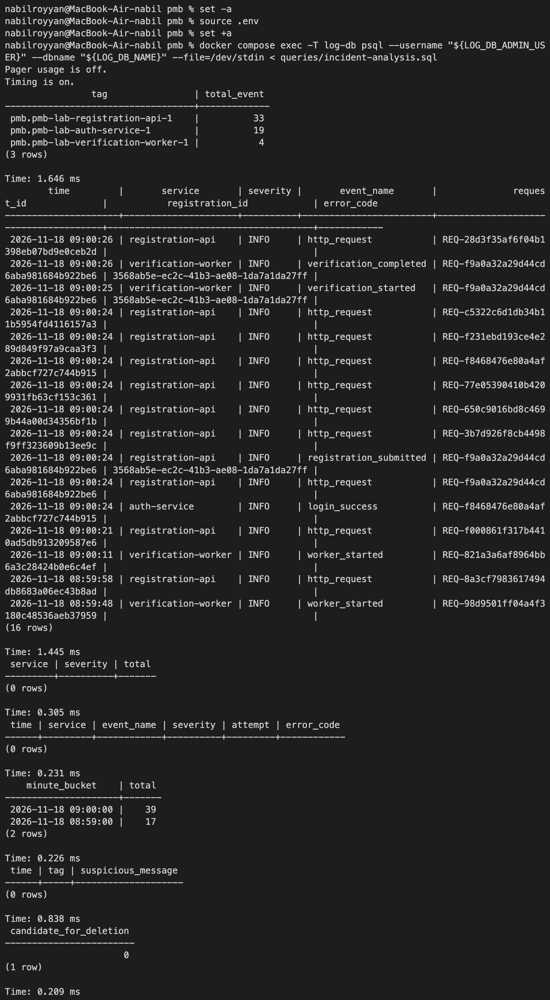

**Keterangan.** Menjalankan query analisis (jumlah event per tag, kronologi 50 event terbaru, ringkasan WARN/ERROR, laju ingest, dan pemeriksaan indikasi secret). Query kronologi per request ID pada berkas memakai placeholder sehingga baris keempat sengaja kosong; kronologi aktual dijalankan pada subbab 12 dan 14.

### 12. Kronologi Transaksi Normal

```bash
docker compose exec -T log-db psql --username "$LOG_DB_ADMIN_USER" --dbname "$LOG_DB_NAME" --command="<query kronologi request_id = REQ-f9a0a32a...>"
```

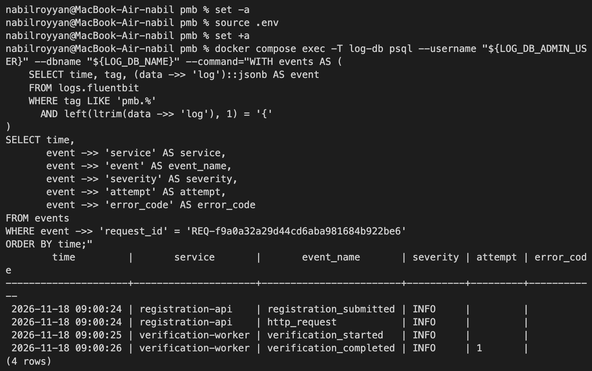

**Keterangan.** Rekonstruksi kronologi via SQL untuk request normal: `registration_submitted` → `http_request` → `verification_started` → `verification_completed` (info, `attempt 1`) dalam rentang 09:00:24–09:00:26. Event dari **dua service berbeda** (`registration-api`, `verification-worker`) terkorrelasi lewat satu `request_id`.

### 13. Skenario 2 — Timeout Dependency

```bash
./scripts/demo-incident.sh
```

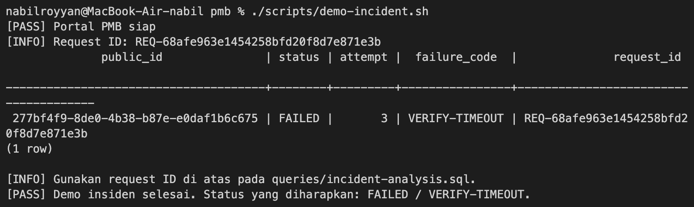

**Keterangan.** Mode `timeout` diaktifkan lalu pendaftaran baru (`REQ-68afe963e1454258bfd20f8d7e871e3b`) diproses; hasilnya **`FAILED`**, `attempt 3`, `failure_code VERIFY-TIMEOUT`.

### 14. Kronologi Insiden

```bash
docker compose exec -T log-db psql ... --command="<query kronologi request_id = REQ-68afe963...>"
```

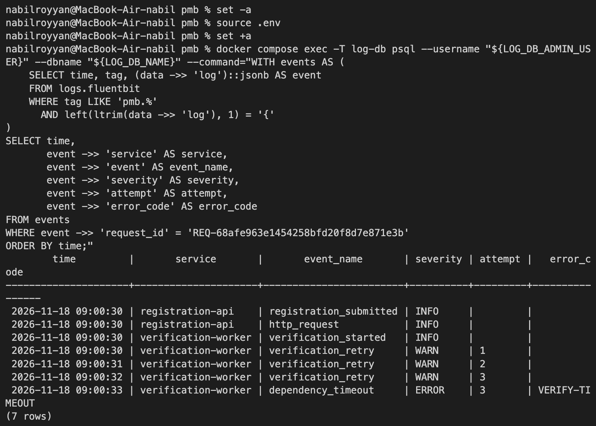

**Keterangan.** Kronologi insiden: `registration_submitted` → `http_request` → `verification_started` → `verification_retry` (WARN, attempt 1, 2, 3) → `dependency_timeout` (ERROR, attempt 3, `VERIFY-TIMEOUT`). Ketiga retry terbatas dan berakhir pada kegagalan yang tercatat — bukan berputar tanpa akhir.

### 15. Ringkasan WARN/ERROR per Service

```bash
docker compose exec -T log-db psql ... -c "SELECT service, severity, count(*) ... WHERE severity IN ('WARN','ERROR') ..."
```

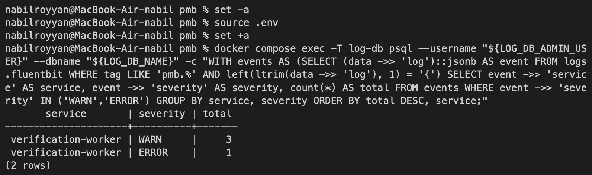

**Keterangan.** `verification-worker` menghasilkan 3 `WARN` dan 1 `ERROR` — cocok dengan tiga retry dan satu `dependency_timeout`. Ini mempersempit service pertama yang menghasilkan gejala kegagalan tanpa harus membaca kode aplikasi.

### 16. Pemeriksaan Kebocoran Secret

```bash
docker compose exec -T log-db psql ... -c "SELECT count(*) ... WHERE data ->> 'log' ~* '(password|authorization|bearer|cookie|session[_-]?secret|api[_-]?key)';"
```

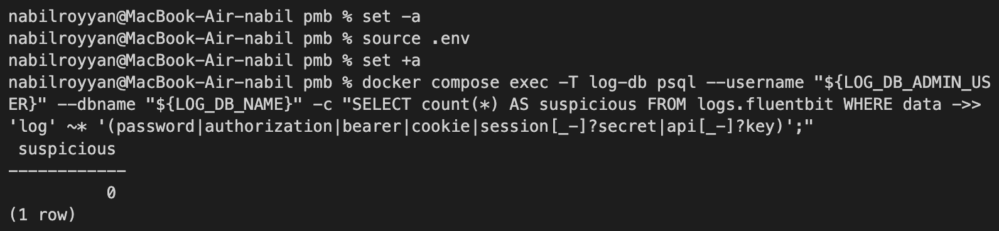

**Keterangan.** `suspicious = 0` — tidak ada payload log yang memuat password, token, cookie, atau nama variabel sensitif. Structured log mencatat event/metadata, bukan data pribadi (nama/email) maupun kredensial.

### 17. Skenario 3 — Recovery

```bash
./scripts/set-incident.sh none
./scripts/demo-normal.sh
```

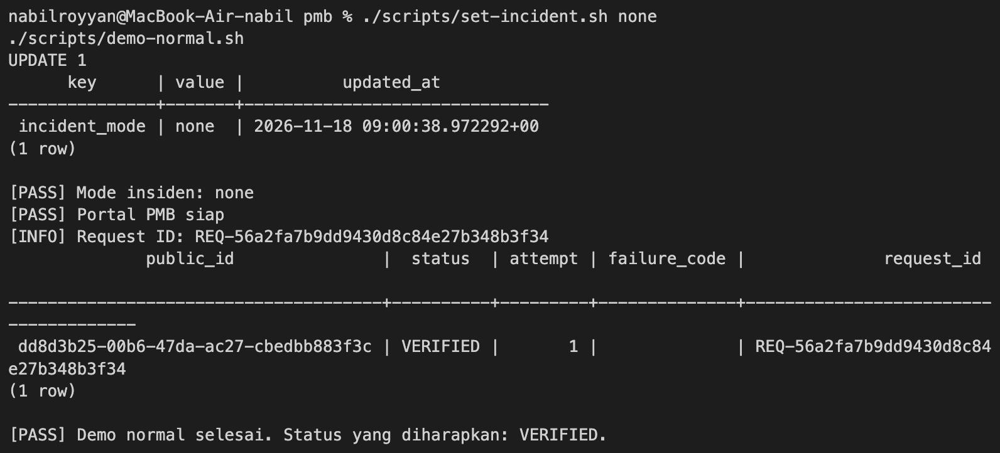

**Keterangan.** Setelah mode dikembalikan ke `none`, transaksi **baru** (`REQ-56a2fa7b9dd9430d8c84e27b348b3f34`) menjadi `VERIFIED`. Transaksi lama yang `FAILED` tetap gagal karena worker sengaja tidak memproses ulang transaksi gagal secara otomatis.

### 18. Resilience — Buffering dan Pemulihan

```bash
# hitung record awal
docker compose stop log-db
./scripts/demo-normal.sh            # transaksi baru saat backend log mati
docker compose logs --tail 100 fluent-bit
docker compose start log-db
# hitung record sesudah backlog terkirim
```

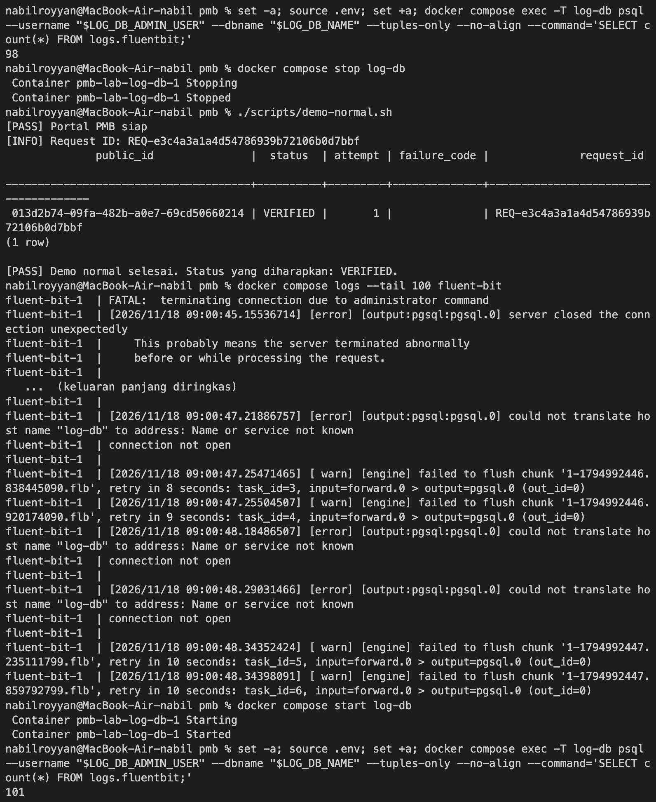

**Keterangan.** Jumlah record awal **98**. Saat `log-db` dihentikan, Fluent Bit mencatat kegagalan koneksi (`could not translate host name "log-db"`, `failed to flush chunk ... retry in 8-11 seconds`) dan **menahan backlog** pada buffer filesystem. Setelah `log-db` dijalankan kembali, jumlah record menjadi **101** — backlog terkirim (kenaikan +3). Ini membuktikan retry/buffering/recovery pada skala lab, **bukan** jaminan exactly-once; retry dapat menduplikasi dan buffer penuh/disk gagal tetap dapat kehilangan event.

### 19. Verifikasi Menyeluruh

```bash
./scripts/verify.sh
```

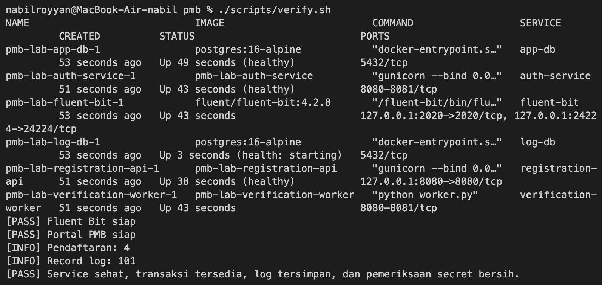

**Keterangan.** `[PASS]` service sehat, `Pendaftaran: 4`, `Record log: 101`, dan `pemeriksaan secret bersih`.

### 20. Unit Test Aplikasi

```bash
docker compose run --rm --no-deps registration-api python -m unittest discover -s tests -v
```

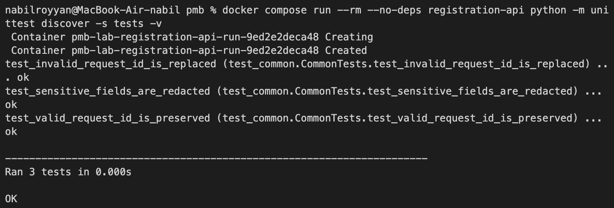

**Keterangan.** Tiga unit test lulus: `test_invalid_request_id_is_replaced`, `test_sensitive_fields_are_redacted`, `test_valid_request_id_is_preserved`. Ini membuktikan redaction field sensitif dan sanitasi `request_id` berfungsi di level kode.

### 21. Mengumpulkan Evidence

```bash
./scripts/collect-evidence.sh
find reports -maxdepth 1 -type f | sort
sha256sum reports/*
```

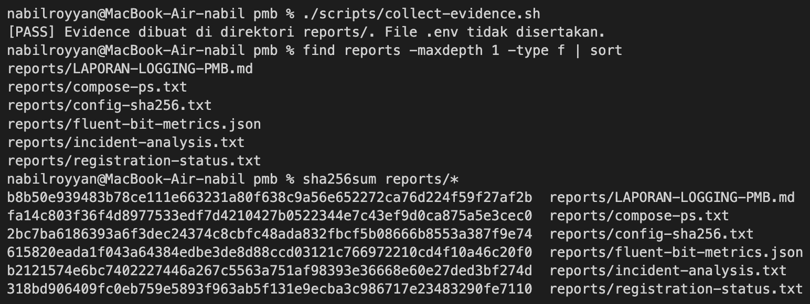

**Keterangan.** Artefak terbentuk di `reports/`: `compose-ps.txt`, `fluent-bit-metrics.json`, `registration-status.txt`, `incident-analysis.txt`, `config-sha256.txt`, beserta checksum. File `.env` tidak disertakan dan status transaksi tidak memuat nama/email.

### 22. Cleanup — Hentikan Service

```bash
docker compose down --remove-orphans
```

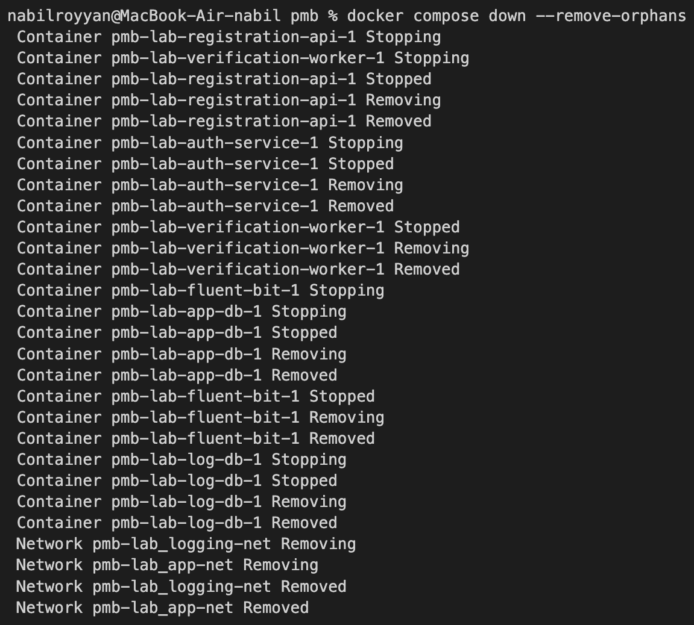

**Keterangan.** Container dan network dihapus tanpa menghapus volume (data lab dipertahankan).

### 23. Cleanup — Hapus Volume

```bash
docker compose down --volumes --remove-orphans
```

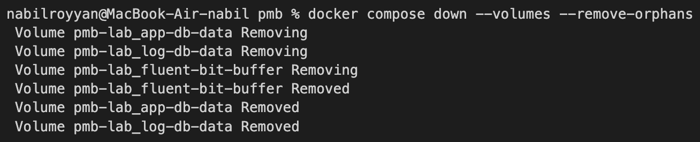

**Keterangan.** Volume `app-db-data`, `log-db-data`, dan `fluent-bit-buffer` dihapus. Destruktif; dijalankan setelah evidence tersimpan.

## 4. Pemetaan Capaian Praktikum ke Evidence

| Capaian | Evidence pada laporan | Bukti |
|---|---|---|
| 1. Membedakan DB transaksi & backend centralized logging | Subbab 9 & 10 | `app-db` menyimpan `registrations`; `log-db` menyimpan `logs.fluentbit` (JSONB) dengan 3 tag |
| 2. Structured log tanpa data pribadi/credential | Subbab 14, 16, 20 | Payload event berisi `service/severity/event/request_id`; `suspicious = 0`; unit test redaction lulus |
| 3. Korelasi lintas service via `request_id` | Subbab 12 & 14 | Satu `request_id` menghubungkan event `registration-api` dan `verification-worker` |
| 4. Rekonstruksi kronologi insiden via SQL | Subbab 14 & 15 | Urutan `verification_retry ×3` (WARN) → `dependency_timeout` (ERROR), ringkasan WARN/ERROR per service |
| 5. Uji retry, timeout, buffering, recovery | Subbab 13, 17, 18 | `VERIFY-TIMEOUT` attempt 3; transaksi baru `VERIFIED`; record 98 → 101 |
| 6. Evidence tanpa secret | Subbab 16 & 21 | Secret scan 0 temuan; `collect-evidence.sh` + checksum, tanpa `.env` |

## 5. Hasil Uji PASS/FAIL

| Pemeriksaan | Hasil pada laporan |
|---|---|
| Autentikasi | **PASS** — login sintetis berhasil; tidak ada password/cookie pada log |
| Pendaftaran | **PASS** — record `SUBMITTED`/`VERIFIED` terbentuk dengan `request_id` |
| Worker normal | **PASS** — status `VERIFIED` |
| Mode timeout | **PASS** — tiga retry dan `VERIFY-TIMEOUT` terlihat |
| Centralized log | **PASS** — ketiga service muncul di `logs.fluentbit` (setelah perbaikan jaringan) |
| Recovery | **PASS** — transaksi baru `VERIFIED` setelah mode `none` |
| Confidentiality | **PASS** — query secret menghasilkan 0 temuan |
| Validasi statis `validate.sh` | **SEBAGIAN** — gagal karena PyYAML host tidak ada; `docker compose config` valid (`exit=0`), unit test container lulus |
| Buffering/resilience | **PASS** — record 98 → 101 setelah `log-db` dipulihkan |

## 6. Analisis dan Evaluasi

**Mengapa status container `Up` tidak membuktikan fungsi bisnis sehat?** Container dapat `Up (healthy)` (healthcheck) sementara worker berhenti memproses karena dependency timeout; kesehatan proses berbeda dari keberhasilan alur bisnis. Karena itu bukti diambil dari database transaksi dan event log terpusat, bukan dari `docker ps`.

**Perbedaan waktu.** `time` pada log adalah waktu event saat dicatat aplikasi; collector menerima dan menulis ke PostgreSQL beberapa saat kemudian. Korelasi memakai `time` yang tersimpan; selisih antar-record tetap menunjukkan urutan sebab-akibat. Penyimpanan memakai zona UTC (WIB = UTC+7).

**Mengapa nama/email tidak dimasukkan ke structured log?** Log cenderung direplikasi, disimpan lama, dan dibaca banyak pihak; memasukkan PII memperbesar dampak bila terjadi kebocoran. Cukup gunakan `registration_id`/`request_id` sebagai referensi; detail pribadi tetap di database transaksi yang aksesnya dibatasi. Unit test `test_sensitive_fields_are_redacted` menegaskan redaction.

**Risiko `request_id` dari client.** `request_id` datang lewat header `X-Request-ID`. Tanpa validasi, client dapat menyuntikkan nilai berbahaya (mis. injeksi/log forging/path traversal). Aplikasi melakukan sanitasi — dibuktikan `test_invalid_request_id_is_replaced` (nilai tidak valid diganti) dan `test_valid_request_id_is_preserved`.

**Batas buffer dan duplikasi.** Buffer Fluent Bit (filesystem) dan buffer driver Docker bersifat terbatas; bila penuh, event dapat hilang. Retry bersifat *at-least-once* sehingga dapat menghasilkan record ganda; deteksi duplikasi dapat dilakukan dengan membandingkan jumlah event input vs tersimpan atau menambahkan event ID dan deduplication. Hasil 98 → 101 membuktikan pemulihan skala lab, bukan exactly-once.

**Kapan PostgreSQL tidak lagi sesuai sebagai backend log utama?** Pada volume/tulis sangat tinggi, retensi panjang, kebutuhan full-text/pencarian, dan agregasi real-time, PostgreSQL menjadi mahal. Backend khusus log/time-series (atau object storage + mesin analitik) lebih tepat; PostgreSQL baik untuk pembelajaran query, indeks, role, dan retensi.

**Kontrol sebelum dipakai mendekati produksi.** (1) TLS antar komponen dan database; (2) secret manager untuk credential DB/session, rotasi berkala; (3) `SESSION_COOKIE_SECURE=true` dan HTTPS; (4) autentikasi internal antar service (auth) dan pembatasan jaringan yang benar (bukan `internal` yang memblokir port pada Docker Desktop — gunakan firewall/egress policy); (5) kebijakan retensi dan indeks; (6) monitoring backlog/retry; (7) dead-letter queue untuk transaksi gagal; (8) audit dan triage temuan secret/PII.

**Temuan operasional lain.** `validate.sh` membutuhkan PyYAML di host; sebaiknya dependensi validasi disediakan (virtualenv/requirements) agar pipeline lokal konsisten dengan container. Perbaikan jaringan (`internal` → `bridge`) menunjukkan pentingnya memverifikasi asumsi platform sebelum menyimpulkan aplikasi gagal.

## 7. Kesimpulan

Praktikum PMB berhasil dijalankan end-to-end. Enam capaian terpenuhi dengan evidence terukur: pemisahan database transaksi dan log terpusat, structured log tanpa PII/credential (secret scan 0 temuan), korelasi lintas service via `request_id`, rekonstruksi kronologi insiden (`verification_retry ×3` → `dependency_timeout`), serta pembuktian retry/timeout/buffering/recovery (status `FAILED`/`VERIFIED` dan record 98 → 101). Satu kendala platform nyata — jaringan `internal` yang memblokir publish port pada Docker Desktop — ditemukan, didiagnosis, dan diperbaiki sehingga ingest log berhasil, berbeda dari kondisi pengujian sebelumnya yang mencatat 0 record pada centralized log.
